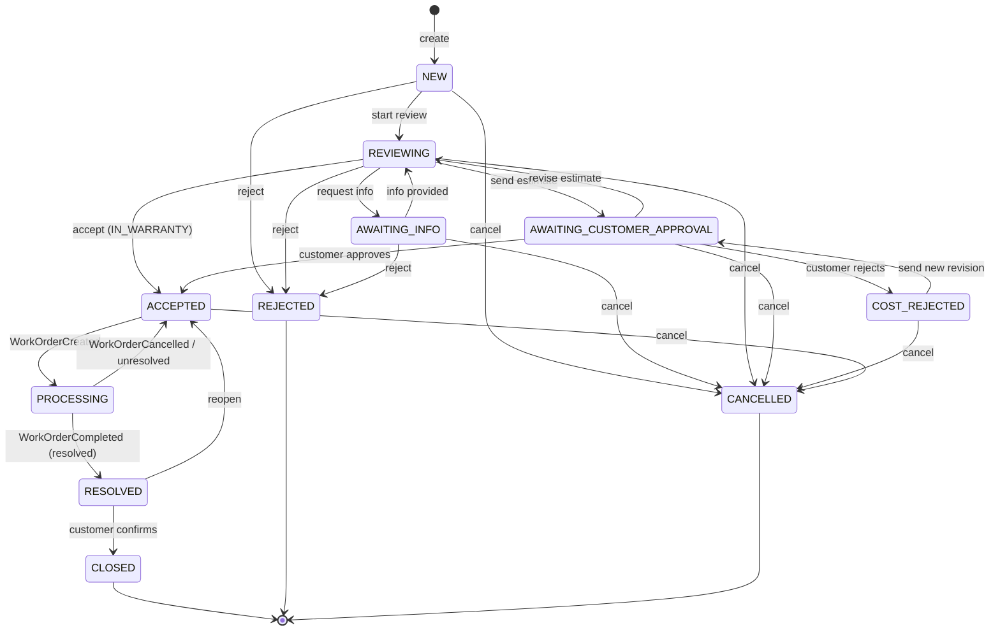
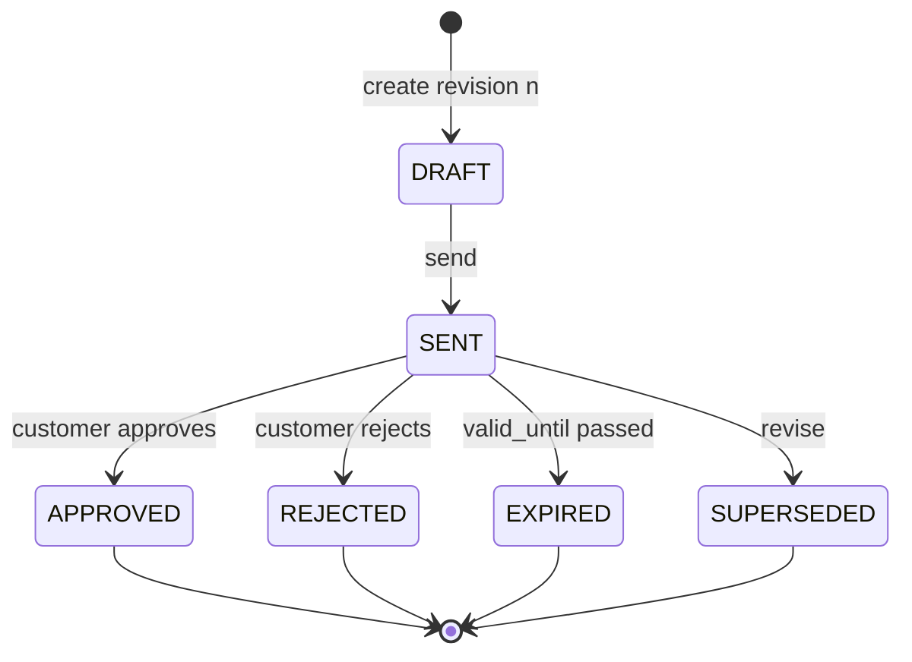
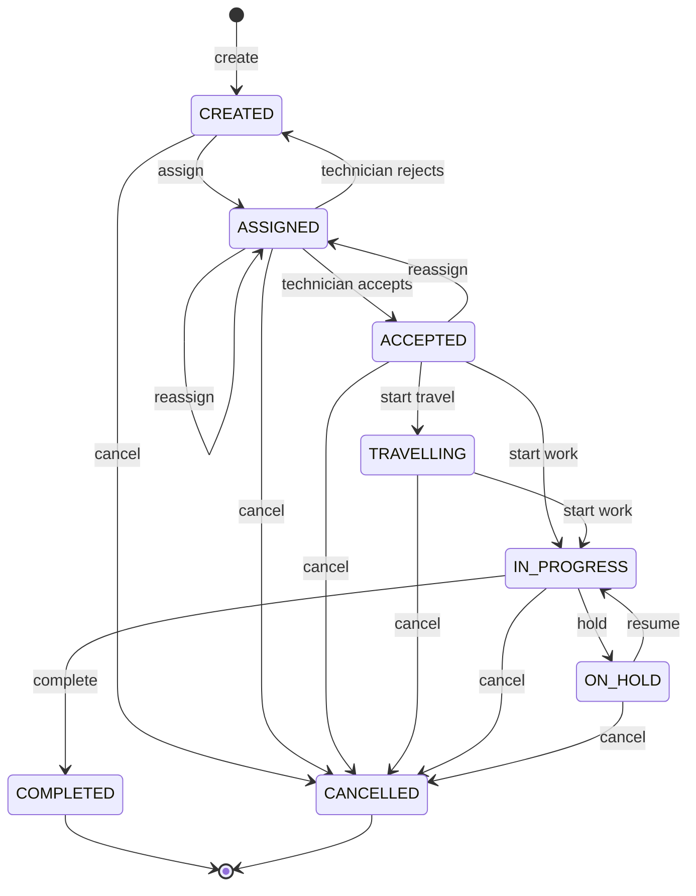

# State machines — Service Request, Cost Estimate, Work Order

- Status: **Proposed** (M0 draft). The owners of Service Request and Work Order
  review it with the team before implementing the transitions; changes go
  through a PR to this file.
- Closes ADR 0001 open point #4 once approved; decisions DEC-05 / DEC-06.
- Statuses are the CHECK values of `service_request_db` / `workorder_db`
  (ERD v3.1). No status is added or removed here.
- "Permission" = code of the shared catalog (`packages/auth/src/catalog.ts`).
  "Own customer" = the row's `customer_id` equals the caller's `customer_id`
  claim (ADR 0003).
- Every transition writes one `*_status_history` row and, where listed, one
  outbox event, in the same transaction.

## Service Request

| From | Action | Who | To | Rules and side effects |
|---|---|---|---|---|
| — | create | `service_request:create`; CUSTOMER only for its own customer and its own equipment; staff for any customer of the tenant | NEW | Equipment validated through Asset (`tenant_id`, `customer_id`, not `RETIRED`). `request_no` = `SR-<year>-<0001>` from `document_sequences`. Event `ServiceRequestCreated`. |
| NEW | start review | `service_request:review` | REVIEWING | `review_started_at = now()`. |
| REVIEWING | request info | `service_request:review` | AWAITING_INFO | Reason required, stored as a `CUSTOMER` comment. |
| AWAITING_INFO | info provided | requester side (own customer) by adding a `CUSTOMER` comment, or `service_request:review` | REVIEWING | — |
| REVIEWING | record warranty check | `service_request:review` | (unchanged) | Calls Asset `warranty-status` for today; stores the snapshot (`warranty_check_result`, `warranty_id`, `warranty_end_date`, `warranty_checked_by/at`). Can be repeated while REVIEWING. |
| REVIEWING | accept | `service_request:review` | ACCEPTED | Only when the snapshot is `IN_WARRANTY`. Out of warranty goes through an estimate. |
| REVIEWING | send estimate | `cost_estimate:manage` | AWAITING_CUSTOMER_APPROVAL | Snapshot required and not `IN_WARRANTY`; the DRAFT revision becomes SENT. |
| AWAITING_CUSTOMER_APPROVAL | customer approves | `cost_estimate:respond`, own customer | ACCEPTED | Estimate SENT → APPROVED; `responded_by/at`. Refused when `valid_until` has passed (estimate → EXPIRED). |
| AWAITING_CUSTOMER_APPROVAL | customer rejects | `cost_estimate:respond`, own customer | COST_REJECTED | Estimate SENT → REJECTED; reason stored as a `CUSTOMER` comment. |
| AWAITING_CUSTOMER_APPROVAL | revise estimate | `cost_estimate:manage` | REVIEWING | SENT revision → SUPERSEDED; a new DRAFT revision `n+1` is created. |
| COST_REJECTED | send new revision | `cost_estimate:manage` | AWAITING_CUSTOMER_APPROVAL | New revision `n+1` (DRAFT → SENT). Recommended answer to ADR 0001 open point #4: yes, a rejected request can get a new estimate. |
| ACCEPTED | WorkOrderCreated (event) | system (`changed_by` NULL) | PROCESSING | Only one non-terminal WO per request (`uq_active_workorder_per_request`). |
| PROCESSING | WorkOrderCompleted with report `RESOLVED` or `PARTIALLY_RESOLVED` (event) | system | RESOLVED | `resolved_at = now()`. |
| PROCESSING | WorkOrderCompleted with `UNRESOLVED`, or WorkOrderCancelled (event) | system | ACCEPTED | A new Work Order can be created. |
| RESOLVED | confirm | requester side (own customer, `service_request:create`) or `service_request:review` on behalf of the customer | CLOSED | `confirmed_by/at`, `closed_at`. Automatic close after N days is a later scheduler (not MVP). |
| RESOLVED | reopen | requester side (own customer) or `service_request:review` | ACCEPTED | Reason required. |
| NEW, REVIEWING, AWAITING_INFO | reject | `service_request:review` | REJECTED | Reason required, visible to the customer. |
| NEW, AWAITING_INFO, AWAITING_CUSTOMER_APPROVAL, COST_REJECTED | cancel | requester side (own customer) | CANCELLED | Reason optional. |
| NEW, REVIEWING, AWAITING_INFO, AWAITING_CUSTOMER_APPROVAL, COST_REJECTED, ACCEPTED | cancel | `service_request:review` | CANCELLED | From ACCEPTED only when no non-terminal Work Order exists. |

Every status change publishes `ServiceRequestStatusChanged` (from, to,
changedBy, reason). Terminal: CLOSED, REJECTED, CANCELLED — no transition
leaves them.

Comment visibility: CUSTOMER accounts only read and write `CUSTOMER` comments;
`INTERNAL` needs `service_request:comment_internal` and is never returned to a
CUSTOMER account (also not in list counts).

## Cost Estimate (per revision)

- Only DRAFT revisions can be edited or deleted (items cascade).
  `total_amount` is recomputed in the same transaction as any item change.
- At most one live revision (DRAFT, SENT or APPROVED) per request — the partial
  unique index `uq_cost_estimates_live_per_request` enforces it.
- EXPIRED is set lazily: when someone opens or answers a SENT revision whose
  `valid_until` is before today.
- A new revision is `revision_no + 1` of the latest one, created from REJECTED,
  EXPIRED or (through *revise*) SENT.

## Work Order

| From | Action | Who | To | Rules and side effects |
|---|---|---|---|---|
| — | create | `work_order:manage` from an ACCEPTED Service Request; system from a Maintenance Task | CREATED | Exactly one of `service_request_id` / `maintenance_task_id`. Event `WorkOrderCreated`. |
| CREATED | assign | `work_order:assign` | ASSIGNED | Technician `AVAILABLE` or `BUSY`, same tenant; assignment ASSIGNED. Event `WorkOrderAssigned`. |
| ASSIGNED, ACCEPTED | reassign | `work_order:assign` | ASSIGNED | Previous assignment → REMOVED (`unassigned_at`), new one ASSIGNED. |
| ASSIGNED | technician accepts | `work_order:execute`, the assigned technician only | ACCEPTED | Assignment → ACCEPTED. |
| ASSIGNED | technician rejects | `work_order:execute`, the assigned technician only | CREATED | Assignment → REJECTED with `rejection_reason`. |
| ACCEPTED | start travel | assigned technician | TRAVELLING | Optional step. |
| ACCEPTED, TRAVELLING | start work | assigned technician | IN_PROGRESS | `started_at` (first time only). |
| IN_PROGRESS | hold | assigned technician or `work_order:manage` | ON_HOLD | Reason required (`work_logs`). |
| ON_HOLD | resume | assigned technician or `work_order:manage` | IN_PROGRESS | — |
| IN_PROGRESS | complete | assigned technician (`service_report:submit`) | COMPLETED | Service report submitted in the same transaction; assignment → COMPLETED; `completed_at`. Event `WorkOrderCompleted` (with report `result`). |
| any non-terminal | cancel | `work_order:manage` | CANCELLED | Reason required; active assignment → REMOVED; `cancelled_at`. Event `WorkOrderCancelled`. A cancelled WO releases its Maintenance Task (ADR 0002). |

Verification of the work (SRS "Verify / Close") is the Service Request step
RESOLVED → CLOSED by the customer, not a Work Order status — recommended answer
to DEC-06, so `workorder_db` keeps the ERD v3.1 statuses.

Terminal: COMPLETED, CANCELLED. Every change writes
`work_order_status_history` and a `work_logs` row with `actor_user_id`.
