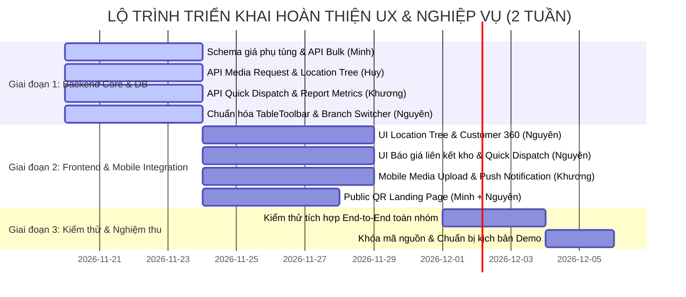

# KẾ HOẠCH CẢI TIẾN TRẢI NGHIỆM NGƯỜI DÙNG (UX) & HOÀN THIỆN NGHIỆP VỤ PBL6

> **Ngày lập:** 19/11/2026  
> **Dự án:** PBL6 — SaaS-based Field Service Management Platform for Equipment Vendors  
> **Tài liệu đối chiếu:** [AGENTS.md](../../AGENTS.md), kiến trúc Microservices và các ADR hiện hành (ADR 0003, 0004, 0013, 0014, 0015, 0022).

**Cập nhật triển khai Nguyên 21/11:** [tiến độ theo từng task, kiểm thử và phụ thuộc](../testing/nguyen-web-tasks-2026-11-21.md). Đã có code Web cho Quick Dispatch, KPI/drilldown, cây vị trí, toolbar, Customer workspace và branch mặc định. Báo giá/media/báo cáo khách và các tiêu chí rộng hơn vẫn còn phụ thuộc; không xem snapshot này là nghiệm thu toàn bộ backlog.

---

## I. TỔNG HỢP 12 VẤN ĐỀ TRẢI NGHIỆM NGƯỜI DÙNG & NGHIỆP VỤ CỐT LÕI

Dưới đây là 12 vấn đề được tổng hợp từ khảo sát thực tế và phân tích trực tiếp trên codebase của dự án (gồm 9 vấn đề từ người dùng và 3 vấn đề kiến trúc mở rộng #10, #11, #12):

### Nhóm A: Quy trình Xử lý Yêu cầu & Điều phối (Service Request & Dispatching)
1. **Vấn đề 1 — Luồng Thẩm định & Điều phối rườm rà, phân mảnh:**
   - *Hiện trạng:* Giao diện chi tiết yêu cầu dịch vụ (`ServiceDetailUI.tsx`) chia thành nhiều panel rời rạc (`assessmentPanel`, `intakeStage`, `estimatePanel`). Người điều phối phải thao tác qua lại nhiều nút (Xem xét → Tiếp nhận → Sang trang tạo Work Order → Vào trang Work Order chọn KTV). Không có chỉ dẫn bước tiếp theo rõ ràng (Next Best Action).
   - *Mục tiêu:* Thiết kế lại theo dạng **Thanh tiến trình chuẩn (Guided Process Stepper)** và bổ sung ngăn kéo **"Điều phối nhanh" (Quick Dispatch Drawer)**: Cho phép Tiếp nhận + Tạo Work Order + Gán KTV + Hẹn giờ ngay trên cùng một màn hình.
2. **Vấn đề 2 — Thiếu minh chứng Hình ảnh / Video khi gửi Yêu cầu Dịch vụ:**
   - *Hiện trạng:* DTO `CreateServiceRequestDto` chỉ nhận text (`title`, `description`). Khách hàng không thể đính kèm ảnh chụp màn hình báo lỗi, tem máy hoặc video quay tiếng kêu bất thường. Service Manager khó thẩm định bảo hành từ xa và KTV không biết trước lỗi cụ thể để chuẩn bị vật tư.
   - *Mục tiêu:* Cho phép tải lên tối đa 5 hình ảnh hoặc 1 video ngắn (dưới 15s) khi tạo Service Request (cả trên Web Portal và Mobile).
3. **Vấn đề 10 (cũ #11) — Thiếu Thông báo Đẩy Thời gian thực (Push Notification & Real-time Events):**
   - *Hiện trạng:* Hệ thống dùng REST polling thủ công. Khi Dispatcher phân công việc, KTV ngoài hiện trường không nhận được thông báo đẩy (FCM) khiến việc xử lý ca khẩn cấp bị chậm trễ. Khi khách duyệt báo giá hoặc KTV nộp báo cáo, Web không tự cập nhật nếu không F5.
   - *Mục tiêu:* Tích hợp Firebase Cloud Messaging (FCM) cho Mobile và Server-Sent Events (SSE) / WebSocket cho Web.

---

### Nhóm B: Báo giá & Quản lý Vật tư Kho (Quotation & Inventory)
4. **Vấn đề 6 — Danh mục Phụ tùng thiếu Cấu hình Giá thành (Part Pricing):**
   - *Hiện trạng:* Bảng `parts` trong `inventory_db` chỉ lưu mã, tên, đơn vị tính và số lượng tồn. Không có trường giá vốn (`costPrice`) lẫn đơn giá bán/niêm yết (`standardPrice`).
   - *Mục tiêu:* Thêm `standardPrice` và `costPrice` vào danh mục phụ tùng; cho phép quản lý cấu hình đơn giá xuất/bán.
5. **Vấn đề 7 — Đứt gãy giữa Báo giá (Cost Estimate) và Lệnh công việc (Work Order):**
   - *Hiện trạng:* Khi lập báo giá, người dùng phải tự gõ text tên phụ tùng và tự gõ giá thủ công (không liên kết kho). Sau khi khách duyệt Báo giá (`APPROVED`), Work Order sinh ra hoàn toàn trống trơn phần phụ tùng, KTV phải nhớ và làm phiếu xin cấp lại từ đầu.
   - *Mục tiêu:* 
     - Form báo giá cho phép chọn linh kiện từ danh mục kho và tự động nhảy đơn giá niêm yết.
     - Khi Báo giá được phê duyệt, hệ thống tự động đồng bộ danh sách phụ tùng đã duyệt sang mục **"Linh kiện cần cấp theo báo giá" (Recommended / Reserved Parts)** trên Work Order.

---

### Nhóm C: Bàn giao & Định danh Thiết bị (Asset & Handover)
6. **Vấn đề 3 — Bàn giao Lô nhiều Thiết bị (Bulk Handover) chưa hoàn thiện:**
   - *Hiện trạng:* Hệ thống chỉ hỗ trợ bàn giao lẻ từng máy (`POST /equipment-registrations`). Doanh nghiệp mua 20–50 máy phải nhập thủ công từng lần rất tốn thời gian.
   - *Mục tiêu:* Hoàn thiện API và Giao diện Web Wizard cho phép tải file Excel/CSV danh sách Model, Serial, Ngày bàn giao, Vị trí để kích hoạt bảo hành hàng loạt.
7. **Vấn đề 11 (cũ #13) — Trải nghiệm Quét QR Công khai (Public QR Landing Page):**
   - *Hiện trạng:* Khách hàng hoặc kỹ thuật viên vận hành quét mã QR dán trên máy bằng camera điện thoại thông thường bị ép buộc đăng nhập mới xem được thông tin.
   - *Mục tiêu:* Xây dựng trang web công khai (Public Landing Page): Hiển thị thông số máy, hạn bảo hành và nút bấm nhanh *"Báo sự cố thiết bị"* (chỉ cần nhập tên, SĐT và ảnh lỗi, không bắt buộc đăng nhập tài khoản).

---

### Nhóm D: Quản lý Khách hàng & Mặt bằng Địa điểm (Organization & Sites)
8. **Vấn đề 5 — Cấu trúc Địa điểm Khách hàng hiển thị Phẳng, chưa theo Cây (Location Tree):**
   - *Hiện trạng:* Backend `organization_db` đã có cấu trúc cây đệ quy (`Location` có `parentId`, phân cấp: `BUILDING` → `FLOOR` → `ROOM` → `AREA`). Nhưng trên Web chỉ render một danh sách `<ul>` phẳng kèm dòng chữ nhỏ `"Thuộc: ..."`.
   - *Mục tiêu:* Xây dựng component **Tree View trực quan** dạng thư mục phân cấp, hỗ trợ đóng/mở nhánh và hiển thị số lượng máy móc đang đặt tại từng phòng/khu vực.
9. **Vấn đề 9 — Trang Khách hàng thiếu Dashboard Thống kê Tổng quan (Customer 360):**
   - *Hiện trạng:* `CustomerDetailPage` hiện chỉ có 2 thẻ text đơn điệu (Tên/Mã và Email/SĐT). Người quản lý không nắm được tổng quan khách hàng này đang có bao nhiêu máy móc, lịch sử sự cố và các yêu cầu đang xử lý.
   - *Mục tiêu:* Xây dựng **Customer 360 Dashboard**:
     - 4 thẻ Metric: *Tổng máy đang chạy*, *Máy còn bảo hành*, *Yêu cầu đang mở*, *Chi phí dịch vụ lũy kế*.
     - Hệ thống Tab: [Tổng quan] - [Cây địa điểm & Thiết bị] - [Yêu cầu & Lệnh dịch vụ] - [Kế hoạch bảo trì].
10. **Vấn đề 12 (cũ #15) — Thiếu Bộ chuyển đổi Ngữ cảnh Chi nhánh (Branch Context Switcher):**
    - *Hiện trạng:* Quản lý cấp cao (Tenant Admin) quản lý nhiều chi nhánh (HCM, Đà Nẵng) nhưng trên thanh Header Web không có dropdown chọn nhanh Chi nhánh đang làm việc, dẫn đến danh sách dữ liệu hiển thị lẫn lộn giữa các chi nhánh.
    - *Mục tiêu:* Bổ sung dropdown chọn Chi nhánh trên thanh Header, lưu trạng thái ngữ cảnh chi nhánh vào Session.

---

### Nhóm E: Báo cáo & Năng suất Vận hành (Reporting & Usability)
11. **Vấn đề 4 — Dashboard KPI Kỹ thuật viên còn sơ sài, chỉ liệt kê số thô:**
    - *Hiện trạng:* `TechnicianKpiPanel` chỉ là một bảng HTML 5 cột tĩnh. Thiếu biểu đồ so sánh, thiếu các chỉ số cốt lõi của ngành dịch vụ hiện trường và không thể click vào KTV để xem chi tiết ca.
    - *Mục tiêu:* 
      - Bổ sung biểu đồ trực quan (Biểu đồ cột khối lượng ca, tỷ lệ hoàn thành đúng hạn).
      - Bổ sung chỉ số **MTTR** (Thời gian xử lý trung bình) và **FTFR** (Tỷ lệ sửa dứt điểm lần đầu).
      - Drilldown: Click vào KTV để xem danh sách các lệnh công việc đã hoàn thành trong kỳ.
12. **Vấn đề 8 — Các Bảng Danh sách thiếu Tìm kiếm & Bộ lọc Chuẩn Server-side:**
    - *Hiện trạng:* Nhiều bảng danh sách lớn (Khách hàng, Thiết bị, Lệnh công việc, Phụ tùng, Giao dịch) dùng cơ chế fetch 100 dòng rồi filter in-memory, hoặc hoàn toàn không có ô tìm kiếm.
    - *Mục tiêu:* Chuẩn hóa component thanh công cụ bảng (`TableToolbar`): Search Debounce 300ms + Dropdown lọc trạng thái/chi nhánh + Bộ chọn khoảng ngày + Phân trang server-side chuẩn.

---

## II. PHÂN CHIA CÔNG VIỆC CHO 4 THÀNH VIÊN

Dựa trên phân công trách nhiệm dịch vụ (Service Ownership) và chuyên môn đã thống nhất:

```mermaid
flowchart TD
    subgraph Huy["1. Nguyễn Hoàng Huy (Backend: Identity, Org, Request, Notification)"]
        H1["Vấn đề 2: API upload ảnh/video cho Service Request"]
        H2["Vấn đề 5: API phân cấp Cây địa điểm (Location Tree)"]
        H3["Vấn đề 9: API Customer 360 Summary Metrics"]
        H4["Vấn đề 10: Tích hợp FCM Push Notification & Web Events"]
    end

    subgraph Minh["2. Trần Bảo Minh (Backend: Asset, Inventory, QR, Pricing)"]
        M1["Vấn đề 3: API Bulk Handover (Import Excel thiết bị)"]
        M2["Vấn đề 6: Schema & CRUD Đơn giá phụ tùng (Part Pricing)"]
        M3["Vấn đề 7: API liên kết Báo giá & Cấp phát phụ tùng"]
        M4["Vấn đề 11: API Public QR tra cứu & Báo sự cố vãng lai"]
    end

    subgraph Khuong["3. Trần Bảo Khương (Fullstack Lead: WorkOrder, Mobile, Reports)"]
        K1["Vấn đề 1: API Quick Dispatch Lệnh công việc"]
        K2["Vấn đề 2: Mobile UI chụp ảnh/quay video khi gửi sự cố"]
        K3["Vấn đề 4: Mở rộng API KPI KTV (MTTR, FTFR, Drilldown)"]
        K4["Vấn đề 10: Mobile FCM Background Handler & Deep-link"]
    end

    subgraph Nguyen["4. Lê Quốc Nguyên (Frontend Lead: React Web UI/UX Design System)"]
        N1["Vấn đề 1: UI Stepper & Drawer Quick Dispatch"]
        N2["Vấn đề 4: UI Biểu đồ KPI KTV (Chart.js / Recharts)"]
        N3["Vấn đề 5: UI Tree View cho Cây địa điểm khách hàng"]
        N4["Vấn đề 7: UI Báo giá chọn kho & hiển thị phụ tùng trên WO"]
        N5["Vấn đề 8: Chuẩn hóa TableToolbar trên toàn bộ hệ thống"]
        N6["Vấn đề 9: UI Customer 360 Dashboard"]
        N7["Vấn đề 11: UI Public Landing Page khi quét mã QR"]
        N8["Vấn đề 12: Dropdown Branch Switcher trên Header Web"]
    end

    H1 -. Tích hợp DTO .- K2
    H2 -. Cung cấp Node Tree .- N3
    H3 -. Cung cấp số liệu .- N6
    H4 -. Bắn thông báo .- K4
    M1 -. Contract Excel .- N1
    M2 -. Cung cấp giá .- N4
    M3 -. Reserve Parts .- K1
    M4 -. Landing API .- N7
    K1 -. Quick Dispatch .- N1
    K3 -. KPI Data .- N2
```

---

### THÀNH VIÊN 1: NGUYỄN HOÀNG HUY
*Phụ trách: Backend Service Request, Organization, Identity, Notification Service.*

| Mã Task | Vấn đề | Chi tiết công việc thực hiện | Đầu ra (Deliverables) |
| :--- | :--- | :--- | :--- |
| **HUY-01** | **Vấn đề 2** | Nâng cấp `service-request-service`: Mở rộng `CreateServiceRequestDto` cho phép nhận danh sách file đính kèm/media (lưu trữ MinIO qua outbox/intent). | API `POST /api/service-requests` nhận ảnh/video; migration schema nếu cần; E2E test. |
| **HUY-02** | **Vấn đề 5** | Nâng cấp `organization-service`: Bổ sung endpoint `GET /api/organization/sites/:siteId/location-tree` trả về cấu trúc cây phân cấp đầy đủ lồng nhau (Nested Nodes) thay vì danh sách phẳng. | API Location Tree có đếm số thiết bị con; Unit test đệ quy không bị lặp vô tận. |
| **HUY-03** | **Vấn đề 9** | Xây dựng API Customer 360 Summary: Endpoint `GET /api/organization/customers/:id/summary` tổng hợp các chỉ số: tổng thiết bị, số site, số yêu cầu dịch vụ đang mở, bảo hành còn hạn. | API Customer Summary tối ưu hóa query (JOIN/Aggregate có cache Redis ngắn). |
| **HUY-04** | **Vấn đề 10** | Tích hợp Firebase Admin SDK trong `notification-service`: Lắng nghe event `WorkOrderAssigned` từ RabbitMQ để bắn Push Notification FCM đến thiết bị KTV; phát triển SSE endpoint cho Web. | Module FCM gửi Push Notification theo device token; tài liệu payload thông báo. |

---

### THÀNH VIÊN 2: TRẦN BẢO MINH
*Phụ trách: Backend Asset Service, Inventory Service, QR Code, Pricing.*

| Mã Task | Vấn đề | Chi tiết công việc thực hiện | Đầu ra (Deliverables) |
| :--- | :--- | :--- | :--- |
| **MINH-01** | **Vấn đề 3** | Triển khai API Bulk Handover trong `asset-service`: Endpoint `POST /api/assets/bulk-handovers` nhận danh sách hoặc file Excel/CSV, tạo hàng loạt thiết bị, kích hoạt bảo hành và sinh mã QR trong 1 transaction an toàn. | API Bulk Handover (hỗ trợ parse Excel/CSV, validate trùng serial, rollback khi lỗi); Swagger doc. |
| **MINH-02** | **Vấn đề 6** | Cập nhật schema `inventory_db`: Bổ sung 2 cột `cost_price` và `standard_price` (Decimal 14, 2) vào bảng `parts`. Cập nhật DTO tạo/sửa phụ tùng. | Migration Prisma `inventory-service`; CRUD API trả về đơn giá niêm yết của phụ tùng. |
| **MINH-03** | **Vấn đề 7** | Tích hợp Báo giá & Kho: Cung cấp API tra cứu linh kiện kèm giá cho module Báo giá; khi nhận event `CostEstimateApproved`, tự động sinh các bản ghi giữ chỗ / đề xuất cấp (`recommended_parts`) cho Work Order. | Event Consumer `CostEstimateApproved` trong Inventory; API lấy danh sách linh kiện đề xuất cho WO. |
| **MINH-04** | **Vấn đề 11** | Triển khai Public QR Endpoint: Endpoint công khai `GET /api/assets/public/equipment-by-qr/:qrCode` (không yêu cầu JWT) trả về thông tin máy cơ bản, hạn bảo hành và form token để báo hỏng vãng lai. | Public API được rate limit an toàn (chống brute force); Swagger contract. |

---

### THÀNH VIÊN 3: TRẦN BẢO KHƯƠNG
*Phụ trách: Fullstack Lead — Work Order Service, Flutter Mobile App, Báo cáo & Tích hợp.*

| Mã Task | Vấn đề | Chi tiết công việc thực hiện | Đầu ra (Deliverables) |
| :--- | :--- | :--- | :--- |
| **KHUONG-01** | **Vấn đề 1** | Tối ưu hóa Backend Work Order: Xây dựng endpoint Quick Dispatch `POST /api/workorders/quick-dispatch` cho phép vừa chuyển trạng thái Request, vừa sinh Work Order và gán KTV ngay trong 1 transaction nguyên tử. | API Quick Dispatch hoàn chỉnh, đảm bảo tenant/branch isolation; E2E test luồng điều phối. |
| **KHUONG-02** | **Vấn đề 2** | Cập nhật Mobile App (Flutter): Bổ sung giao diện chọn ảnh từ thư viện hoặc chụp ảnh/quay video trực tiếp khi KTV/Khách tạo yêu cầu dịch vụ; tích hợp upload lên MinIO qua presigned URL. | UI đính kèm file trên Mobile; widget xem trước ảnh/video; validate dung lượng file. |
| **KHUONG-03** | **Vấn đề 4** | Nâng cấp API Báo cáo & KPI KTV: Mở rộng `GET /api/workorders/reports/technicians` tính toán thêm các chỉ số MTTR (thời gian sửa trung bình), FTFR (tỷ lệ dứt điểm lần đầu) và endpoint drilldown chi tiết ca theo KTV. | API Report nâng cấp trả về dữ liệu cho biểu đồ và bảng xếp hạng KPI; Unit test logic tính toán. |
| **KHUONG-04** | **Vấn đề 10** | Tích hợp `firebase_messaging` trên Mobile Flutter: Đăng ký device token khi đăng nhập; nhận push notification khi có ca mới; khi bấm vào thông báo thì mở thẳng ca làm việc tương ứng. | Cấu hình Android Notification Channel, xử lý foreground/background notification và deep-link. |

---

### THÀNH VIÊN 4: LÊ QUỐC NGUYÊN
*Phụ trách: Frontend Lead — React Web Application, UI/UX Design System, Data Visualization.*

| Mã Task | Vấn đề | Chi tiết công việc thực hiện | Đầu ra (Deliverables) |
| :--- | :--- | :--- | :--- |
| **NGUYEN-01** | **Vấn đề 1** | Tái thiết kế trang Yêu cầu & Điều phối (`ServiceDetailUI.tsx`): Xây dựng Process Stepper trực quan 3 bước; tích hợp Drawer "Điều phối nhanh" (chọn KTV, giờ hẹn, vật tư trên 1 màn hình). | Giao diện điều phối mượt mà, giảm 70% số lượt click; nút bấm chính nổi bật. |
| **NGUYEN-02** | **Vấn đề 4** | Xây dựng Dashboard KPI KTV trực quan: Sử dụng thư viện biểu đồ (Recharts hoặc Chart.js) hiển thị biểu đồ cột so sánh KTV, tỷ lệ đúng hạn và bảng xếp hạng; hỗ trợ bấm vào KTV để xem drilldown danh sách ca. | Màn hình KPI trực quan, sinh động thay thế bảng HTML liệt kê tĩnh hiện tại. |
| **NGUYEN-03** | **Vấn đề 5** | Xây dựng Component `LocationTreeView`: Hiển thị sơ đồ mặt bằng khách hàng dạng cây thư mục phân cấp (Tòa nhà → Tầng → Phòng) kèm icon, nút đóng/mở và số lượng thiết bị tại từng node. | Component Tree View tái sử dụng được ở cả trang Quản trị vị trí và trang Chi tiết khách hàng. |
| **NGUYEN-04** | **Vấn đề 7** | Cải tiến Báo giá & Work Order UI: Nâng cấp `EstimatePanel.tsx` cho phép chọn phụ tùng từ kho (tự điền đơn giá niêm yết); hiển thị danh sách "Phụ tùng đề xuất theo báo giá" trên trang chi tiết Work Order. | Giao diện lập báo giá chuyên nghiệp; nút "Xuất kho nhanh theo báo giá" cho Thủ kho. |
| **NGUYEN-05** | **Vấn đề 8** | Chuẩn hóa Thanh công cụ Bảng (`TableToolbar`): Xây dựng component dùng chung gồm Ô tìm kiếm (Debounce 300ms) + Dropdown lọc trạng thái/chi nhánh + Bộ chọn ngày; áp dụng đồng bộ cho Khách hàng, Thiết bị, Lệnh, Kho. | Bộ UI Table Toolbar đồng nhất trên toàn bộ các trang danh sách của Web. |
| **NGUYEN-06** | **Vấn đề 9** | Thiết kế Customer 360 Dashboard: Xây dựng lại `CustomerDetailPage` gồm 4 Metric Cards đầu trang và hệ thống Tab chuyên sâu (Tổng quan, Vị trí & Thiết bị, Yêu cầu & Lệnh, Kế hoạch bảo trì). | Màn hình Customer 360 hoàn chỉnh, cung cấp góc nhìn toàn diện cho người quản lý. |
| **NGUYEN-07** | **Vấn đề 11** | Xây dựng Public Landing Page cho QR Code: Trang web độc lập không cần login, hiển thị thông tin máy khi quét QR và form "Báo sự cố nhanh" kèm ô tải ảnh lỗi. | Public QR Landing Page thân thiện trên cả mobile browser và desktop. |
| **NGUYEN-08** | **Vấn đề 12** | Xây dựng Dropdown Branch Switcher: Đặt trên thanh Header của Web, cho phép Tenant Admin chuyển đổi xem dữ liệu của: *Toàn doanh nghiệp* hoặc *Chi nhánh cụ thể*. | Header Branch Context Selector, đồng bộ ngữ cảnh lọc cho toàn bộ trang con. |

---

## III. MA TRẬN PHỐI HỢP & LỘ TRÌNH TRIỂN KHAI (MILESTONES)

### Tiêu chí Nghiệm thu Chung (Definition of Done - DoD):
1. **Bảo mật & Phân quyền:** Tuân thủ nghiêm ngặt quy tắc cách ly Tenant và Branch (ADR 0022); không lộ dữ liệu chéo giữa các chi nhánh hoặc khách hàng khác nhau.
2. **Kiểm thử tự động:** Mọi API mới hoặc sửa đổi phải có Unit test / E2E test; chạy `pnpm test` và `pnpm typecheck` đạt 100% không có regression lỗi.
3. **Hiệu năng & Trải nghiệm:**
   - Các bảng dữ liệu tải mượt mà dưới 500ms nhờ phân trang và tìm kiếm debounce server-side.
   - Thao tác điều phối kỹ thuật viên từ lúc nhận yêu cầu đến khi ra lệnh không quá 3 click chuột.
   - Giao diện đồng nhất ngôn ngữ thiết kế, màu sắc tương phản rõ ràng và thân thiện trên cả màn hình nhỏ.
