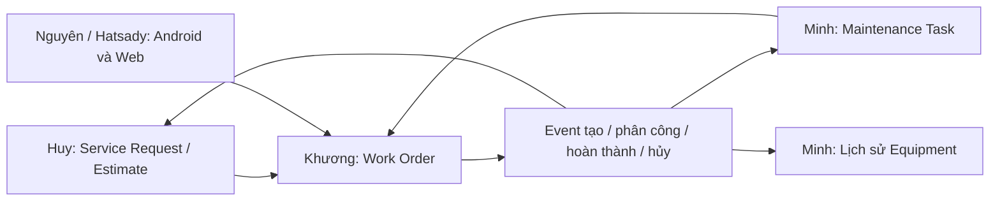

# M2 — Kế hoạch triển khai của Khương

| Thuộc tính | Giá trị |
| --- | --- |
| Người phụ trách | Khương — Member A theo bản phân công M2 người dùng cung cấp |
| Ngày tạo / cập nhật gần nhất | 2026-10-26 / 2026-10-28 |
| Mốc code đã đối chiếu | `develop ccace00` sau #36; K7 seed/demo và K8 trên nhánh `feature/khuong-m2-upload-contract-demo` |
| Trạng thái tài liệu | K1–K6 đã triển khai/merge; K7 seed/demo đã có, K8 owner contract đã có để consumer review; nghiệm thu UI còn riêng |
| PR dependency | [#20](https://github.com/neyugn261/pbl6-saas-equipment/pull/20) — đã merge `fbbc97d` |
| PR implementation | [#21](https://github.com/neyugn261/pbl6-saas-equipment/pull/21) — đã merge `b8935d1` |
| Việc tiếp theo | Consumer review K8 với Nguyên/Hatsady/Huy; Huy sửa H4; tích hợp Web/Android và nghiệm thu K7 |

Tài liệu lưu kế hoạch, phụ thuộc, tiêu chí hoàn thành và bằng chứng để Khương,
thành viên nhóm hoặc AI tiếp tục cập nhật. Đây không phải biên bản nghiệm thu
hay ADR mới. Việc viết tài liệu không có nghĩa các task đã được triển khai.

**Cập nhật 28/10:** issue #31 đã có implementation và bằng chứng
[K6 replacement](../testing/m2-maintenance-replacement-test-cases.md), gồm
producer Maintenance thật qua Gateway/PostgreSQL/RabbitMQ. Các ghi nhận ngày
26–27/10 bên dưới là lịch sử, không dùng câu “chờ producer/contract” cũ để
đánh giá trạng thái mới. M2 toàn nhóm vẫn cần nghiệm thu riêng.

**Cập nhật sau PR #36:** K6 đã merge vào develop `ccace00`. K7 có seed
Technician/Skill và demo SR/WO qua API thật, 130 WO DB tests (19 seed cases mới)
và real demo smoke; [hướng dẫn](../demo/workorder-m2.md). K8 có
[OpenAPI](../api/workorder-attachments.yaml) và [semantics/handoff](../api/workorder-attachments.md).
Phần owner contract đã chuẩn bị; chưa ghi nhận consumer approval hoặc upload
implementation. Các checkbox/baseline lịch sử bên dưới không thay trạng thái mới.

Nguồn phân công là bản **“M2 — Phân công công việc cho 5 thành viên”**, ngày
25/10/2026, đối chiếu `7cc48ba`, do người dùng cung cấp dưới tên
`m2-task-assignment.md`. Bản nguồn nằm ngoài repository. Các mã `M2-K1`–`M2-K8`
được giữ lại; thứ tự PR bên dưới là đề xuất sau khi đọc code. Nghiệp vụ phải
theo ADR/contract đã duyệt; nếu có mâu thuẫn thì ghi nhận và review trước phần
code phụ thuộc, không dùng kế hoạch này để tự thay đổi thiết kế.

## 1. Mục tiêu và phạm vi

Khương sở hữu `apps/workorder-service/**` và `docs/api/workorder.yaml` trong M2.
Ưu tiên tạo một luồng có thể tích hợp sớm:

**SR ACCEPTED → tạo WO → phân công → Technician nhận và thực hiện → nộp
Service Report → phát event → SR nhận kết quả → khách xác nhận hoặc reopen.**

Mốc demo đầu tiên dùng SR trong bảo hành để kiểm chứng WO mà chưa phụ thuộc API
Cost Estimate mới. Sau đó bổ sung ca ngoài bảo hành và luồng Maintenance.



Trong M2: Technician/Skill, WO và lịch sử, assignment, work log, Service Report,
API nội bộ WO, consumer hủy SR, consumer tạo WO từ Maintenance Task và nhánh
thay thế. Cuối M2 bàn giao contract upload cho M3.

M3 mới triển khai upload/MinIO, tích hợp kho/phụ tùng, Notification và báo cáo
thống kê. Không mở rộng sang thanh toán, GPS, tối ưu tuyến đường hay offline
sync. Service Report thuộc M2; không nhầm với báo cáo thống kê.

## 2. Hiện trạng đã đối chiếu

Các nhận định sau là kết quả đọc code tại `e3acf49`, không phải kết quả chạy
kiểm thử M2. Đây là baseline lịch sử trước triển khai; xem cập nhật tuần 1
ngay dưới bảng để biết hiện trạng mới.

| Hạng mục | Hiện trạng | Hành động |
| --- | --- | --- |
| Ứng dụng WO | AppModule còn controller/service mẫu; chưa nối Prisma, shared auth, health DB và event relay | K1 triển khai nền tảng theo mẫu các service M1 |
| Dependency và scripts | Chưa khai báo các package dùng chung; build/test/dev chưa tự generate Prisma client | PR dependency riêng; cập nhật scripts trong bootstrap |
| Database | Đã có schema và migration `0001_init`, `0002_attachment_visibility`, `0003_created_by_nullable` | Giữ migration cũ; chỉ thêm migration khi có thay đổi thiết kế cần thiết |
| Contract WO | Đã có các API M2, event v2 và quy tắc khóa khi tạo/hủy | Rà soát rồi triển khai; không viết lại contract từ đầu |
| Test DB / CI | Có business DB và shadow DB; chưa có bootstrap `workorder_test_db`, biến test URL hoặc DB suite WO trong CI | Khương chuẩn bị nhu cầu, phối hợp Nguyên ở K1 |
| Service Request | Đã có internal reference và consumer WO v1/v2 | Dùng client giả theo contract trước, tích hợp thật với Huy sớm |
| Gateway | Đã có route `/api/workorders/*`, chuyển tiếp sau khi bỏ prefix | Xác minh bằng test; không yêu cầu tạo lại route |
| Maintenance | ADR 0007 đã Accepted; ứng dụng còn scaffold | Làm K1–K4 độc lập; chốt cơ chế thay thế với Minh trước phần K6 phụ thuộc |
| Permission | Catalog có quyền WO/technician/report nhưng vẫn `PROVISIONAL` | Đối chiếu bằng chứng duyệt với Nguyên; không tự thêm role/quyền |

**Cập nhật 2026-10-26 tại `2aecbe7`:** đã thay scaffold WO bằng Prisma/shared
auth/validation/health/logger, HTTP references, outbox relay, toàn bộ API
Technician/Skill và phần K3 create/list/detail/patch/history/internal reference.
Đã thêm test DB/env, DB suite, smoke tuần 1 và cấu hình CI tương ứng. Local:
lint/typecheck/build toàn repo, 183 test (có RabbitMQ thật), 2 bootstrap test,
16 DB test, drift WO, smoke M1 và M2 tuần 1 đạt. CI dependency `cf54470` và
implementation `7e4aa75` đều xanh cả hai job. Bằng chứng/run cụ thể:
[M2 tuần 1](../testing/m2-week1-test-cases.md).

**Sau merge:** #20/#21 đã lên develop `b8935d1`, CI SUCCESS.
[Audit tuần 1](../testing/m2-week1-review.md) đủ phạm vi K1–K3; có fix UUID riêng.
[Kế hoạch tuần 2](m2-khuong-week-2.md): K4/K5 đã triển khai/test local;
[bằng chứng](../testing/m2-week2-test-cases.md). H4 giao Huy theo quyết định Khương,
chặn nghiệm thu event WO cũ/WO thay thế; không sửa SR thay owner.

Nghiệm thu M1 toàn nhóm vẫn cần bảng kết quả và quyết định release. CODEOWNERS
hiện còn comment; trạng thái branch protection/CI trên GitHub chưa được xác
minh trong lượt lập kế hoạch này. Những việc đó không tự động chặn các task M2
độc lập đã đủ đầu vào kỹ thuật.

## 3. Quyết định đã có và điểm cần chốt

### Các quyết định đã có

- WO dùng các trạng thái của state machine hiện hành, không thêm VERIFIED/CLOSED.
- WO có đúng một nguồn: Service Request hoặc Maintenance Task.
- Phát `WorkOrderCreated.v1`, `WorkOrderAssigned.v1`, `WorkOrderCompleted.v2`
  và `WorkOrderCancelled.v2`; không phát Completed/Cancelled v1 cho luồng mới.
- WO từ API ghi người gọi; WO từ event có `created_by = NULL`. Thay đổi do hệ
  thống ghi history với `changed_by = NULL`, không tạo user giả để ghi work log.
- CUSTOMER theo dõi kết quả qua summary của SR, không đọc trực tiếp WO/report.
- BUSY/AVAILABLE tự cập nhật trong transaction thay đổi assignment, khóa dòng
  technician; OFF_DUTY/INACTIVE không bị tự động ghi đè (ADR 0008 D11).
- Hủy SR chỉ tự hủy WO ở CREATED/ASSIGNED/ACCEPTED. WO đang
  TRAVELLING/IN_PROGRESS/ON_HOLD tiếp tục; M2 ghi cảnh báo, Notification từ M3.
- WO bảo trì bị hủy trả Task về PENDING chờ WO thay thế, cùng task ID và ngày
  lịch. WO bảo trì đã COMPLETED vẫn chặn WO thứ hai (ADR 0002/0007).
- API `customerSummary` lưu vào `service_reports.customer_note`; không cần
  thêm cột chỉ vì tên API khác tên DB.

### Các đầu việc phối hợp cần ghi nhận

| Mã / nội dung | Người phối hợp | Chặn phần nào | Đầu ra cần có | Trạng thái |
| --- | --- | --- | --- | --- |
| M2-D01: đối chiếu permission M2 với bằng chứng duyệt, catalog và seed | Khương + Nguyên, consumer API | Giữ quyền hiện có cho tuần 1 | Khương đã chốt giữ nguyên catalog; không có role/quyền hoặc migration Identity mới | Khương chốt 2026-10-26; catalog trong code vẫn PROVISIONAL, cần review chung trước version hóa sau này |
| M2-N2: test DB, env, bootstrap và CI cho WO | Khương chuẩn bị, Nguyên review | Review thay đổi dùng chung | Đã thêm `workorder_test_db`, test URL, script an toàn và CI DB/smoke | Đã merge #21; develop CI đạt; không suy diễn người duyệt cụ thể |
| M2-D04: ai yêu cầu WO bảo trì thay thế, operation/event, retry/backoff/giới hạn | Khương + Minh; Huy/Nguyên review | Contract kỹ thuật cho nhánh thay thế K6 | Khương chốt Service Manager chủ động yêu cầu, mỗi yêu cầu có định danh chống trùng; không tự động tạo lại | Khương chốt 2026-10-26; endpoint/event và quy tắc thứ tự còn cần review với các owner trước K6 |
| M2-D06: làm rõ từ “reports” ngoài M2 trong mô tả contract | Khương + Nguyên/Hatsady và consumer liên quan | Review contract | Đã phân biệt Service Report M2 với thống kê/upload M3 | Đã sửa câu chữ tại `2aecbe7`; chờ consumer review |
| H4: sự kiện của WO cũ đến muộn sau WO thay thế | Khương + Huy; Minh cho trường hợp Task | Nghiệm thu nhánh thay thế và consumer an toàn | Cách nhận diện WO hiện hành, xử lý event cũ và test sai thứ tự | Rủi ro từ đọc code; chưa chạy tái hiện |

M2-D02 (EquipmentMoved), D03 (chi tiết lịch) và D05 (migration snapshot) do Minh
chủ trì; Khương review phần giao tiếp với WO. Không cần đợi toàn bộ Maintenance
hoàn thành để làm nhánh SR → WO.

**Lưu ý D04:** replay đúng event đã xử lý sẽ bị inbox bỏ qua. Không kỳ vọng
replay đó tạo WO thay thế; cũng không tự sinh event ID mới để tạo vòng lặp.
Tách rõ retry do xử lý thất bại và yêu cầu nghiệp vụ tạo một WO thay thế.

**Lưu ý H4:** consumer SR hiện đối chiếu SR/equipment và trạng thái nhưng chưa
đối chiếu WO hiện hành ở nhánh cancellation. Có nguy cơ event WO cũ đến muộn
làm đổi trạng thái SR đang xử lý WO mới. Phải viết ca tái hiện và thống nhất
cách xử lý với Huy trước khi kết luận đã khắc phục; thay đổi schema/contract,
nếu cần, thuộc PR của owner tương ứng.

## 4. Thứ tự PR đề xuất

Mỗi PR chỉ chứa một mục đích, có test phù hợp và hướng dẫn kiểm tra. Các nhánh
tách từ `develop`, theo [CONTRIBUTING](../../CONTRIBUTING.md). Bảng này không
phải yêu cầu gom toàn bộ một task lớn vào một PR.

| Thứ tự | Phạm vi PR | Task | Đầu ra để người khác dùng | Trạng thái / PR |
| --- | --- | --- | --- | --- |
| 1 | Dependency riêng: package của WO + lockfile | K1 | Có thư viện dùng chung và validation cần thiết; Nguyên review | Merged #20, commit `cf54470` |
| 2 | Bootstrap: Prisma, auth, validation, health, env, nền tảng event/test | K1 | Service khởi động và kiểm tra được; có test DB/CI | Đã merge #21 tại `b8935d1` |
| 3 | Technician/Skill, `/technicians/me` | K2 | Mobile nhận diện technician; web có dữ liệu phân công | Đã merge #21 tại `b8935d1` |
| 4 | Tạo/đọc/sửa/history/internal WO; thiết kế khóa tạo/hủy cùng K5 | K3 | Tạo WO từ SR ACCEPTED, phát Created v1 | Đã merge #21; K5 đã code/test local tuần 2 |
| 5 | Assign/reassign/accept/reject và cập nhật trạng thái technician | K4 | Web phân công, Android nhận việc | Đã merge develop `988dbe0` qua #25; regression đạt |
| 6 | Start-travel/start/hold/resume và work log | K4 | Android thực hiện công việc | Đã merge develop `988dbe0` qua #25; regression đạt |
| 7 | Complete, Service Report và Completed v2 | K4 | Huy/Minh nối consumer kết quả thật | Đã merge develop `988dbe0` qua #25; regression đạt |
| 8 | Consumer hủy SR, cancel WO và Cancelled v2 | K5 | An toàn khi create/cancel chạy đồng thời; hoàn thiện trước nghiệm thu nhánh SR | Đã merge develop `988dbe0` qua #25; regression đạt |
| 9 | MaintenanceTaskDue và WO thay thế sau khi D04 được chốt | K6 | Luồng bảo trì với Minh | K6 tạo lần đầu `d658a56` đã test local; replacement/producer thật chờ Minh |
| 10 | Seed, hướng dẫn demo, tích hợp và bằng chứng cuối giai đoạn | K7 | Web/Android dùng Gateway và event thật | Đang làm: DB test/smoke và hướng dẫn tuần 1 đã đạt; nghiệm thu K4–K6 còn tiếp tục |
| 11 | Contract upload, chưa code MinIO | K8 | Mobile/web có đầu vào chuẩn bị M3 | Chưa bắt đầu / — |

Thiết kế advisory lock của K5 ngay khi làm PR 4: create lấy khóa theo SR ID rồi
mới đọc SR, consumer hủy dùng cùng khóa trong transaction. Có thể đưa PR 8 lên
sớm khi phần create đã sẵn sàng; không chờ hoàn tất mọi transition mới xử lý
race. Không coi nhánh tạo WO đã nghiệm thu đầy đủ khi K5 chưa được xác minh.

K7 diễn ra xuyên suốt: test/seed/README đi cùng từng PR nghiệp vụ; PR cuối chỉ
tổng hợp tích hợp và bằng chứng. Chốt D04 ngay đầu M2 dù K6 triển khai sau.

**Cập nhật bảng PR 2026-10-26:** dependency đã tách thành commit `cf54470`,
nhánh `feature/khuong-workorder-deps`; implementation và kiểm thử tuần 1 ở
`2aecbe7`, nhánh `feature/khuong-workorder-week1`. Để giữ luồng đã chạy có thể
review cùng nhau, bootstrap, Technician và create/read WO được gộp trong nhánh
implementation, thay vì các PR dự kiến 2–4. Thay đổi test DB/CI/contract được
liệt kê trong PR để Nguyên/consumer review. K4–K8 còn theo phạm vi tương ứng,
chưa được coi hoàn thành vì có smoke tuần 1.

PR #20/#21 đã merge. Tuần 2 tách fix UUID, implementation K4/K5 và cấu hình
CI dùng chung để reviewer xem độc lập; quan hệ base/merge xem kế hoạch tuần 2.

## 5. Checklist K1–K8

K1–K5 phía WO đã merge develop qua #25; checkbox K6 tạo lần đầu phản ánh
code/test local `d658a56`, chưa thay review/merge K6 hoặc nghiệm thu mọi thứ
tự event xuyên service. H4 và replacement còn theo các tiêu chí chưa tick.

### M2-K1 — Contract và nền tảng

- [x] Đối chiếu OpenAPI, state machine, schema/migration, permission và event;
  ghi các khác biệt, gồm M2-D06, để review.
- [x] PR dependency riêng; nối service-kit/auth/event-contracts/testing và
  cập nhật scripts generate Prisma cần thiết.
- [x] Nối Prisma, JWT/permission guard toàn cục, validation, lỗi chuẩn, logger
  và correlation ID; health kiểm tra DB.
- [x] Validate DB URL, JWT, service URL và broker theo nhu cầu thực tế; env mới
  có tài liệu; cấu hình tuần 1 đã merge #21.
- [x] Chuẩn bị test DB/CI để Nguyên review; bootstrap test và negative test auth đạt.
- [x] Lint/typecheck/test/build liên quan đạt; không tạo lại migration D5.

### M2-K2 — Technician và Skill

- [x] API Technician/Skill theo contract, gồm `/technicians/me` và gán skill.
- [x] Kiểm tra tài khoản TENANT_STAFF có role TECHNICIAN qua Identity và branch
  hợp lệ qua Organization, chuyển tiếp token/correlation ID; không đọc DB khác.
- [x] Kiểm tra uniqueness, tenant, profile thiếu và reference lỗi; xử lý quyền
  thay đổi trạng thái theo D11, không cho gán BUSY trực tiếp.
- [x] Test rollback, quyền và dữ liệu tenant khác; bàn giao API mẫu cho mobile/web.

### M2-K3 — Tạo và đọc Work Order

- [x] List/filter/sort/pagination, detail/update/history và internal reference
  theo contract; CUSTOMER không được đọc WO.
- [x] Tạo từ SR ACCEPTED; kiểm tra equipment/customer/reference, dữ liệu nguồn
  và lịch; số WO từ document sequence, không nhận tenant ID từ client.
- [x] WO + history/work log theo actor + outbox Created v1 cùng transaction;
  bảo đảm chỉ một WO chưa terminal cho cùng SR.
- [x] Áp dụng assignment scope cho Technician trên tất cả endpoint đọc, kể cả
  history/logs/report/internal; `mine` không được nới scope.
- [x] Thiết kế khóa cùng K5; test tạo đồng thời, upstream lỗi, rollback, 404
  ngoài phạm vi và Gateway chặn internal.

### M2-K4 — Assignment, thực thi và Service Report

- [x] Assign/reassign/accept/reject; chỉ một assignment ASSIGNED/ACCEPTED trên
  WO; reassign cập nhật assignment cũ/mới và technician trong cùng transaction.
- [x] Start-travel/start/hold/resume; work log và lịch sử assignment; đúng
  actor, trạng thái và lý do bắt buộc theo contract.
- [x] Quyền dạng “hoặc” ở hold/resume/thêm log được kiểm tra theo từng nhánh;
  không biến thành yêu cầu đồng thời mọi permission của các nhánh.
- [x] Khóa WO/technician nhất quán khi thay đổi; BUSY/AVAILABLE tính theo các
  assignment ACCEPTED còn lại; giữ OFF_DUTY/INACTIVE.
- [x] Complete chỉ do technician hiện được giao: report, WO, assignment,
  technician, history/work log và Completed v2 cùng transaction.
- [x] `customerSummary` bắt buộc, tách nội dung nội bộ; chỉ lưu một report/WO.
- [x] Test mọi transition, submit lặp, complete/cancel/reassign đồng thời và
  rollback; `allowedActions` khớp quyền/trạng thái nhưng backend vẫn kiểm tra.

### M2-K5 — Hủy SR và WO

- [x] Consume ServiceRequestStatusChanged v1 → CANCELLED qua inbox; kiểm tra
  tenant/reference, dùng advisory lock cùng create.
- [x] Tự hủy WO chỉ ở CREATED/ASSIGNED/ACCEPTED, phát Cancelled v2 với
  `cancelServiceRequest: true`; WO đang thực hiện giữ nguyên và ghi cảnh báo.
- [x] API cancel xử lý assignment/technician/history/outbox nguyên tử;
  `cancelServiceRequest` theo D4a và chỉ hợp lệ với nguồn SR.
- [ ] Test cancel trước/sau create, start/accept chạy đồng thời với cancel,
  event trùng/sai thứ tự; SR không gọi WO đồng bộ để kiểm tra/hủy.

H4 trên SR do Huy sửa theo quyết định Khương; ca event cũ/WO thay thế vẫn
chưa nghiệm thu. Chi tiết trong [bàn giao H4](../testing/h4-stale-work-order-events.md).

### M2-K6 — WO từ Maintenance Task

- [ ] Chốt M2-D04 và ví dụ thứ tự sự kiện với Minh trước code nhánh thay thế.
- [x] Consume MaintenanceTaskDue v1, tenant từ envelope và customer/site từ
  snapshot; không gọi upstream bằng token giả; `created_by = NULL`.
- [x] Inbox + WO + history + outbox Created v1 cùng transaction.
- [x] Constraint chặn nhiều WO chưa hủy cho một Task; WO COMPLETED vẫn chặn
  WO mới; Due replay sau hủy không tự tạo replacement. Nhánh thay thế giữ
  task ID/ngày lịch còn cần contract được review.
- [ ] Test concurrent delivery, replay, rollback, hủy/thay thế và event cũ
  không ghi đè WO mới/Task đã hoàn tất; tích hợp producer thật với Minh.

K6 tạo lần đầu đã có 21 DB tests và smoke fixture qua RabbitMQ/Gateway thật.
Chưa hoàn tất toàn K6: replacement, Task state và producer thật còn chờ tích hợp.
Chi tiết: [tuần 3](m2-khuong-week-3.md), [bằng chứng](../testing/m2-maintenance-test-cases.md).

### M2-K7 — Kiểm thử, seed và bàn giao

- [x] DB suite chạy trên test DB riêng, có `requireTestDatabaseUrl`; migration
  và drift check; seed chỉ ghi DB WO, dùng fixtures đã thống nhất, idempotent.
- [ ] Test constraint/transaction/concurrency chạy với PostgreSQL thật; test
  delivery/inbox/retry và luồng liên service qua RabbitMQ thật khi tích hợp.
- [ ] Giữ regression M1; README và API mẫu cho web/mobile cập nhật cùng code.
- [ ] Có bằng chứng SR → WO → assign → Android complete → SR summary/Asset
  history → customer confirm/reopen, cả ca trong và ngoài bảo hành phù hợp.
- [ ] Có bằng chứng Maintenance → Task → WO → hoàn thành và ca hủy/thay thế.
- [ ] Ghi commit, môi trường, case, kết quả và PR; phân biệt fake, integration
  và end-to-end; không ghi Pass cho ca chưa chạy.

### M2-K8 — Contract upload cho M3

- [x] Chuẩn bị contract attachment WO/report: presigned URL, MIME/size,
  quyền tenant/assignment, visibility INTERNAL/CUSTOMER và vòng đời file.
- [ ] Review với Nguyên/Hatsady; phối hợp Huy nếu customer nhận attachment qua
  SR, không mở quyền đọc toàn bộ WO/report cho CUSTOMER.
- [ ] Chốt đầu ra contract trước M3; chưa triển khai upload/MinIO/thống kê.

## 6. Phối hợp và lịch dự kiến

| Thành viên | Cần phối hợp với Khương | Thời điểm |
| --- | --- | --- |
| Nguyên | Permission, dependency/test DB/CI, review thay đổi dùng chung; API me/My Jobs và action/report cho Android | Ngay K1; bàn giao tăng dần theo K2/K4 |
| Huy | Internal SR, Created/Completed/Cancelled v2, summary, race và event WO cũ | Chốt test case đầu giai đoạn; tích hợp Created rồi Complete sớm |
| Minh | MaintenanceTaskDue, WO thay thế, tương quan task/WO; event hoàn thành cho Asset history | Chốt D04 đầu giai đoạn; K6 tích hợp sau luồng SR |
| Hatsady | Contract/types, list/detail/assign/cancel, allowedActions và kịch bản nghiệm thu | Dùng mock M2 trong phát triển; chuyển màn hình demo sang API thật khi sẵn |

Ước tính khoảng ba tuần từ bản phân công, chưa phải lịch cam kết:

| Khoảng thời gian | Ưu tiên | Mốc chứng minh |
| --- | --- | --- |
| Tuần 1 | Hoàn thiện K1, ưu tiên profile API của K2 và create/read của K3; thiết kế K5, chốt D04 và test case thứ tự event với Huy | Mục tiêu tạo WO từ SR thật; mobile/web có API đọc và profile; ghi rõ K2/K3 còn thiếu |
| Tuần 2 | K4 và K5; consumer SR tích hợp producer thật | Assign → accept → start → complete/report → SR nhận summary |
| Tuần 3 | K6, kiểm tra lỗi/đồng thời, tổng hợp K7 và K8 | Luồng Maintenance/hủy/thay thế và contract upload |
| 2–3 ngày cuối, nằm trong tuần 3 | Dành riêng cho tích hợp và nghiệm thu | Web + Android + Gateway + DB/broker thật, ghi bằng chứng |

Chi tiết công việc từng ngày, đầu ra, PR và bảng theo dõi có tại
[M2 — Tuần 1 của Khương](m2-khuong-week-1.md). Kế hoạch giả định 5 ngày làm việc,
5–6 giờ tập trung/ngày. K2/K3 chỉ được đánh dấu hoàn thành khi đủ toàn bộ tiêu
chí; mốc API ưu tiên cuối tuần không thay thế nghiệm thu toàn task.

Nếu chậm, báo phần chưa hoàn thành và phụ thuộc cụ thể; giữ phạm vi M2 theo
kế hoạch nhóm. Không dùng mock để thay bằng chứng end-to-end hoặc tự chuyển
task bắt buộc sang M3. Công việc quản trị/nghiệm thu M1 phối hợp song song.

## 7. Bằng chứng và cách cập nhật

Trạng thái dùng trong bảng PR/task: **Chưa bắt đầu**, **Đang làm**, **Chờ review**,
**Chờ đầu vào**, **Hoàn thành**. Ghi rõ đầu vào còn thiếu khi đang chờ. Checkbox
chỉ được tick khi tiêu chí đã đạt và có bằng chứng; PR chưa merge thì không
đánh dấu toàn task hoàn thành.

Mỗi lần tiếp tục công việc:

1. Đọc tài liệu này, đối chiếu `develop`, code và ADR/contract mới; cập nhật mốc
   đối chiếu khi đã thực sự kiểm tra lại. Các dòng hiện trạng cũ phải ghi ngày
   hoặc được sửa cho đúng, không để người đọc nhầm với hiện trạng mới.
2. Cập nhật đúng dòng task/PR, phụ thuộc và mục **Việc tiếp theo** ở đầu file.
3. Ghi kết quả kiểm tra vào bảng bên dưới; test mới, DB script hoặc smoke M2
   chỉ ghi lệnh khi đã được thêm và thực sự chạy. Không lưu token/password.
4. Quyết định thay đổi nghiệp vụ phải được ghi vào ADR/contract và review theo
   CONTRIBUTING; thêm link quyết định tại mục 3. Tài liệu này chỉ theo dõi.
5. Ghi ngày, tác giả và thay đổi trong nhật ký. Cập nhật qua PR để nhóm cùng
   review; tài liệu không tự đồng bộ khi code thay đổi.

| Ngày | Commit / PR | Phạm vi hoặc lệnh kiểm tra | Môi trường | Kết quả / bằng chứng |
| --- | --- | --- | --- | --- |
| 2026-10-26 | `e3acf49` — mốc code | Đọc code/contract/schema/ADR phục vụ lập kế hoạch | Repository local | Baseline trước triển khai; lúc lập kế hoạch chưa chạy kiểm tra M2 |
| 2026-10-26 | `2aecbe7` / PR #21 | Lint/typecheck/build toàn repo; 183 test; 2 bootstrap + 16 DB test WO; drift; smoke M1 và M2 tuần 1 | PostgreSQL 17, RabbitMQ 4, sáu service thật | Pass local; [bằng chứng](../testing/m2-week1-test-cases.md); xem Checks của PR #21 cho trạng thái CI remote mới nhất |
| 2026-10-26 | `cf54470`, `7e4aa75` / PR #20, #21 | Hai job CI của từng PR | GitHub Actions | Pass; run 40332043876 và 40332441109 được liên kết trong bảng bằng chứng tuần 1 |

Những lệnh sẵn có để dùng khi triển khai (không phải bằng chứng đã chạy):

```bash
pnpm build:packages
pnpm --filter workorder-service lint
pnpm --filter workorder-service typecheck
pnpm --filter workorder-service test
pnpm --filter workorder-service test:e2e
pnpm --filter workorder-service build
pnpm --filter workorder-service db:check-drift
```

Migration/drift cần môi trường DB/shadow đúng. DB suite WO riêng và smoke M2
chưa có tại mốc đối chiếu; bổ sung lệnh tương ứng sau PR triển khai, không
chạy E2E có ghi/xóa dữ liệu trên business DB.

## 8. Nguồn đối chiếu

- [AGENTS — phạm vi và kiến trúc](../../AGENTS.md),
  [CONTRIBUTING — ownership, PR và Definition of Done](../../CONTRIBUTING.md).
- [Work Order OpenAPI](../api/workorder.yaml),
  [Service Request OpenAPI](../api/service-request.yaml),
  [Maintenance OpenAPI](../api/maintenance.yaml),
  [fixtures](../api/fixtures.md).
- [State machines](../architecture/state-machines.md),
  [event catalog](../architecture/events.md),
  [catalog trong code](../../packages/event-contracts/src/catalog.ts).
- [Shared packages](../../packages/README.md),
  [permission catalog](../../packages/auth/src/catalog.ts),
  [permission guard](../../packages/auth/src/guards.ts).
- [Schema WO](../../apps/workorder-service/prisma/schema.prisma),
  [quy tắc migration](../../apps/workorder-service/prisma/README.md),
  [ERD/SQL](../erd/pbl6-schema-v3.1.sql).
- [ADR 0002 — Task/WO thay thế](../decisions/0002-workorder-maintenance-task-index.md),
  [ADR 0003 — customer scope](../decisions/0003-customer-scope.md),
  [ADR 0004 — auth](../decisions/0004-service-auth-and-authorization.md),
  [ADR 0005 — event transport](../decisions/0005-event-transport.md),
  [ADR 0006 — quyết định sau M0](../decisions/0006-m0-review-decisions.md),
  [ADR 0007 — Maintenance, Accepted](../decisions/0007-maintenance-snapshot.md),
  [ADR 0008 — quyết định sau M1](../decisions/0008-m1-review-decisions.md).
- [Consumer WO phía SR](../../apps/service-request-service/src/events/work-order-events.consumer.ts),
  [bootstrap DB dev/test](../../infrastructure/postgres/dev-databases.sql),
  [CI](../../.github/workflows/ci.yml),
  [bảng kiểm thử M1](../testing/m1-test-cases.md).

## 9. Nhật ký cập nhật

| Ngày | Người cập nhật | Nội dung |
| --- | --- | --- |
| 2026-10-26 | Codex, theo yêu cầu Khương | Tạo kế hoạch từ bản phân công 25/10 và phân tích repository `e3acf49`; bổ sung thứ tự PR, checklist, phụ thuộc, rủi ro event và cách ghi bằng chứng. Chưa triển khai task M2; chưa ghi nhận nhóm duyệt. |
| 2026-10-26 | Codex, theo yêu cầu Khương | Bổ sung kế hoạch tuần 1 theo từng ngày tại `m2-khuong-week-1.md`; làm rõ mục tiêu ưu tiên của K2/K3, giả định thời gian và tiêu chí bàn giao. Các task triển khai vẫn chưa bắt đầu. |
| 2026-10-26 | Codex, Khương chốt D01/D04 | Triển khai/test tuần 1 tại `2aecbe7`, dependency `cf54470`; cập nhật trạng thái K1–K3 và bằng chứng; K4/K5/K6 chưa triển khai. Chờ review/merge. |

| 2026-10-26 | Codex; Khương giao H4 cho Huy | Audit develop sau merge #20/#21; fix UUID; triển khai/test K4/K5 `687d911`; cập nhật kế hoạch tuần 2 và giới hạn nghiệm thu replacement. |

| 2026-10-27 | Codex, Khương xác nhận #25 đã merge | Đối chiếu develop `988dbe0`/CI SUCCESS; triển khai K6 tạo lần đầu `d658a56`; 79 DB, 183 unit/transport, 2 bootstrap và smoke thật đạt. Replacement chưa có contract được review; không nghiệm thu thay Minh/Huy. |
