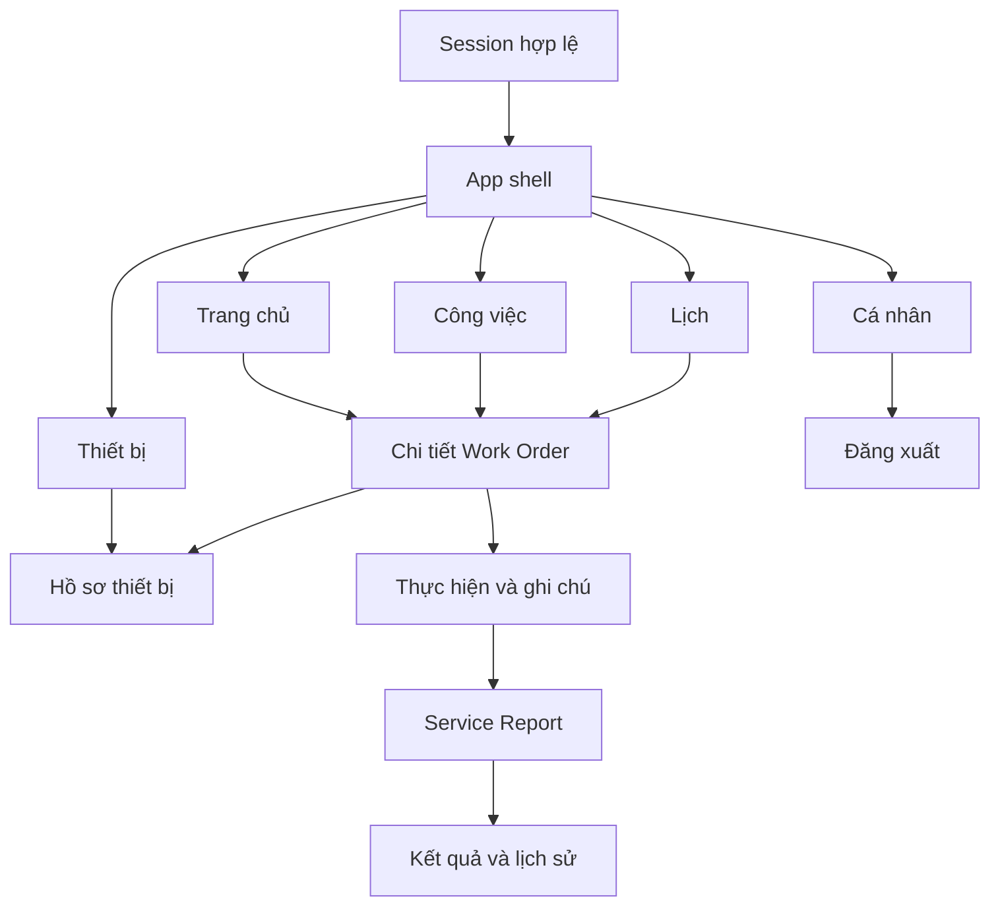

# Mobile Technician — thiết kế chức năng, điều hướng và demo

Ngày: 28/10/2026. Người chuẩn bị: Khương theo yêu cầu thiết kế mobile đầy đủ.
Đây là đề xuất thiết kế để thống nhất trước khi code; không phải xác nhận mọi
chức năng đã triển khai. Nền tảng/session P0 đã có ở `e6e538a` và `a9a114c`.
Backend được đối chiếu thêm tại `origin/develop cffbaa6`; không rebase, apply
migration hoặc thay đổi backend trong lần thiết kế này.

**Cập nhật giao diện:** đã dựng Flutter UI theo theme ảnh tham chiếu trên nhánh
`feature/khuong-mobile-session`. Màn hình dùng fixtures; API/mutation/plugin mới
còn TODO. [Cách mở và bàn giao UI](../demo/mobile-ui-preview.md). Kết quả này
không đổi trạng thái nghiệm thu nghiệp vụ M2/M3 trong thiết kế bên dưới.

## 1. Mục tiêu và căn cứ

Mobile phục vụ Technician nội bộ trong quy trình hậu mãi của tenant: biết việc
cần làm → chuẩn bị thông tin thiết bị/khách hàng → nhận việc → thực hiện → ghi
nhận kết quả → bàn giao qua Service Report → tra cứu lại. Web tiếp tục phục vụ
điều phối, xét duyệt SR/báo giá, quản trị và khách hàng xác nhận kết quả.

Baseline là AGENTS, ADR Accepted và contract/code hiện hành. ADR 0006 DEC-01
đã thay baseline SRS v1.0 trong repo; vì vậy không lấy checklist/Verify trong
SRS cũ để tự mở thêm nghiệp vụ. ADR 0001 loại Maintenance Checklist và Request
Part khỏi MVP. Theo DEC-06, xác nhận cuối là SR RESOLVED → CLOSED của khách,
WO không có VERIFIED/CLOSED. Thêm checklist hoặc chữ ký điện tử cần quyết định
scope và backend riêng, không đưa thành điều kiện hoàn thành WO hiện tại.

Phân kỳ:

- **M2 lõi:** 5 mục điều hướng, dashboard công việc cá nhân, My Jobs/lịch sử,
  lịch dự kiến, WO workflow/logs, thiết bị/hồ sơ/lịch sử, Service Report,
  hồ sơ kỹ thuật viên và session. API các nghiệp vụ lõi đã có.
- **M2 bổ sung sau lõi:** camera quét QR tra cứu thiết bị; backend resolve QR
  đã có. Không dùng phần này để trì hoãn luồng thực hiện WO thật.
- **M3:** ảnh/tài liệu theo K8, Notification thật, phụ tùng chỉ đọc cho
  Technician, nháp cục bộ/phục hồi mất mạng. Chưa cam kết offline state-changing
  workflow hoặc tự đồng bộ hàng đợi mutation.

## 2. Cấu trúc điều hướng

Bottom navigation giữ ổn định 5 mục:

| Mục | Câu hỏi người dùng cần giải quyết | Nội dung chính |
| --- | --- | --- |
| Trang chủ | Hôm nay cần ưu tiên việc gì? | Tổng quan, việc chờ nhận, việc đang làm, lịch gần nhất, truy cập nhanh |
| Công việc | Tôi đang/từng được giao những việc nào? | Hiện tại, lịch sử, tìm kiếm, lọc, chi tiết và thực hiện |
| Lịch | Tôi dự kiến làm việc gì vào ngày nào? | Ngày/tuần/tháng, agenda, chưa xếp lịch; chỉ đọc |
| Thiết bị | Tôi cần biết gì trước khi sửa? | Danh sách/tra cứu/QR, dossier, bảo hành, thông số và lịch sử |
| Cá nhân | Hồ sơ và phiên của tôi ra sao? | Profile/skill/branch/status, tùy chọn giao diện, trợ giúp, logout |

Chuông thông báo ở app bar, kích hoạt khi Notification được tích hợp ở M3;
không dành một tab M2 cho API chưa triển khai. Badge chờ nhận ở Công việc lấy
tổng chính xác từ server, không lấy số item của trang hiện tại.

Các root tab giữ vị trí cuộn/filter/ngày đang chọn khi chuyển tab. Chi tiết,
form report, ảnh toàn màn hình và camera dùng route riêng có Back; bottom nav
ẩn ở các route này, thay bằng nút nghiệp vụ cố định phía dưới khi thích hợp.
Back trả về đúng nơi đã mở: Trang chủ, Công việc, Lịch hoặc Thiết bị.

## 3. Trang chủ

- Chào tên Technician; ngày nghiệp vụ theo Asia/Ho_Chi_Minh; trạng thái hồ sơ.
- Bốn ô: Chờ tiếp nhận, Đang thực hiện, Tạm dừng, Bắt đầu dự kiến hôm nay.
  Bấm ô mở Công việc/Lịch với đúng filter, không tạo một danh sách logic khác.
- Việc cần chú ý: WO URGENT, các việc chờ nhận và ON_HOLD. Thứ tự ưu tiên có
  mô tả rõ; danh sách preview có Xem tất cả và tổng từ API.
- Khối Tiếp tục công việc: hiện WO đang IN_PROGRESS hoặc ON_HOLD phù hợp,
  mở đúng detail. Có thể có nhiều assignment ACCEPTED, không giả định mỗi
  Technician chỉ được một WO.
- Lịch sắp tới, cùng thông tin giờ dự kiến; liên kết sang Lịch.
- Shortcut: Công việc, Tra cứu thiết bị, Quét QR khi có scanner.
- Thiếu profile `/technicians/me` → hướng dẫn liên hệ quản lý thiết lập hồ sơ;
  không tự tạo profile hoặc xem 404 là danh sách công việc bằng 0.

Không dựng KPI hoàn thành hôm nay từ `scheduledStart`; đây không phải ngày
hoàn thành. Truy vấn không sẵn sàng hiển thị lỗi/thử lại, không hiển thị số 0.

## 4. Công việc và lịch sử cá nhân

Hai chế độ **Hiện tại / Lịch sử**. Hiện tại có các chip Chờ nhận, Đã nhận,
Di chuyển, Đang làm, Tạm dừng. Lịch sử cho xem lại WO đã hoàn thành/hủy và
assignment đã từ chối/chuyển giao nếu API cung cấp được quan hệ tương ứng.

Card: workOrderNo, tiêu đề, loại, ưu tiên, trạng thái, giờ dự kiến; thiết bị,
khách/site khi đã resolve được theo quyền. Tên thiếu có trạng thái riêng,
không bịa tên từ ID. Không gọi N lần dossier đầy đủ chỉ để vẽ một trang list.

Tìm theo mã WO/tiêu đề; lọc type/priority/status/ngày dự kiến; pagination,
pull-to-refresh, loading/empty/error và giữ filter khi mở rồi quay lại detail.
Lọc nâng cao mở bottom sheet có Áp dụng/Xóa lọc. Thông báo thành công sau
mutation kèm reload state server; không giả thay status ở client.

`mine=true` là current assignment ASSIGNED/ACCEPTED; complete/reject/reassign
có thể đưa WO ra khỏi danh sách Hiện tại. WO COMPLETED vẫn có trang kết quả.
Không dùng `mine=true&status=COMPLETED` để làm lịch sử. Account chỉ có TECHNICIAN
được backend giới hạn WO từng được giao khi list không bật mine. Account đa
vai trò cần filter lịch sử cá nhân bổ sung trước khi dùng cùng nhãn này.
Không suy ra assignment REJECTED chỉ từ WO CREATED.

## 5. Chi tiết WO — trung tâm của mobile

Header: mã, tiêu đề, trạng thái, ưu tiên, loại, nguồn SR/Maintenance nếu có.
Phần đầu thể hiện thiết bị/site và lịch dự kiến; nhấn thiết bị mở dossier.

Các tab trong detail:

1. **Tổng quan:** yêu cầu/mô tả, thiết bị, khách hàng/địa điểm/liên hệ được phép
   xem, lịch dự kiến, assignment hiện hành và yêu cầu gốc. Có sao chép địa chỉ,
   mở dialer từ số liên hệ; không tự gọi điện. Không đồng nhất lịch dự kiến với
   lịch đã được khách xác nhận.
2. **Hoạt động:** status history, assignment history và work logs. Thể hiện
   tác nhân/thời gian/lý do được phép; ghi chú mới qua POST logs. Các feed có
   thể gộp để trình bày nhưng giữ nguồn/identity, không giả là global audit mới.
3. **Báo cáo:** mở form khi complete được phép; đọc report khi đã tồn tại,
   gồm kết quả và summary cho khách tách chẩn đoán nội bộ.
4. **Tài liệu** (M3): ảnh/file theo WO và report; xem, tải, upload/hủy/retry theo
   quyền. Phụ tùng bổ sung thành section/tab ở M3 khi API Inventory sẵn sàng.

Nút chuyển trạng thái theo `allowedActions`; backend kiểm lại assignment,
permission và state. Note theo quyền/current assignment thực tế, không giả
`allowedActions` đã có action add-log trong contract hiện tại.

| WO hiện tại | Nhãn UI | Thao tác Technician |
| --- | --- | --- |
| ASSIGNED | Chờ tiếp nhận | Nhận việc / Từ chối có lý do |
| ACCEPTED | Đã tiếp nhận | Bắt đầu di chuyển hoặc Bắt đầu công việc |
| TRAVELLING | Đang di chuyển | Bắt đầu công việc |
| IN_PROGRESS | Đang thực hiện | Ghi chú / Tạm dừng có lý do / Lập báo cáo và hoàn thành |
| ON_HOLD | Tạm dừng | Ghi chú / Tiếp tục; resume trước khi complete |
| COMPLETED | Đã hoàn thành | Đọc report/lịch sử; file report theo quyền M3 |
| CANCELLED | Đã hủy | Đọc lịch sử/lý do được phép; không tự mở lại |

Reject và hold dùng dialog/bottom sheet bắt buộc lý do. Thao tác nhạy cảm có
xác nhận và pending; 409 → tải lại và giải thích state đã đổi. Reassigned WO
từng được giao có thể vẫn đọc được, nhưng action cũ phải bị vô hiệu và server
từ chối nếu gửi. Technician không tự assign/reschedule/cancel/replacement WO.

## 6. Service Report

Form ba bước trên một route:

1. **Chẩn đoán:** problemDescription bắt buộc (tối đa 5000), rootCause nội bộ
   tùy chọn (tối đa 5000).
2. **Xử lý:** solution bắt buộc (tối đa 5000), tham khảo work logs đã ghi.
3. **Kết quả:** RESOLVED/PARTIALLY_RESOLVED/UNRESOLVED; customerSummary bắt buộc
   (tối đa 2000), có nhãn rõ đây là thông tin gửi khách. Preview trước gửi.

Nút **Gửi báo cáo và hoàn thành** gọi complete một lần, không có thao tác tạo
report độc lập trước đó. M2 giữ nội dung khi quay bước hoặc API lỗi; nếu rời
form có thay đổi chưa gửi phải xác nhận. Không gắn nhãn Đã lưu server cho nháp
chưa có API. Nháp lưu bền vững riêng theo user/tenant/Gateway/WO là M3.

Sau thành công: màn hình kết quả có mã WO, thời gian hoàn thành, result,
customerSummary và link đọc lại report/lịch sử. Điều hướng về Lịch sử được,
kể cả khi WO đã rời mine=true. Timeout không gửi lại complete mù quáng; đọc
WO/report để biết server đã hoàn thành hay chưa.

Report chưa có API sửa; không có nút sửa report đã nộp. Complete không tự xác
nhận tình trạng vận hành thiết bị, đóng SR hoặc giả khách đã chấp nhận kết quả.

## 7. Lịch dự kiến

Root có chuyển Ngày/Tuần/Tháng và ngày được chọn; danh sách agenda bên dưới.
Mỗi WO hiện khung giờ nếu đủ start/end, hoặc giờ bắt đầu nếu chỉ có start.
Nhóm Chưa xếp lịch giữ các WO chưa có scheduledStart để không làm mất việc.
Nhấn item mở detail dùng chung, giữ ngày khi Back.

Đây là cách nhìn lịch WO đã giao, không phải chấm công, nghỉ phép, lịch rảnh,
tối ưu tuyến hoặc chức năng Technician kéo-thả sửa lịch. M2 truy vấn theo
scheduledStart trong khoảng; công việc nhiều ngày cần hiển thị đúng mô tả
Ngày bắt đầu dự kiến. Nếu muốn lịch kiểu mọi khoảng overlap ngày/tuần, cần
bổ sung query overlap thay vì coi API hiện tại đã hỗ trợ.

## 8. Thiết bị, QR và hồ sơ

List: tìm mã asset/serial/tên model; lọc khách/site/status/bảo hành/tình trạng
vận hành theo Asset API. Gọi là Thiết bị trong phạm vi truy cập, không gọi
Thiết bị của tôi khi API hiện giới hạn theo tenant và quyền staff.

Dossier hiển thị: mã/tên/model/serial; thông số; khách hàng/site/location/contact;
ngày lắp/bàn giao/đưa vào dùng; bảo hành; operational status; timeline và công
việc liên quan. Giữ các section AVAILABLE/RESTRICTED/UNAVAILABLE/NOT_CONFIGURED/
NOT_FOUND; preview có Xem tất cả với pagination.

Warranty coverage theo thời gian khác warrantyCheck đã chốt cho SR. UNKNOWN
là Chưa xác nhận tình trạng vận hành. WO complete không đồng nghĩa equipment
OPERATIONAL. Technician chỉ đọc, không tự PATCH tình trạng/QR/admin fields.
Maintenance section chỉ có nội dung khi quyền/API cho phép; role TECHNICIAN
hiện không có maintenance:read, không tự mở quyền để làm đầy giao diện.

Timeline/related WO giữ scope caller. Tên actor nếu chưa được phép resolve thì
ghi Hệ thống/Bạn/Vai trò/ID phù hợp, không gọi Identity internal từ điện thoại.
Không coi tên/model/site hiện tại là snapshot tại mọi sự kiện cũ.

QR: nút Quét ở tab Thiết bị và shortcut Home; scan mẫu QR dự án → gọi resolve
qua Gateway có bearer → mở dossier. Không mở URL tùy ý hoặc bypass scope;
mã hỏng/thu hồi/ngoài quyền có thông báo phù hợp. Từ chối camera có đường tìm
bằng mã/serial; không bắt buộc quét để dùng ứng dụng. Không cấp/in lại QR từ
Technician. Scanner là phần UI cần triển khai thêm, backend resolve đã có.

## 9. Cá nhân và tùy chọn

Identity profile: tên/email/vai trò; Technician profile: employeeCode, branch,
skills và AVAILABLE/BUSY/OFF_DUTY/INACTIVE. Đây là dữ liệu đọc; BUSY/AVAILABLE
được service tính, OFF_DUTY/INACTIVE do quản lý đặt. Không thêm toggle tự đổi
status khi không có quyền.

Tùy chọn local: giao diện sáng/tối/theo hệ thống, hỗ trợ cỡ chữ thiết bị; thông
tin phiên bản và hướng dẫn thao tác; kiểm tra phiên/đăng xuất. Không dựng form
đổi mật khẩu/sửa user/đổi tenant khi chưa có self-service contract tương ứng.
Thông báo thiết bị, dung lượng/file nháp và quản lý nháp bổ sung ở M3.

## 10. Các chức năng M3 được thiết kế trước

**Thông báo:** chuông có unread count; danh sách Tất cả/Chưa đọc, đánh dấu từng
notification đã đọc, nhấn để mở đúng WO trong scope hiện hành. Không giả mọi
sự kiện thay đổi lịch đã có producer. Bám recipient matrix được owner chốt;
in-app trước, push là bổ sung có contract/permission. Deep link hết session
đi qua login và kiểm lại resource, không giữ dữ liệu của user cũ. API hiện là
draft, public prefix còn phải thống nhất với Gateway.

**Ảnh/tài liệu:** chụp/chọn JPEG/PNG hoặc chọn PDF; xem trước, kiểm giới hạn
K8, hiển thị progress theo file, retry/hủy, mở/tải theo quyền. Technician upload
INTERNAL, manager công bố CUSTOMER trên web. Quy trình prepare → signed PUT →
finalize → metadata, chỉ finalize mới được coi là attach thành công. File WO
thực hiện trước terminal; ảnh report upload sau complete/report đã tồn tại.
Upload report lỗi có thể retry riêng, không rollback complete. Không gửi JWT
Gateway tới object storage, không cache/log signed URL.

**Phụ tùng của WO:** hiển thị part/code/đơn vị/đã cấp/đã trả/tiêu hao theo ADR,
chỉ khi Inventory thực thi contract. Technician có inventory:read, không có
inventory:issue. Request Part bị loại khỏi MVP; không có nút yêu cầu/cấp/trả
hoặc chỉnh tồn kho bằng tài khoản Technician. Bộ phận kho thao tác trên web.

**Nháp và phục hồi mất mạng:** giữ form/file tạm theo đúng user/tenant/WO/Gateway,
hiển thị Chưa gửi/Cần kiểm tra/Thử lại. Khi online phải đọc lại assignment/state;
không tự replay complete hoặc các mutation khác. Đăng xuất/đổi account dọn dữ
liệu theo chính sách và cảnh báo nháp chưa gửi. Không cam kết offline sync đầy
đủ hoặc hàng đợi chuyển trạng thái ngoài quyết định MVP hiện hành.

## 11. Các API/gap cần lưu ý khi triển khai

| Nhóm | Đầu vào hiện có / phần cần bổ sung |
| --- | --- |
| Auth/profile | Identity auth + WO technicians/me; P0 đã có auth |
| Home counts | WO list trả total theo filter; không cần KPI giả hoặc đếm page.items |
| Current jobs | WO list mine=true, status/type/priority/date/q |
| Personal history đa role | Cần contract filter ever-assigned-to-caller; không dùng staff-wide list cho nhãn Cá nhân |
| Schedule | scheduledFrom/To hiện lọc start; overlap/dedicated personal aggregate là bổ sung nếu chọn UX đó |
| WO workflow/report | detail/history/assignments/logs/actions/service-report hiện có |
| Dossier/contact/history | Asset dossier và các list/detail nguồn; giữ section status và quyền của caller |
| Names | Không có lịch sử tên Identity được xác thực cho mọi actor; dùng fallback an toàn |
| QR | Asset /qr/:token có auth; scanner/camera UI chưa có |
| Replacement badge | WO DB có references nhưng public view chưa trả replacesWorkOrderId; muốn liên kết A → B trên mobile cần contract bổ sung. Web Task journey có thể thể hiện chuỗi theo quyền |
| Attachments | K8 contract-only, cần implementation/migration mới M3 |
| Notifications | Draft + recipient/public-route decisions; chưa có API nghiệp vụ |
| Parts | Inventory draft, chưa có API nghiệp vụ |

Các gap không được giải bằng cách truy cập DB service khác, gọi internal từ
mobile hoặc thay đổi quyền. PR backend/contract mới phải review riêng.

## 12. Luồng demo đề xuất

**Demo chính M2:** Web customer tạo SR → manager review/accept (Estimate trên
web khi ngoài bảo hành) → dispatcher tạo/assign WO → mobile Home thấy chờ nhận
→ Công việc/detail/thiết bị/bảo hành/lịch sử → accept → Lịch xem giờ dự kiến →
travel/start → thêm note → hold có lý do → resume → report/complete → xem lại
Lịch sử/report → web customer thấy summary và confirm/reopen theo state machine.

**Demo nhánh từ chối:** một WO khác ASSIGNED → Technician reject có lý do →
khỏi danh sách Hiện tại → dispatcher xem lịch sử và phân công lại trên web.
Không gộp reject và complete vào cùng lần thực hiện để bỏ qua bước assign lại.

**Demo đồng thời:** mở WO rồi dispatcher reassign/cancel trên web → app refresh
thông báo thay đổi và bỏ action không còn hợp lệ. Thử gửi action stale phải bị
server chặn; dữ liệu từng được giao có thể vẫn đọc theo contract.

**Demo bảo trì:** web tạo plan/task → WO MAINTENANCE tự động → dispatcher giao
→ mobile thực hiện/report → Task/Asset history cập nhật. Nhánh WO hủy → quản lý
yêu cầu replacement → giao WO mới cho mobile; không bắt Technician gọi Task
journey hoặc tự yêu cầu replacement khi thiếu maintenance:read/manage.

**Demo tra cứu:** quét QR/tìm mã → dossier/model/warranty/timeline → mở công
việc liên quan trong scope. M3 nối thêm chụp ảnh → finalize → report attachment,
chuông in-app và xem phụ tùng kho đã cấp.

Dữ liệu demo đề xuất 6–8 WO: chờ nhận, đã nhận, đang làm, tạm dừng, completed,
cancelled, một WO bảo trì và một ca reassign/replacement; reuse 2 customer,
3 site và equipment fixtures phù hợp. Tạo bằng API/seed orchestration của owner,
không sửa SQL trạng thái. K7 hiện chuẩn bị một marker SR/WO, chưa tự có đủ bộ
dữ liệu đa trạng thái này. Chạy đủ luồng trên UI thật trước ghi Pass.

## 13. Thứ tự triển khai và chất lượng

1. App shell 5 tab + Technician profile + My Jobs/detail/actions cơ bản.
2. Service Report, lịch sử, logs, state conflict và toàn bộ luồng complete thật.
3. Home counts/shortcuts, lịch, dossier/history/contact và polish/loading/error.
4. QR scanner bổ sung sau lõi; negative scope tests, APK và demo 9/9 M2.
5. M3: upload → Notification → parts read-only → nháp/phục hồi, theo owner API.

Các shell tab có thể dựng song song với feature nhưng bản bàn giao chỉ bật
chức năng thật. Mỗi route có loading/empty/error/retry; không xem restricted
hoặc unavailable là rỗng. Dùng text + icon cho status, hỗ trợ chữ lớn, nút
touch đủ lớn, bàn phím không che CTA, giữ dữ liệu khi lỗi. Tách runtime cache/
draft theo user/tenant/Gateway; session change reset navigation và dữ liệu.

M2 acceptance gồm toàn bộ workflow thực tế, 403/404/sai tenant, reassignment
race, 409, timeout complete, profile chưa cấu hình, restore/logout và report
history sau khi mine=true rỗng. P0 có 42 tests không thay cho test feature mới.

Nguồn: [phân công M2](../plans/m2-task-assignment.md),
[ADR 0001](../decisions/0001-database-v3.1.md),
[ADR 0006](../decisions/0006-m0-review-decisions.md),
[state machines](../architecture/state-machines.md),
[WO API](../api/workorder.yaml),
[equipment handoff](../plans/equipment-dossier-handoff.md),
[attachment K8](../api/workorder-attachments.md),
[Inventory](../api/inventory.yaml), [Notification](../api/notification.yaml).
