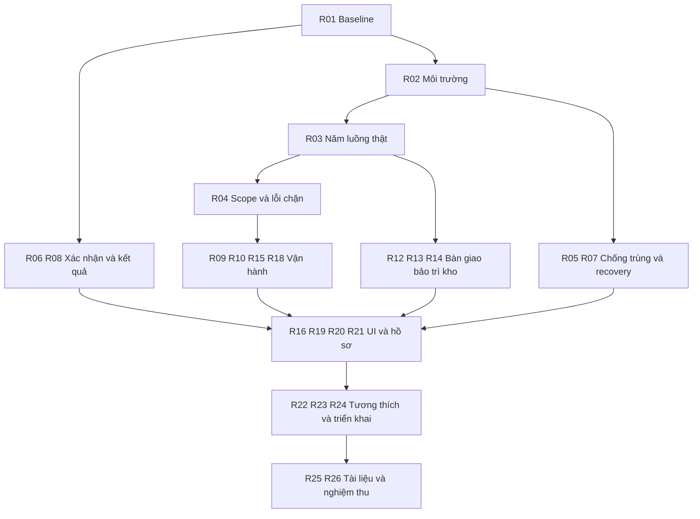

# Kế hoạch hoàn thiện dự án PBL6 từ baseline ngày 10/11/2026

## 1. Kết luận và mục tiêu

Dự án đã có phần lớn khối nghiệp vụ cốt lõi và nhiều luồng nối API thật. Việc tiếp theo là hoàn thiện độ tin cậy, tính minh bạch với khách hàng, trải nghiệm theo vai trò và bằng chứng nghiệm thu trên một bản tích hợp thống nhất. Không có đủ cơ sở để quy đổi tiến độ thành một tỷ lệ phần trăm hoặc khẳng định toàn bộ M1–M3 đã nghiệm thu.

Mục tiêu bản hoàn thiện:

1. Doanh nghiệp cấu hình được chi nhánh, nhân viên, khách hàng và chính sách dịch vụ.
2. Khách nhận đúng thiết bị, điều khoản, thời hạn; theo dõi được từng yêu cầu và biết mình đang chấp thuận nội dung nào.
3. Service Manager quản lý được ca từ tiếp nhận đến kết quả cuối, biết người phụ trách, điểm đang chờ và phần còn phải xử lý.
4. Technician thực hiện đúng WO; bộ phận kho giao dịch và đối soát phụ tùng có căn cứ.
5. Lịch sử máy, báo cáo, thông báo và phân quyền nhất quán với dữ liệu nguồn.
6. Người khác có thể dựng, chạy thử, nghiệm thu và khôi phục môi trường theo tài liệu.

**Tài liệu này là kế hoạch đề xuất, không phải xác nhận đã triển khai hoặc giao việc thành công.** Thiết kế API/schema/quy tắc mới phải được owner và consumer review trước khi code. Không tự mở rộng sang ERP, đơn hàng bán hàng, thanh toán, VAT, mua hàng, nhân sự, GPS hoặc AI dự đoán hỏng.

## 2. Baseline và phạm vi rà soát

- Code đối chiếu: `develop@48f86d5f3ca93e1cea5bb9c612e6f1576be60336`, cùng `origin/develop` ở lượt fetch trước trong phiên làm việc; đã gồm PR #67–#70. Khi bắt đầu triển khai từng task phải fetch và ghi baseline mới.
- Có ba diff Web chưa commit: `OperationsPages.tsx`, `ServiceManagerShell.tsx`, `role-workspace.ts`. Chúng bỏ thông tin thời hạn bảo trì, thông báo phạm vi chi nhánh và menu phân bổ dịch vụ. Cần quyết định giữ/đặt lại ở vị trí khác trước khi coi UI local là bản nghiệm thu.
- Đã lập [kịch bản kiểm thử](../testing/2026-11-10-full-system-acceptance-test-plan.md): 5 luồng xuyên suốt và 105 ca chi tiết; các ca đó chưa được chạy trong lượt soạn kế hoạch.
- Rà soát lần này dùng code, contract, README và báo cáo trong repo; chưa chạy lại toàn bộ stack, chưa kiểm trực tiếp trạng thái CI/GitHub settings hiện tại.
- Giữ nguyên code mobile. Các việc Mobile dưới đây là bàn giao kiểm tra tương thích cho owner; nếu cần sửa app phải có phạm vi riêng được thống nhất.

### 2.1. Đã có, cần giữ và nghiệm thu thay vì xây lại

| Khối | Đã có trong repo | Công việc còn cần xác nhận |
|---|---|---|
| Identity/Organization | Đăng nhập, refresh/logout, invite/activate, user/role/status, tenant/customer/site/contact; chi nhánh chính và routing site | Quyền sau thay đổi tài khoản, onboarding đầy đủ, luồng phục hồi truy cập, nghiệm thu hai tenant |
| Chi nhánh | SR/WO/kho/notification/report theo scope; TA xem tổng và phân bổ; SM kiêm điều phối; Dispatcher giữ tương thích | UI dễ hiểu; hàng chờ chưa phân bổ; mọi endpoint và recovery áp cùng phạm vi |
| Model/Asset | Policy revision/publish/preview, equipment/warranty/QR/dossier/history/parts | Điều khoản khách thực sự nhận, dữ liệu lịch sử và quyền truy cập, trình bày dễ hiểu |
| Bàn giao | STORE và CUSTOMER_SITE, snapshot/version, từ chối/gửi lại, khách chấp thuận, provisioning bảo trì | Race/replay/mất phản hồi; không công bố thành công khi còn provisioning; liên kết tài liệu đúng snapshot |
| Service Request/Estimate | Review/bổ sung/đánh giá bảo hành, dự toán revision/approve/reject, kết quả/confirm/reopen | Xác nhận thay có bằng chứng, chủ ca và trạng thái chờ, phục hồi ghi chưa rõ kết quả, phát sinh so với phạm vi duyệt |
| Work Order | Phân công, workflow, checklist/report/log/attachments, kết quả một phần/chưa xử lý, reservation với kho | Thông tin còn phải làm, trải nghiệm điều phối, lịch dự kiến rõ nghĩa, nghiệm thu đồng thời |
| Maintenance | Ngày neo, Plan/Task/scheduler/replacement; term YEARS/UNLIMITED/WARRANTY_END và hết hạn | Chống trùng khi tạo Plan trực tiếp; diễn giải đúng hạn; fixture lịch và event mới nhất |
| Inventory | Stock/ledger, receive/issue/return/adjust, quarantine/inspect, usage/correction, operation recovery, LowStock | Biên nhận/đối soát dễ hiểu, các race reservation, phản hồi lỗi và quyền sau đổi branch |
| Notification/Reports | Inbox/count/read, audience/projection; thống kê WO cơ bản | Liên kết đúng vai trò, dữ liệu hội tụ, định nghĩa chỉ số và drill-down |
| Web/Mobile | Web API thật + Workshop Studio riêng; Mobile Technician đã có workflow, file, parts read-only, lịch/nháp/tùy chọn | Tách mockup khỏi sản phẩm; nghiệm thu toàn luồng trên build tích hợp và API thay đổi |
| Triển khai | Compose demo, Dockerfile, migrate gate, seed demo hai branch, CI workflow và bằng chứng cũ | Dựng lại từ đầu, readiness nghiệp vụ, CI đúng commit, phục hồi dữ liệu và tài liệu cập nhật |

### 2.2. Khoảng trống có bằng chứng và điều chưa xác minh

| Nhận xét | Bằng chứng tại baseline | Hành động |
|---|---|---|
| POST Plan trực tiếp chưa có key/lookup trong controller và DTO đầu vào đã đọc | [PlansController](../../apps/maintenance-service/src/plans/plans.controller.ts), [DTO](../../apps/maintenance-service/src/plans/dto.ts) | R05; phân biệt với registration/replacement đã có cơ chế riêng |
| Confirm SR chỉ ghi principal.userId và thời điểm | [ServiceRequestsService](../../apps/service-request-service/src/service-requests/service-requests.service.ts), hàm `confirm` | R06; chưa đủ bằng chứng khách đồng ý khi nhân viên thao tác thay |
| SR create dùng title/description, chưa có bộ field chủ ca/chờ/liên hệ cấu trúc trong DTO đã đọc | [SR DTO](../../apps/service-request-service/src/service-requests/dto.ts) | R09; chốt nhu cầu trước khi mở rộng schema |
| Report có result/customerSummary, chưa có trường phần việc còn lại trong DTO đã đọc | [Workflow DTO](../../apps/workorder-service/src/work-orders/workflow.dto.ts) | R08; giữ tương thích client cũ |
| scheduledStart/End đã có; chưa đủ bằng chứng lịch khách xác nhận hoặc kiểm slot | [WO schema](../../apps/workorder-service/prisma/schema.prisma) | R10; không gọi AVAILABLE/BUSY là lịch rảnh |
| Auth/User controllers đã đọc có login/invite/activate, chưa có reset-password/resend endpoint | [Auth controller](../../apps/identity-service/src/auth/auth.controller.ts), [Users controller](../../apps/identity-service/src/users/users.controller.ts) | R17; kiểm thêm worker/service trước khi thiết kế |
| Runbook cũ còn nói Inventory/Notification là scaffold và ghép seed cũ | [Runbook demo](../deployment/m3-demo.md), đối chiếu [demo hiện tại](../user-guide/demo-data.md) | R23; kiểm Compose thực tế, không suy ra code chưa có nghiệp vụ |
| CONTRIBUTING nói 4 người ở đầu nhưng có Member E; ownership tên thật cần thống nhất | [CONTRIBUTING](../../CONTRIBUTING.md) | R01; chỉnh tài liệu theo phân công nhóm đã chốt |
| Billing từng chặn CI PR #65/#66 | Báo cáo bàn giao cũ; không phải trạng thái live hôm nay | R02; kiểm lại CI, không mặc định vẫn lỗi hay đã hết lỗi |

Các nhận xét tìm kiếm code chỉ áp dụng các điểm đã đọc, không thay cho audit đầy đủ mọi endpoint.

## 3. Ưu tiên và trách nhiệm

- **P0:** phải đóng trước nghiệm thu luồng tích hợp: scope, dữ liệu đúng, phục hồi giao dịch, version chấp thuận, chạy kiểm thử và lỗi chặn.
- **P1:** cần cho bản sử dụng rõ ràng và đầy đủ: điều hành ca, lịch sử, trải nghiệm theo vai trò, tài liệu vận hành.
- **P2:** cải thiện sau khi cốt lõi ổn, hoặc cần chốt phạm vi riêng: lịch hẹn nâng cao, chỉ số mới, metadata mở rộng.
- **A — nghiệm thu/sửa hồi quy:** tính năng nền đã có; chỉ sửa khi có bằng chứng thiếu/sai.
- **B — nối UI:** tận dụng API hiện có, thêm projection khi thực sự cần.
- **C — mở rộng contract:** chưa tự coi là quyết định kiến trúc đã chốt.

| Thành viên | Trách nhiệm đề xuất | Phối hợp bắt buộc |
|---|---|---|
| Minh | Asset, policy/bàn giao/dossier; Maintenance; Inventory | Khương cho reservation/report/usage; Huy cho request/notification; Hatsady UI |
| Huy | Service Request, Cost Estimate, Notification | Khương kết quả WO; Minh bảo hành/parts; Nguyên auth/events |
| Khương | Work Order, Technician, Service Report; đầu mối Organization theo ownership Member A | Nguyên scope/contracts; Minh kho/bảo trì; Hatsady điều phối |
| Nguyên | Identity/Gateway/shared contracts, CI/hạ tầng/release | Owner service phê duyệt migration; chủ repository xử lý billing/settings; owner Mobile cho tương thích |
| Hatsady | Web, hướng dẫn người dùng, điều phối UAT | Mọi owner backend; không tự diễn giải rule mới bằng UI |

Một task có một người chịu trách nhiệm chính. Người phối hợp/reviewer không mặc định là người viết thay service của nhau. Không giao thêm mobile trong phạm vi sửa Web hiện tại.

## 4. Danh mục công việc chi tiết

Ước lượng là **ngày công tập trung**, gồm code/tài liệu và kiểm thử task, chưa gồm thời gian chờ review/môi trường. Với task nghiệm thu chưa biết số lỗi, ước lượng là thời gian rà và sửa nhỏ; lỗi lớn phải ước lượng riêng. Không cộng đơn giản thành ngày lịch vì có phụ thuộc và một người sở hữu nhiều task.

### R01 — Chốt baseline, danh mục chức năng và phạm vi bản hoàn thiện

- **P0 · A · Hatsady + nhóm · 0,5–1 ngày công.** Phụ thuộc: không.
- Ghi commit/dirty diff; thống nhất dữ liệu và môi trường; chia rõ chức năng API thật, Studio và yêu cầu còn đề xuất. Cập nhật ownership 5 người, giữ Dispatcher legacy theo ADR 0022.
- Xử lý quyết định ba diff UI local: đề xuất đưa lại ý nghĩa chi nhánh/thời hạn và lối vào phân bổ trong thiết kế mới; không cần giữ đúng bố cục cũ. Không tự discard diff khi chưa chốt mục đích của chúng.
- Đầu ra: checklist phạm vi, mapping task-owner, danh sách thay đổi local cần bảo toàn.
- Hoàn thành khi mọi thành viên biết bản nào đang được kiểm và việc nào là mở rộng; test plan không bị nhầm thành báo cáo PASS.

### R02 — Xác nhận CI và dựng môi trường kiểm thử thống nhất

- **P0 · A · Nguyên + chủ repo · 1–2 ngày công.** Phụ thuộc: R01.
- Kiểm CI đúng commit; xác nhận billing đã được giải quyết hay còn BLOCKED. Đối chiếu job thực tế với CONTRIBUTING/CODEOWNERS/branch protection, không xóa check để làm CI xanh.
- Chuẩn bị DB test riêng từng service, broker namespace riêng, MinIO và tài khoản hai tenant/hai branch/hai customer. Không dùng DB đang demo cho suite TRUNCATE.
- Đầu ra: cách chạy lặp lại, danh sách biến môi trường không chứa secret, evidence CI/môi trường và owner lỗi.
- Hoàn thành khi một người khác chạy được kiểm tra nền; CI bị chặn phải ghi rõ, không tự sử dụng ngoại lệ PR #65/#66 cho PR mới.

### R03 — Chạy năm luồng xuyên suốt và lập danh sách lỗi thật

- **P0 · A · Hatsady chủ trì, cả nhóm · 2–3 ngày công ban đầu.** Phụ thuộc: R01/R02.
- Chạy E2E-01 đến E2E-05 trong test plan; ghi ID, state, số dư, version và dữ liệu khách nhìn thấy. Đối chiếu Web/API; owner Mobile tự xác nhận phần tương thích khi có sử dụng.
- Phân loại FAIL, BLOCKED, GAP; mỗi lỗi có bước tái hiện, mức ảnh hưởng, service owner. Không sửa thêm tính năng chỉ vì không đẹp trong một ảnh chụp.
- Hoàn thành khi năm luồng có kết quả và các lỗi P0 có kế hoạch sửa cụ thể. Đây là bước khám phá lỗi, chưa phải gate nghiệm thu cuối R26.

### R04 — Khép hồi quy phạm vi chi nhánh, tenant và customer

- **P0 · A/B · Khương + Nguyên; Huy/Minh theo service; Hatsady UI · 2–3 ngày công, chưa tính lỗi lớn.** Phụ thuộc: R03.
- Kiểm list/detail/mutation/attachment/report/count/operation recovery; staff không có branch hợp lệ fail closed; đổi membership không để quyền cũ truy cập tiếp qua cache/key.
- Hoàn thiện TA gán nhân viên, routing site, hàng chờ chưa phân bổ; giữ danh mục dùng chung tenant phân biệt với ca/kho theo branch.
- Đầu ra: ma trận endpoint/quyền và bằng chứng BR/SEC; lỗi sửa ở service sở hữu.
- Hoàn thành khi không truy cập/ghi chéo phạm vi; menu/notice giúp người dùng hiểu thiếu branch, không mở rộng quyền để hết lỗi 403.

### R05 — Chống tạo trùng Maintenance Plan trực tiếp

- **P0 · C · Minh; Nguyên review contract, Hatsady nối form · 2–3 ngày công.** Phụ thuộc: R01/R02; triển khai độc lập sau chốt contract.
- Thiết kế key, fingerprint payload và endpoint tra kết quả cho POST Plan; định nghĩa scope key, quyền lookup/retry, thời gian lưu receipt, phản hồi khi đang xử lý hoặc key trùng khác body.
- Lưu receipt và Plan trong transaction cùng Maintenance DB; hai request cùng key phải trả cùng kết quả, không chỉ khóa nút ở UI. Không thay receipt của registration hoặc replacement bằng một cơ chế chưa tương thích.
- UI giữ intent chưa rõ kết quả qua reload theo scope; tra cứu trước khi cho tạo lại; xử lý quyền bị đổi sau khi gửi.
- Đầu ra: OpenAPI, migration nếu cần, code, test race/mất response và hướng dẫn recovery.
- Hoàn thành: MT-08 và biến thể replay/key khác payload đạt; không có hai Plan do mất response; lịch ngày neo giữ nguyên.

### R06 — Xác nhận kết quả thay khách có căn cứ

- **P0 · C · Huy; Hatsady UI, Khương review kết quả · 2–3 ngày công.** Phụ thuộc: R01 và chốt rule.
- Phân biệt khách tự xác nhận với staff ghi nhận thay. Đề xuất lưu phương thức, người phản hồi, thời điểm, kênh, nội dung/căn cứ và liên kết tệp hợp lệ nếu có; tên field do owner chốt.
- Kiểm quyền, trạng thái, version kết quả; staff principal luôn là người thao tác, không bị trình bày thành danh tính người khách. Bản cũ thiếu căn cứ ghi rõ legacy, không bịa dữ liệu để backfill.
- Đầu ra: API/audit/public projection, form review xác nhận và lịch sử đọc lại.
- Hoàn thành: SR-07/HS-03/SEC-03 đạt cho self/proxy; từ chối thiếu bằng chứng theo rule; khách biết ai ghi nhận thay và vì sao.

### R07 — Chống gửi trùng Request và quyết định dự toán khi mất phản hồi

- **P0 · C · Huy; Nguyên contract, Hatsady UI · 3–4 ngày công.** Phụ thuộc: R01; phối hợp R06.
- Kiểm cơ chế đã có ở từng write; ưu tiên create SR và quyết định ảnh hưởng chấp thuận. Dùng key/receipt ở chỗ tạo mới, version/transition guard ở quyết định; chốt cách lookup để không lặp action mù.
- Hai cửa sổ duyệt bản cũ khi SM revise phải có kết quả xác định; read sau POST lỗi không được đổi thông báo thành “chưa ghi” nếu write đã thành công.
- Đầu ra: contract recovery và form ứng xử thống nhất; không áp một middleware ghi trùng chung khi chưa hiểu transaction của từng service.
- Hoàn thành: CE-02/03/05, SR-01/04 và mất response sau commit có bằng chứng; không trùng yêu cầu, không chấp thuận sai revision.

### R08 — Kết quả một phần và phần việc còn lại

- **P1 · B/C · Khương; Huy projection, Hatsady UI, Minh dữ liệu máy · 2–3 ngày công.** Phụ thuộc: R06/R07 contract liên quan.
- Giữ result và customerSummary hiện có; chốt thông tin còn lại/khuyến nghị và nguồn xác nhận tình trạng máy. Chỉ thêm field cấu trúc khi cần tìm kiếm/xử lý; không tự tạo thêm WO status.
- Với PARTIALLY_RESOLVED, khách phải đọc được phần chưa làm trước khi confirm; UNRESOLVED không trình bày như sửa thành công. Reopen áp rule assessment hiện hành.
- Đầu ra: report/public summary/dossier nhất quán, tương thích client cũ; nếu bắt buộc field mới phải có kế hoạch version/cập nhật client được phê duyệt riêng.
- Hoàn thành: SR-06/07, WO-06, HS-03; tách rõ WO kết thúc, kết quả kỹ thuật, trạng thái máy và xác nhận của khách.

### R09 — Trách nhiệm ca và thông tin sự cố đủ để xử lý

- **P1 · C · Huy; Hatsady thiết kế, Khương phối hợp · 3–4 ngày công.** Phụ thuộc: R01, R04.
- Chốt tập thông tin tối thiểu: người chịu trách nhiệm dịch vụ, liên hệ thực tế, mức ảnh hưởng, bên đang chờ, lý do, thời điểm bắt đầu chờ và hành động kế tiếp. Tránh tạo quy trình SLA chưa được thống nhất.
- Khi nhiều SM cùng branch, phân biệt branch sở hữu và người phụ trách ca; đổi người lưu history. Khách chỉ thấy thông tin công khai, không lộ trao đổi nội bộ.
- Đầu ra: DTO/schema/API/query/projection cần thiết; form có field rõ ràng thay vì chỉ nối mọi thông tin vào description.
- Hoàn thành: dữ liệu còn đúng sau reload, lịch sử đổi chủ/chờ truy vết được, dashboard lọc đúng nguồn; hồ sơ cũ thiếu field vẫn dùng được.

### R10 — Điều phối và lịch dự kiến rõ nghĩa

- **P1 phần hiện có / P2 mở rộng · B/C · Khương + Hatsady · 2–4 ngày công sau chốt phạm vi.** Phụ thuộc: R04.
- Trước tiên hoàn thiện danh sách kỹ thuật viên theo branch/kỹ năng, xem các WO và lịch đã xếp, nhãn dự kiến rõ; hiện địa điểm công việc đã lưu, không dùng vị trí hiện tại của máy để thay lịch sử.
- Chốt riêng: chỉ cảnh báo lịch chồng hay cấm; cách tính duration/slot; khách có xác nhận/đề nghị đổi lịch hay không. AVAILABLE/BUSY không đủ cho việc hứa giờ tới nơi.
- Đầu ra tối thiểu: màn hình phân công có ngữ cảnh và lịch công việc thực. API slot/appointment chỉ triển khai sau quyết định và kiểm concurrency.
- Hoàn thành: WO-02/03/09 và AS-10; không quảng bá lịch khách đã xác nhận nếu chỉ có scheduledStart/End.

### R11 — Khép quy trình phát sinh so với dự toán đã duyệt

- **P1 · C · Huy + Khương, Minh vật tư, Hatsady UI · 2–4 ngày công sau chốt rule.** Phụ thuộc: R07/R08.
- Xác định cách ghi phạm vi đã duyệt, phần thực hiện và phần phát sinh cần hỏi khách; chốt xử lý khi phát hiện thêm công việc trong lúc WO đang chạy.
- Dự toán APPROVED hiện là bản cuối theo state machine; không tự sửa tại chỗ. Owner phải chốt amendment/revision mới hoặc ghi rõ phạm vi MVP chưa tính phát sinh trước khi thiết kế API.
- Không dùng giá vốn kho làm giá bán; không xây hóa đơn/thanh toán. Không tạo vòng chờ báo cáo → xác nhận dùng → báo cáo.
- Hoàn thành: ví dụ duyệt 1 bộ nhưng thực tế cần 2 bộ được xử lý minh bạch, có căn cứ chấp thuận hoặc rõ chưa được thực hiện/tính thêm; bản đã duyệt đọc lại nguyên vẹn.

### R12 — Nghiệm thu và hoàn thiện bàn giao/chính sách mới

- **P0 nghiệm thu / P1 UI · A/B · Minh + Hatsady · 2–3 ngày công.** Phụ thuộc: R03.
- Dùng lại STORE/CUSTOMER_SITE đã có. Kiểm khách đúng role, snapshot đúng phiên bản, ngày hiệu lực theo ngày bàn giao, reject/cancel/expire/resend và event provisioning.
- Kiểm bộ điều khoản/tệp khách đã xem có gắn với đúng snapshot không; nếu thiếu chỉ bổ sung phần liên kết thiếu, không xây lại handover. Bản cũ/legacy được diễn giải rõ.
- Hoàn thiện màn hình chờ đồng bộ và recovery/resume bằng receipt hiện có; không gợi ý tạo registration khác.
- Hoàn thành: E2E-02, MP-01–05, AS-01–08; accept lặp và sự cố broker không tạo trùng Warranty/Plan.

### R13 — Nghiệm thu thời hạn và lịch bảo trì

- **P0 · A/B · Minh + Hatsady · 1–2 ngày công.** Phụ thuộc: R03/R12.
- Kiểm MONTH/YEAR neo ngày, inclusive endDate, pause/resume/inactive, không sinh bù sau hết hạn, task đã sinh giữ nguyên; replacement không trùng.
- List/detail/history phải phân biệt chu kỳ và thời hạn; `hasNextOccurrence=false` không hiển thị nextDue ngoài hạn như cam kết dịch vụ còn hiệu lực.
- Hoàn thành: E2E-04, MT-01–07; scheduler/history/summary và UI cùng ý nghĩa. Không tự mở lại policy snapshot cũ khi đổi mặc định.

### R14 — Nghiệm thu reservation, số tồn và recovery kho

- **P0 · A · Minh + Khương; Nguyên harness, Hatsady lỗi UI · 2–3 ngày công chưa tính lỗi lớn.** Phụ thuộc: R02/R03/R04.
- Chạy song song ISSUE với complete/cancel; giữ HELD ở thời điểm xác định trong test; mất response trước/sau commit/settle; retry/abort theo proof.
- Kiểm tồn khả dụng/cách ly, precision, return sau terminal/inactive, đổi quyền sau khi tạo key, confirm-use/correction và replay LowStock.
- Hoàn thành: IN-02–15, không âm tồn/issue trùng/complete lọt HELD; mọi operation treo có đường xử lý và lỗi chỉ đúng nguyên nhân.

### R15 — Phiếu giao dịch và màn hình đối soát vật tư

- **P1 · B, C khi thêm giao nhận · Minh + Hatsady; Khương review trình tự · 2–3 ngày công.** Phụ thuộc: R14, phối hợp R08/R11.
- Tận dụng balanceBefore/After, createdBy, documentReference/note và usage hiện có. Hiện số xuất/trả/dùng/chưa đối soát, nguồn ledger, condition và cơ chế correction.
- Nếu cần người giao/người nhận thực tế, chốt field/quyền/bằng chứng; không coi createdBy là người nhận hàng.
- Tạo liên kết từ WO/máy tới đúng dòng usage và giao dịch theo quyền; không cho khách thấy dữ liệu kho nội bộ.
- Hoàn thành: người kho giải thích được số dư và từng phần đã sử dụng; Return không vượt phần còn lại; thao tác không mâu thuẫn trạng thái report.

### R16 — Hồ sơ thiết bị và lịch sử phục vụ có thể tra cứu

- **P1 · B/C · Minh + Hatsady; Huy/Khương projection · 2–4 ngày công.** Phụ thuộc: R08/R12/R15.
- Ghép các nguồn dossier/timeline/service-parts/applied-policies/file đã có; phân biệt lịch sử tổng với lịch sử Request/WO/bảo trì/vật tư cụ thể.
- Mỗi sự kiện có thời điểm, người/nguồn, nội dung, liên kết và phạm vi hiển thị; phân trang thể hiện còn dữ liệu. Tài liệu hiện tại khác tài liệu được khách chấp thuận trong quá khứ.
- Chốt metadata thư viện bổ sung nếu cần. Không suy ra Customer đã được upload sự cố từ việc SR có endpoint download.
- Hoàn thành: HS-01–03, FL-03; trả lời được máy đã thay gì, khi nào, ở ca nào, lý do và đính chính; customer không đọc nguồn nội bộ.

### R17 — Hoàn thiện onboarding và phục hồi truy cập

- **P1 · C/A · Nguyên + Khương Organization, Hatsady UI · 2–4 ngày công.** Phụ thuộc: R01/R04.
- Kiểm invite/activate/mail worker đã có; thiết kế resend link hết hạn và phục hồi mật khẩu khi cần, dùng cơ chế gửi hiện hành. Không thêm auth stack/role tùy chỉnh.
- Chốt TTL, dùng một lần, rate limit và phản hồi không tiết lộ tài khoản; xác định hành vi phiên cũ sau đổi mật khẩu/status.
- UI hướng dẫn admin gán branch chính và profile Technician sau mời; lỗi bước sau không tạo lại user ở bước trước.
- Hoàn thành: ID-01–06, OR-02; người dùng không cần nhờ developer sửa DB để vào hệ thống; kiểm riêng customer và staff.

### R18 — Thông báo có hành động và đúng phạm vi

- **P1 · A/B · Huy + Hatsady; Nguyên recipient/auth, các owner event · 1–3 ngày công.** Phụ thuộc: R04/R08/R09 theo payload.
- Kiểm bootstrap recipient, pending projection, branch/customer scope, count/read/list; phân biệt lỗi 403 với hộp thư rỗng.
- Deep link dẫn đúng tài nguyên/mục và kiểm quyền hiện tại; thông báo cũ hiển thị trạng thái hiện tại khi mở; không mặc định notification đã đọc là đã duyệt.
- Hoàn thành: NT-01–03, SEC-03; replay không nhân đôi hiệu ứng; không tạo inbox mới thay hệ thống đang có; không hứa push nền khi chỉ hỗ trợ in-app.

### R19 — Bàn điều hành Service Manager và Tenant Admin

- **P1 · B/C · Hatsady; Huy/Khương/Minh API nguồn · 2–4 ngày công.** Phụ thuộc: R04/R09/R18, có thể thiết kế trước.
- Tổ chức nhóm cần quyết định/chờ khách/chờ kỹ thuật–kho/cần xem lại kết quả; có tuổi hồ sơ, ưu tiên, lý do cần chú ý và đường tới đúng hồ sơ.
- Không lọc vài record mới nhất để suy ra toàn bộ việc tồn. Nếu API chưa có aggregate/filter phù hợp thì tạo contract truy vấn có phân trang/sort/định nghĩa số liệu trước.
- TA thấy tổng và branch, SM thấy phạm vi được giao; bàn giao chưa xác nhận/bảo trì cần chú ý có nguồn rõ.
- Hoàn thành: RP-01/02, UX-01; ca cũ khẩn cấp không bị bỏ qua chỉ vì nằm ngoài trang đầu; count và danh sách chi tiết cùng filter.

### R20 — Hoàn thiện Web theo vai trò và trang con

- **P1 · B · Hatsady; từng owner review · 4–6 ngày công chia PR theo hành trình.** Phụ thuộc: R01; tích hợp dần R05–19.
- SM: review/estimate/WO/maintenance/history; TA: nhân viên/branch/routing; kho: giao dịch/recovery; customer: máy/bàn giao/yêu cầu/chi phí/kết quả. Platform Admin kiểm quản trị tenant theo quyền.
- Với mỗi page: danh tính hồ sơ, trạng thái thật, ai/bước tiếp theo, CTA đúng quyền, loading/empty/error/read-only, validation cạnh field và trạng thái đang gửi/chưa rõ kết quả.
- Giữ tìm kiếm/bộ lọc/pagination khi Back; nháp đúng scope; keyboard/focus, label, chuỗi dài và responsive Web. Tách hoàn toàn Studio khỏi dữ liệu thật và không tự đưa field chưa có API thành form “đã lưu”.
- Hoàn thành: UX-01–04 trên role matrix; các trang con có dữ liệu thực, hành động hoạt động, không chỉ chỉnh màu/bố cục.

### R21 — Báo cáo nghiệp vụ có định nghĩa và có thể đối chiếu

- **P1 phần có sẵn / P2 metric mới · A/B/C · Khương nguồn WO, Hatsady đặc tả; Huy/Minh nguồn khác · 2–3 ngày công.** Phụ thuộc: R04/R09/R19.
- Chốt kỳ, timezone, scope branch, đối tượng đếm và denominator; kiểm báo cáo WO hiện có trước khi thêm số đo.
- Đề xuất thêm tuổi ca/chờ/ca xử lý lại/máy bị ảnh hưởng khi đã có dữ liệu; mỗi chỉ số có drill-down cùng bộ lọc. Không dùng completed count làm mức hài lòng.
- Hoàn thành: RP-01/02; total không lấy từ trang list; chưa có dữ liệu ghi chưa đo. Metric mới phải có API nguồn sở hữu, không join DB xuyên service.

### R22 — Nghiệm thu tương thích Mobile, không sửa app trong kế hoạch Web

- **P0 khi backend đổi contract / P1 hồi quy · A · Nguyên hoặc owner Mobile; Khương/Huy/Minh hỗ trợ · 1–2 ngày công kiểm tra.** Phụ thuộc: các API liên quan đã ổn.
- Chạy MB-01–05 trên build hiện có và backend tích hợp; kiểm login/assignment/report/file/parts/calendar/notification và quyền branch.
- Contract mới phải giữ đường dùng của client hiện có hoặc có rollout/version rõ. Nếu phát hiện buộc sửa mobile, lập task riêng và trình phạm vi trước khi đụng app.
- Hoàn thành: có báo cáo compatibility, không chỉ Flutter build; phân biệt in-app/push, parts read-only và lịch dự kiến.

### R23 — Cập nhật triển khai và vận hành từ máy sạch

- **P0 trước demo bàn giao · A · Nguyên; các owner cấu hình/seed · 2–3 ngày công.** Phụ thuộc: R02/R04 và migrations mới.
- Đối chiếu Compose/Docker/nginx/.env với code mới; sửa runbook cũ; kiểm migrate gate, branch routing events, recipient bootstrap và seed dùng chung.
- Một người chưa dựng stack làm lại từ hướng dẫn: build/migrate/start/login/health/attachment/notification. Nếu remote staging thì cấu hình HTTPS và signed storage origin đúng thiết bị.
- Đầu ra: runbook cài mới/cập nhật/dừng/khởi động/kiểm lỗi; readiness phản ánh API nghiệp vụ, không chỉ process sống.
- Hoàn thành: môi trường sạch chạy E2E-01 bằng hướng dẫn, không cần đoán secret, sửa DB thủ công hoặc ghép seed lỗi thời.

### R24 — Sao lưu, phục hồi và xử lý sự cố

- **P1 trước bàn giao dữ liệu thật · A/C vận hành · Nguyên; Minh/Khương/Huy kiểm dữ liệu · 2–3 ngày công.** Phụ thuộc: R23.
- Thiết kế backup DB từng service + MinIO + cấu hình/khóa cần khôi phục, lưu secret an toàn ngoài Git; thống nhất thời điểm quiesce hoặc chiến lược snapshot nhất quán liên service.
- Viết quy trình restore vào môi trường tách biệt; broker/outbox/inbox cần chiến lược replay tránh tạo side effect trùng sau restore; không giả rằng dump tám DB riêng đương nhiên cùng thời điểm.
- Runbook operation HELD/PENDING, outbox lỗi, provisioning bàn giao treo: tra key/correlation, kiểm proof, ai xử lý, API recovery đúng; không xóa ledger/migration để “hết lỗi”.
- Hoàn thành: phục hồi thử được một ca có report/file/parts, đối chiếu số dư và liên kết; ghi thời gian phục hồi thực, không hứa RTO/RPO chưa đo.

### R25 — Làm sạch tài liệu và đồng bộ contract

- **P1 · A · Hatsady tổng hợp; mỗi owner chịu phần mình, Nguyên shared · 1–2 ngày công cộng cập nhật theo PR.** Phụ thuộc: xuyên suốt.
- Cập nhật OpenAPI/event/ADR/ERD/migration/README theo thay đổi; lịch sử báo cáo cũ ghi rõ baseline thay vì xóa bằng chứng.
- Đồng bộ hướng dẫn role mới: SM kiêm điều phối, Dispatcher legacy, scope chi nhánh; nhãn quyền/provisioning/timezone/term; chỉ rõ Studio và tính năng chưa có.
- Rà state machine nhánh assessment: reopen có thể về REVIEWING khi cần đánh giá lại, không mặc định mọi SR đều về ACCEPTED. Cập nhật test matrix theo code/ADR và owner xác nhận nếu có mâu thuẫn.
- Hoàn thành: người đọc biết gì đã chạy/đã merge/chưa làm, link nội bộ tồn tại, không có mật khẩu thật trong repo, mỗi API mới có ví dụ lỗi/recovery.

### R26 — Nghiệm thu tích hợp cuối và chốt release

- **P0 · A · Hatsady điều phối; cả nhóm, Nguyên release · 2–3 ngày công + thời gian sửa lỗi phát hiện.** Phụ thuộc: các task bắt buộc đã xong, R23/R25.
- Chốt commit ứng viên; chạy 5 E2E + 105 ca theo phạm vi, đánh dấu rõ NOT RUN/BLOCKED/GAP; regression tập trung theo diff và chạy các gate bắt buộc trong CONTRIBUTING.
- Bằng chứng gồm commit, môi trường, role, ID hồ sơ, ảnh/response/log đã che nhạy cảm. Owner retest từng lỗi; không tái sử dụng PASS của build khác mà không nêu giới hạn.
- CI job phải thực sự chạy; owner review và approval theo repo. Chỉ khi đạt gate mới đề xuất merge release/tag và bàn giao; việc lập kế hoạch này không tự cho phép phát hành.
- Hoàn thành: báo cáo nghiệm thu + hạn chế được chấp thuận + runbook + hướng dẫn người dùng + người nhận bàn giao; không còn lỗi P0 mở.

## 5. Các quyết định cần chốt trước phần mở rộng

Các câu dưới là agenda họp/review, không phải yêu cầu dừng mọi việc. R02/R03/R12/R13/R14 và phần độc lập của R05 có thể chuẩn bị song song.

| Quyết định | Đề xuất ban đầu | Người chốt / task bị ảnh hưởng |
|---|---|---|
| Xác nhận thay khách | Bắt buộc danh tính người phản hồi/kênh/thời điểm/căn cứ; giữ nhân viên là actor; customer tự xác nhận là mặc định | Chủ sản phẩm + Huy/Khương/Hatsady; R06 |
| Kết quả một phần | Bắt buộc trình bày phần còn lại, khách thấy trước xác nhận; không tự tạo thêm WO | Chủ sản phẩm + Khương/Huy; R08 |
| Chi phí phát sinh | Không tự sửa bản APPROVED; phải có quy tắc chấp thuận phần thêm trước khi coi đó là cam kết khách | Chủ sản phẩm + Huy/Khương; R11 |
| Chủ ca và waiting | Một đầu mối chính, history đổi người; không thêm SLA thương mại khi chưa có hợp đồng | Huy + Hatsady + chủ sản phẩm; R09 |
| Lịch kỹ thuật viên | MVP ưu tiên xem lịch và cảnh báo; chỉ hứa chặn tuyệt đối khi backend kiểm race/slot được chốt | Khương + chủ sản phẩm; R10 |
| Biên nhận giao vật tư | Phân biệt người nhập hệ thống và người giao/nhận thực tế; chốt có cần chữ ký/xác nhận hay chỉ ghi nhận | Minh + chủ sản phẩm; R15 |
| Mức phát hành | Demo nội bộ, nghiệm thu đồ án hoặc vận hành với dữ liệu thật có tiêu chí môi trường/backup khác nhau | Nhóm + chủ sản phẩm; R23/R24/R26 |

## 6. Lộ trình thực hiện đề xuất

Đề xuất bốn đợt, mỗi đợt khoảng một tuần làm việc khi nhóm có thời gian tập trung; dự trù thêm 1–2 tuần nếu lỗi tích hợp hoặc mở rộng R09–R11 lớn. Đây là nhịp lập kế hoạch, **không phải cam kết hoàn thành trong 4 tuần**. Sau R03 phải ước lượng lại theo số lỗi, năng lực thực và phạm vi đã chốt; nếu giữ tất cả mở rộng thì có thể cần thêm đợt.

| Đợt | Kết quả cần đạt | Việc chính | Gate |
|---|---|---|---|
| A — Baseline và lỗi chặn | Biết luồng nào chạy, lỗi nào thật, môi trường tái lập được | R01–04, chuẩn bị R05, rà R12–14, quyết định mục 5 | Không rò scope; 5 E2E có kết quả; backlog lỗi được giao |
| B — Tính đúng và recovery | Ghi dữ liệu/chấp thuận có bằng chứng, giao dịch không trùng | R05–08, R12–14, R17 phần cấp thiết; R20 nối từng phần | Mất response/race được đối soát; policy và số tồn đúng |
| C — Trải nghiệm vận hành | Người dùng biết cần làm gì, hồ sơ đủ chi tiết | R09/R10 phạm vi tối thiểu, R15–21, R25 | Role journeys dùng API thật, lịch sử/notification/report rõ |
| D — Tích hợp và bàn giao | Dựng lại được, nghiệm thu trên một build | R22–26; R11 chỉ vào release khi rule/code/test hoàn chỉnh | P0 đạt, CI/review đúng quy trình, hạn chế công khai |

Nếu cần rút ngắn để demo: giữ scope/R05–08/R12–14 và luồng thật; R10 phần appointment, R11 amendment phức tạp, R21 metric mới có thể chốt đưa backlog. Khi hoãn phải sửa thông điệp UI/tài liệu để không hứa chức năng chưa có. Không hoãn chống rò dữ liệu, sai tồn hoặc chấp thuận sai phiên bản.

### Phụ thuộc quan trọng



## 7. Checklist giao việc theo người

### Minh

1. Bắt đầu R05: kiểm create Plan → draft contract/receipt → owner review → transaction/key/lookup → Hatsady nối → test MT-08.
2. R12/R13: nghiệm thu tính năng mới #68/#69; lập issue cụ thể cho snapshot/provisioning/term UI thiếu, không mở lại thiết kế toàn bộ.
3. R14: cùng Khương tái hiện HELD/commit/settle/race và đối soát tồn.
4. R15/R16: cung cấp projection/contract dữ liệu đủ để Hatsady hoàn thiện biên nhận, phần đã dùng và lịch sử máy.
5. Đầu ra bàn giao: API/error mẫu, migration/ADR nếu đổi, ca kiểm thử, seed/fixture và danh sách phụ thuộc cần người khác nhận.

### Huy

1. R06/R07: confirm minh bạch và recovery write SR/estimate.
2. R08/R09: public result và trách nhiệm ca; cùng Khương chốt R11 trước khi mở rộng estimate.
3. R18: recipient/branch/customer/count/link, xử lý thông báo trễ và replay.
4. Review nguồn dữ liệu dashboard/report, không để UI tự suy trạng thái chờ từ vài record.

### Khương

1. R04: scope, Organization/site routing, Technician branch và hàng chờ.
2. R08/R10: kết quả/việc còn lại, phân công/lịch dự kiến và thông tin công việc.
3. R14 cùng Minh; giữ đúng reservation và thứ tự report–usage.
4. R21 aggregate WO; cung cấp public projection và contract attachment cho customer/dossier.

### Nguyên

1. R02: CI, test environment, shared contract review và quyền repository.
2. R17: onboarding/khôi phục truy cập; kiểm compatibility auth và branch scope.
3. R23/R24: dựng lại Compose, readiness, backup/restore/runbook; không coi file bundle Git là backup dữ liệu nghiệp vụ.
4. Điều phối R22 với owner Mobile; R26 release khi đủ gate. API thay đổi không tự kéo theo sửa app trong nhánh Web.

### Hatsady

1. R01/R03: baseline, role matrix, chạy E2E và ghi lỗi.
2. R19/R20: ưu tiên Service Manager và trang con theo yêu cầu trước, sau đó TA/kho/customer; mỗi hành trình nối contract đã sẵn.
3. R12/R13/R15/R16/R18: hiển thị policy, kỳ bảo trì, vật tư, hồ sơ và thông báo theo dữ liệu thật.
4. R25/R26: hướng dẫn từng role, evidence UAT, theo dõi lỗi và checklist bàn giao.

## 8. Cách quản lý task và gate hoàn thành

Mỗi task tách PR theo mục đích; contract dùng chung được review trước consumer. Tên task roadmap không thay thế issue/PR thực tế; chưa tạo issue hoặc gửi thông báo cho thành viên trong lượt lập tài liệu.

Mẫu task:

```text
ID / tên / P0-P1-P2 / A-B-C:
Owner / reviewer / consumer:
Baseline và nhánh:
Vấn đề của người dùng:
Phạm vi nhận làm / quyết định cần chốt:
API/schema/event/UI thay đổi:
Phụ thuộc và cách làm phần độc lập:
Đầu ra / tiêu chí hoàn thành:
Case kiểm thử liên quan / dữ liệu / bằng chứng:
Migration và compatibility client cũ:
Trạng thái: TODO / IN_PROGRESS / REVIEW / BLOCKED / DONE
Blocker / người giải quyết / mốc cập nhật:
PR / commit nghiệm thu / giới hạn còn lại:
```

Task chỉ DONE khi code/contract/tài liệu phù hợp phạm vi đã duyệt, test cần thiết đã chạy, có consumer tích hợp thật hoặc ghi rõ giới hạn của contract test, PR được review và kết quả nghiệm thu gắn commit. Mockup, test unit hoặc merge riêng lẻ không chứng minh cả luồng đã hoàn thành.

Gate release:

- Không còn lỗi P0 về scope, dữ liệu, số tồn, giao dịch trùng, bản chấp thuận và luồng cốt lõi.
- 5 E2E và các ca P0 liên quan PASS trên ứng viên release; các case chưa chạy ghi rõ, không trộn vào số đạt.
- CI thực chạy; môi trường mới dựng được; hướng dẫn/data demo không chứa secret; các migration không sửa lịch sử đã merge.
- Các yêu cầu mở rộng chưa làm có owner, mức ưu tiên và giới hạn được người nghiệm thu chấp nhận.
- Nếu dùng dữ liệu thật: phục hồi thử R24 đạt trước bàn giao; có người chịu trách nhiệm vận hành và nơi lưu backup được bảo vệ.

## 9. Nguồn và quan hệ với tài liệu cũ

- [Kế hoạch kiểm thử ngày 10/11](../testing/2026-11-10-full-system-acceptance-test-plan.md) là nguồn mã case; kết quả sẽ nằm trong báo cáo chạy riêng.
- [Bàn giao Workshop 08/11](../reports/2026-11-08-workshop-ui-handoff.md): H01→R09; H02→R06/R08; H03→R07/R11; H04→R10; H05→R08/R14; H06→R12; H07→R05/R13; H08→R15; H09→R17; H10→R16; H11→R18; H12→R21; H13→R20; H14→R02.
- [Chi nhánh](../user-guide/branch-service-management.md), [bàn giao](../user-guide/equipment-delivery-methods.md), [thời hạn bảo trì](../decisions/0020-maintenance-terms.md) đã bổ sung sau bàn giao 08/11; không đánh dấu các phần đó là chưa có.
- [CONTRIBUTING](../../CONTRIBUTING.md), [state machines](../architecture/state-machines.md), [API contracts](../api/conventions.md), [demo data](../user-guide/demo-data.md), [Mobile README](../../apps/mobile/README.md) là nguồn quy tắc/cấu hình; khi mâu thuẫn cần owner xác nhận, không chọn tùy ý hành vi dễ làm hơn.
