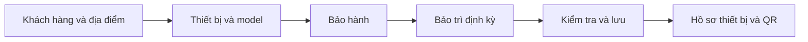

# Đề xuất luồng ghi nhận thiết bị đã bàn giao

Ngày: 31/10/2026. Bản 0.3. Trạng thái: **đã triển khai trên nhánh `feature/equipment-registration-handover`**.
Kết quả và phạm vi thực tế: [kiểm thử bàn giao](../testing/equipment-registration.md).
Đối chiếu code tại `develop`, `ca22f09` và các ADR hiện hành.
Không thay thế contract/ADR Accepted; phần API/schema mới bên dưới cần review
trước khi code. Lượt thiết kế này không đổi code, contract đã merge hay migration;
chỉ bổ sung contract nháp riêng để review.

Chi tiết DB, hai migration dự kiến, endpoint/payload, concurrency, wireframe và
ma trận kiểm thử đã được cụ thể hóa tại
[thiết kế kỹ thuật](equipment-registration-technical-design.md).
Các quyết định kiến trúc đề xuất được ghi ở [ADR 0012](../decisions/0012-equipment-registration.md).
OpenAPI: [equipment-registration.yaml](../api/equipment-registration.yaml).
Trong phạm vi triển khai đầu, chỉ thêm backend/migration ở Asset/Maintenance
và nối giao diện; dùng nguyên API Organization/Identity/Gateway hiện có.

## 1. Vấn đề và phạm vi

Hiện đã có API tạo Customer/Site/Contact trong Organization; Model/Equipment/
Warranty/QR trong Asset; Plan trong Maintenance. Web thật ở `App.tsx` chủ yếu
cho đọc Customer/Equipment; form customer sample chưa gọi API. Web chưa có
luồng thống nhất đưa thiết bị thực tế vào quản lý sau bán hàng.

Tên chức năng đề xuất: **Ghi nhận thiết bị đã bàn giao**.
Đây là ghi nhận thông tin từ việc bàn giao thực tế/chứng từ bên ngoài hệ thống.
Không triển khai đơn bán hàng, nhập kho thành phẩm, hóa đơn, thanh toán hoặc
quản lý tồn thiết bị. Kho Inventory tiếp tục chỉ phục vụ phụ tùng.

Mục tiêu: Service Manager nhập được một thiết bị từ đầu đến cuối, không cần
seed hoặc gọi API thủ công. Một thao tác nghiệp vụ trên giao diện có thể cần
nhiều transaction của các service; không hứa transaction xuyên database.

## 2. Các khái niệm trên giao diện

| Khái niệm | Ví dụ | Nguồn dữ liệu |
| --- | --- | --- |
| Tenant | Công ty cung cấp thiết bị An Tín | Organization |
| Customer | Công ty khách hàng Minh Phát | Organization |
| Customer Site | Nhà máy Bình Dương của Minh Phát | Organization |
| Location | Tầng 1 / phòng máy của nhà máy | Organization; không bắt buộc |
| Branch | Chi nhánh phục vụ của An Tín | Organization; không phải Customer Site |
| Equipment Model | Hãng X, dòng máy bơm PUMP-200 | Asset; danh mục trong từng tenant |
| Equipment | Máy PUMP-200, serial SN-001, mã TB-001 của Minh Phát | Asset; một bản ghi cho từng máy |
| Warranty | Khoảng thời gian và điều khoản bảo hành riêng của SN-001 | Asset |
| Maintenance Plan | Bảo trì SN-001 mỗi 3 tháng, kỳ đầu ngày cụ thể | Maintenance |

Một model có nhiều máy. Mỗi máy có serial, customer/site, ngày bàn giao,
bảo hành và kế hoạch thực tế riêng. Bảo hành và bảo trì là hai quyết định
độc lập: có bảo hành không đồng nghĩa tự động có bảo trì định kỳ hoặc miễn phí.

## 3. Điểm vào và các màn hình

Điểm vào thống nhất trên web:

- Danh sách **Thiết bị**: nút **Ghi nhận bàn giao**.
- Chi tiết **Khách hàng**: nút cùng tên, điền sẵn customer.
- Chi tiết **Địa điểm khách hàng**: điền sẵn customer/site.
- Chi tiết **Thiết bị**: **Hoàn thiện hồ sơ bàn giao**, nếu thiếu quyết định.

Các trang độc lập cần có để hỗ trợ luồng: Khách hàng (tạo/sửa/site/contact),
Danh mục model (list/tạo/sửa/ngừng dùng), Thiết bị (list/hồ sơ) và form bàn giao.
Không tạo một danh mục thiết bị khác song song với Equipment hiện tại.
Route thật và sample cần được thống nhất, tránh hai nút cùng tên nhưng một
nút dùng fixture. Route chuẩn dự kiến và alias cho đường dẫn cũ được liệt kê
ở mục 10 của thiết kế kỹ thuật.

Luồng chính là biểu mẫu 5 bước:



Quay lại bước trước giữ input. Đổi customer phải xóa/lựa chọn lại site,
location và thiết bị cũ phụ thuộc; không giữ quan hệ sai mà người dùng không biết.

## 4. Bước 1 — Khách hàng và nơi lắp đặt

Mặc định tìm customer có sẵn theo tên/mã; bổ sung tìm mã số thuế nếu API được
mở rộng. Kết quả hiển thị mã, tên, mã số thuế và trạng thái để tránh chọn nhầm.
Không tự tạo customer mới chỉ vì tên gần giống hoặc tên không khớp tuyệt đối.

Nếu chưa có, mở form **Thêm khách hàng** ngay trong luồng:

| Trường | Yêu cầu |
| --- | --- |
| Mã khách hàng | Bắt buộc; duy nhất trong tenant theo schema hiện tại |
| Tên doanh nghiệp | Bắt buộc |
| Mã số thuế | Tùy chọn; gợi ý kiểm tra trùng, không tự thêm unique constraint |
| Email / điện thoại / địa chỉ | Tùy chọn theo contract hiện tại |

Lưu Customer thành công rồi tự chọn bản ghi vừa tạo. Đây là dữ liệu danh mục
đã lưu thật; nếu hủy wizard, không tự xóa customer đó.

Tiếp theo chọn hoặc tạo **Customer Site**, bắt buộc để ghi nhận Equipment theo
schema hiện tại. Site mới cần mã, tên, địa chỉ; có thể đặt tên "Trụ sở chính"
nếu đó là nơi đặt máy thật. Không tạo site ảo để né field bắt buộc.
Chọn Location chi tiết là tùy chọn. Branch phục vụ mặc định cũng tùy chọn và
lấy từ danh sách chi nhánh nội bộ, không thay cho địa chỉ đặt thiết bị.

Có thể chọn/tạo Contact: tên, vai trò liên hệ, email/điện thoại, site liên quan.
Contact không tự trở thành tài khoản Customer Portal.
Customer/Site INACTIVE hoặc đã xóa không được chọn cho bàn giao mới; hiển thị
lý do và link quản lý thay vì tự kích hoạt lại.

## 5. Bước 2 — Chọn thiết bị đã có hoặc ghi nhận máy mới

Hai lựa chọn được đặt tên rõ ràng:

1. **Ghi nhận máy mới:** máy chưa có trong hệ thống sau bán hàng.
2. **Chọn máy đã có để hoàn thiện hồ sơ:** nhập thiếu bảo hành/bảo trì hoặc
   đang tiếp tục một lần lưu chưa hoàn tất.

### Máy mới

| Trường | Yêu cầu / hành vi |
| --- | --- |
| Model | Bắt buộc; tìm theo hãng, mã model, tên; chỉ chọn ACTIVE trong tenant |
| Mã thiết bị | Bắt buộc; duy nhất trong tenant; MVP nhập tay |
| Serial | Bắt buộc; unique theo tenant + model + serial hiện tại |
| Tên hiển thị | Tùy chọn; gợi ý từ model, có thể thêm vị trí để phân biệt |
| Ngày bàn giao thực tế | Bắt buộc để hoàn tất luồng này; khác ngày nhập hồ sơ |
| Ngày lắp đặt / đưa vào sử dụng | Tùy chọn; không tự đồng nhất với ngày bàn giao |
| Thông số / mô tả | Tùy chọn; chỉ các thông tin cần cho hỗ trợ kỹ thuật |
| Tình trạng vận hành | Mặc định UNKNOWN; không suy ra OPERATIONAL từ việc đã bàn giao |

Ngày bàn giao/lắp đặt/đưa vào sử dụng được khai là ngày thực tế thì không ở
tương lai. Không áp một thứ tự cứng giữa bàn giao và lắp đặt vì có thể giao
máy trước rồi lắp sau; các mốc bất thường cần người nhập kiểm tra. Luồng này
không có bước tạo lịch bàn giao trong tương lai.

Không bắt nhập giá bán, số đơn hàng hoặc số lượng tồn. Một máy = một Equipment.
MVP làm một máy mỗi lượt; nhiều máy cùng model được hỗ trợ bằng "Ghi nhận máy
tiếp theo", giữ customer/site/model và gợi ý điều khoản nhưng xóa serial/mã.
Không sao chép warranty/plan ID của máy trước.

Kiểm tra trùng mã hoặc serial ngay lúc nhập và kiểm tra lại ở backend/DB.
Nếu tìm thấy đúng máy đã có, đề nghị mở/hoàn thiện hồ sơ đó. Không tự tạo bản
thứ hai hoặc tự sửa model để vượt ràng buộc serial.

### Máy đã có

Chỉ chọn Equipment cùng tenant/customer đã chọn, không RETIRED. Không có
khái niệm "máy trống chưa bán" trong schema hiện tại: mỗi Equipment đã có
customer/site. Máy thuộc customer khác phải đi theo quy trình chuyển giao
riêng nếu sau này được yêu cầu; wizard này không âm thầm đổi chủ sở hữu.

Nếu chỉ chuyển site trong cùng customer, dùng thao tác di chuyển đã có với
xác nhận riêng và history/EquipmentMoved. Không thay site ngầm trong lúc
thêm bảo hành. Ngày bàn giao đã khai báo được giữ nguyên; chỉnh sai dữ liệu
phải hiển thị là thao tác chỉnh hồ sơ có audit.

Thiết bị đã có warranty/plan phải tải và hiển thị các bản ghi hiện tại.
Người dùng chọn giữ bản có sẵn; không tự cấp lại bảo hành hoặc tạo plan trùng
mỗi lần mở wizard. Hồ sơ đã đầy đủ dẫn về trang chi tiết.

## 6. Danh sách model lấy từ đâu?

**Do chính doanh nghiệp cung cấp thiết bị quản lý trong Asset Service.**
Nguồn nhập là catalogue, tài liệu kỹ thuật hoặc thông tin sản phẩm của doanh
nghiệp/hãng. Không phụ thuộc API hãng, danh mục toàn nền tảng hoặc Inventory.
Hai model do seed hiện tại chỉ là dữ liệu demo, không phải quy trình nghiệp vụ.

TENANT_ADMIN/SERVICE_MANAGER có `equipment:manage` tạo model với hãng, mã model,
tên, nhóm và mô tả. Có trang danh mục riêng và nút **Thêm model** trong bước 2;
lưu xong quay lại với model mới được chọn. CUSTOMER không được tự sửa danh mục.
Model INACTIVE không dùng cho đăng ký mới nhưng thiết bị cũ và lịch sử vẫn giữ.

Schema hiện tại chỉ có thông tin nhận diện model, **chưa có chính sách mặc
định theo model**. MVP nhập chính sách thực tế trong wizard là đủ.
Bổ sung sau có thể là các giá trị gợi ý đơn giản theo model (thời hạn/điều
khoản bảo hành, chu kỳ bảo trì); không cần service hoặc bộ rule policy riêng.
Nếu triển khai giá trị gợi ý, phải có contract/migration mới; chỉ dùng để điền
trước, người nhập xác nhận theo từng máy. Sửa model không đổi ngược warranty
hoặc Maintenance Plan đã lưu.

## 7. Bước 3 — Xác nhận bảo hành ngay khi ghi nhận bàn giao

Bắt buộc chọn một quyết định trước khi hoàn tất:

- **Có điều khoản bảo hành:** nhập/chọn khoảng bảo hành thực tế.
- **Không áp dụng bảo hành:** ghi rõ lý do, không tạo Warranty giả.
- Chưa xác định: chỉ được lưu hồ sơ chưa hoàn tất; không tự hiểu là không có.

"Lưu để hoàn thiện sau" chỉ tạo Equipment khi các trường nền bắt buộc đã đủ
(customer/site/model/mã/serial); không thêm máy thiếu định danh để giả làm
bản nháp. Những bước chưa lưu giữ input trong phiên làm việc và cảnh báo
trước khi rời. Tiến độ đã lưu trên server mở lại được từ hồ sơ thiết bị.

Nếu có bảo hành:

| Trường | Thiết kế |
| --- | --- |
| Loại | Ví dụ STANDARD/EXTENDED; thống nhất danh sách hiển thị khi review contract |
| Ngày bắt đầu | Gợi ý ngày bàn giao; có thể chọn ngày lắp đặt/đưa vào sử dụng hoặc ngày cụ thể theo điều khoản |
| Ngày kết thúc | Bắt buộc, lưu ngày thực tế; endDate >= startDate |
| Thời hạn tháng/năm | Có thể là công cụ gợi ý nhập ngày, không phải nguồn thứ hai mâu thuẫn với ngày đã xác nhận |
| Điều khoản hiển thị cho khách | Nội dung bảo hành, phạm vi, loại trừ, điều kiện áp dụng; không chứa ghi chú nội bộ |

Ngày kết thúc gồm cả ngày đó theo API hiện tại. Lưu startDate/endDate là kết
quả đã xác nhận; nếu có công cụ cộng tháng/năm, phải hiển thị preview và thống
nhất cách tính cuối tháng/năm nhuận trước khi code. Không tự lấy một quy tắc
tính ngày thay cho điều khoản thực tế.

Ví dụ: bàn giao 01/11/2026, thời gian đã xác nhận từ 01/11/2026 đến hết
31/10/2027. Nhập hồ sơ ngày khác không làm thay đổi hai mốc này.

Giữ quy tắc hiện tại: các Warranty ACTIVE không được chồng thời gian trên
cùng máy. Khi đã có warranty, mặc định giữ nguyên; thay điều khoản sai hoặc
gia hạn là thao tác quản lý riêng, giữ lịch sử, không ghi đè tự động.
Nhập dữ liệu cũ có bảo hành đã hết hạn vẫn hợp lệ; không reset từ ngày hôm nay.

Warranty calendar chỉ mô tả phạm vi ngày. Service Manager vẫn kiểm tra và
lưu quyết định bảo hành riêng khi review từng Service Request.

## 8. Bước 4 — Xác nhận bảo trì định kỳ

Bắt buộc chọn:

- **Có bảo trì định kỳ:** tạo/giữ Maintenance Plan cho máy.
- **Không thiết lập bảo trì định kỳ:** ghi lý do, ví dụ chỉ hỗ trợ khi phát
  sinh yêu cầu; không tạo plan PAUSED giả để biểu diễn lựa chọn này.
- Chưa xác định: hồ sơ chưa hoàn tất, cần Service Manager xử lý.

Khi tạo plan ban đầu:

| Trường | Thiết kế |
| --- | --- |
| Tên kế hoạch | Ví dụ "Bảo trì định kỳ máy bơm PUMP-200" |
| Chu kỳ | Giá trị dương + DAY/WEEK/MONTH/YEAR theo API hiện tại |
| Mốc tham chiếu | Ngày bàn giao/đưa vào sử dụng hoặc ngày người nhập chọn; dùng để gợi ý kỳ đầu |
| Kỳ bảo trì đầu tiên | Bắt buộc xác nhận; đây là nextDueDate/anchor đầu tiên gửi cho Maintenance |
| Nội dung công việc | Mô tả các việc cần làm; MVP không xây checklist engine |

Ví dụ bàn giao/đưa vào dùng 01/11/2026, mỗi 3 tháng, kỳ đầu 01/02/2027.
Không mặc định kỳ đầu là ngày bàn giao, vì scheduler có thể tạo Task/WO ngay.
MVP hiển thị kỳ đầu và chu kỳ đã xác nhận. Nếu bổ sung nhiều kỳ dự kiến,
phải dùng cùng quy tắc lịch với backend, không tính một lịch riêng ở frontend.

Khi đến hạn: scheduler → Task/outbox → WO tự động → Dispatcher phân công.
Đăng ký plan không có nghĩa đã hẹn giờ hoặc phân công Technician.
Hoàn thành muộn không đẩy lịch gốc theo ngày hoàn thành. Pause/resume,
catch-up và lịch tháng/năm theo ADR 0007/0009 và implementation hiện tại.

MVP chỉ tạo tối đa một plan ban đầu trong wizard; sau đó màn Maintenance vẫn
có thể quản lý thêm các plan khác nếu cần. Không thêm unique equipmentId
lên toàn bộ bảng Plan vì một máy có thể có nhiều kế hoạch nghiệp vụ khác nhau.

Với máy đã có plan, hiển thị chu kỳ/trạng thái/kỳ tiếp theo và chọn **Giữ kế
hoạch hiện tại**. Không tự resume plan PAUSED, không phục hồi INACTIVE và
không reset nextDueDate khi người dùng nhập lại hồ sơ. KEEP với INACTIVE chỉ
xác nhận lịch sử đã ngừng, phải hiện rõ rằng không có kỳ mới từ plan này.

Nếu nhập kỳ đầu trong quá khứ, phải cảnh báo chính xác catch-up hiện tại chỉ
sinh kỳ gần nhất đến hạn, không phục dựng mọi lần bảo trì cũ. Người dùng có
thể chọn ngày tương lai nếu bắt đầu quản lý từ nay. Không ghi đã bảo trì khi
chưa có report/history thật.

**Bảo trì không tự dừng theo ngày hết bảo hành.** Schema Plan hiện chưa có
endDate hoặc hợp đồng bảo trì có thời hạn. MVP là chu kỳ tiếp tục đến khi
manager tạm dừng/ngừng. Không trình bày "miễn phí 12 tháng/4 lần" như chức
năng đã hỗ trợ chỉ bằng cách ghi trong description; muốn tự động áp dụng
thời hạn/số lần/cước phí cần quyết định nghiệp vụ và contract riêng.

## 9. Bước 5 — Kiểm tra và kết quả

Trang kiểm tra hiển thị customer/site, model/serial/mã, ngày bàn giao,+khoảng bảo hành hoặc lý do không áp dụng, chu kỳ/kỳ đầu hoặc lý do không lập
plan. Có hai hành động: **Lưu để hoàn thiện sau** và **Hoàn tất ghi nhận**.

Chỉ báo hoàn tất sau khi các mục được yêu cầu đã được service sở hữu xác
nhận lưu. Nếu có bảo trì, phải có Plan đã tạo hoặc đã chọn giữ; không coi
thành công chỉ vì Equipment đã được tạo.

Trang kết quả dùng ngôn ngữ nghiệp vụ:

```text
Đã ghi nhận TB-001 — serial SN-001
Khách hàng: Minh Phát / Nhà máy Bình Dương
Bảo hành: 01/11/2026–31/10/2027
Bảo trì: mỗi 3 tháng / kỳ đầu 01/02/2027

[Mở hồ sơ] [Tạo / in QR] [Ghi nhận máy tiếp theo]
```

QR là bước hỗ trợ sau khi có thiết bị, không quyết định tính hợp lệ bàn giao.
Lỗi tạo/in QR không làm mất Equipment/Warranty/Plan. Cấp lại QR phải theo
hành vi revoke/reissue hiện tại và thông báo rõ, không gọi lặp âm thầm.

## 10. Phân quyền giữ theo catalog hiện tại

| Actor | Quyền trong luồng |
| --- | --- |
| SERVICE_MANAGER | Actor chính: customer/site/model/equipment/warranty/QR và Maintenance Plan |
| TENANT_ADMIN | Tạo/chỉnh khách hàng, model, thiết bị, bảo hành; chỉ đọc Maintenance, không được tạo plan |
| DISPATCHER/TECHNICIAN/INVENTORY_STAFF | Đọc theo quyền; không ghi nhận bàn giao mới |
| CUSTOMER_ADMIN/CUSTOMER_USER | Không khai báo bàn giao hoặc chính sách; đọc thiết bị thuộc customer theo quyền |

Tenant Admin có thể lưu phần Asset và bàn giao phần bảo trì cho Service
Manager; UI hiển thị **Cần Service Manager thiết lập bảo trì**. Không gọi
API Maintenance bằng token đặc quyền hoặc tự thêm role/quyền để vượt giới hạn.
Hoàn tất quyết định bảo trì trong luồng mới cần `maintenance:manage`; Tenant
Admin không tự đánh dấu "không cần" để né bước này. Đây là rule đề xuất cho
endpoint đăng ký mới, không khẳng định catalog hiện tại đã có rule đó.

Mời người dùng Portal là hành động tiếp theo riêng của TENANT_ADMIN hoặc
CUSTOMER_ADMIN theo Identity/RBAC hiện tại. Service Manager không có
`user:manage`, nên tạo Contact/email trong wizard không tự gửi lời mời.
Khách hàng có thể tồn tại và được bàn giao máy trước khi có tài khoản portal.

## 11. Ownership và cách lưu phù hợp microservices

| Dữ liệu | Service ghi |
| --- | --- |
| Customer/Site/Location/Contact | Organization |
| Model/Equipment/Warranty/QR và tiến độ ghi nhận hồ sơ | Asset |
| Maintenance Plan/Task, liên kết idempotent từ lần đăng ký | Maintenance |
| User/invite/membership | Identity + Organization theo luồng riêng hiện có |

Không thêm Handover Service, Sales Service hoặc workflow engine.
Customer/Site/Model được tạo qua API hiện có ngay khi người dùng lưu form
con và trở thành danh mục tái sử dụng; hủy wizard không xóa chúng.

Đề xuất phần bổ sung nhỏ, nhưng cần review API/schema ở cả Asset/Maintenance:

1. Asset có operation ghi nhận bàn giao; tên dự kiến `POST /equipment-registrations`
   (Gateway `/api/assets/equipment-registrations`). Hỗ trợ tạo máy hoặc hoàn
   thiện máy đã có; không tạo lại Equipment khi resume.
2. Asset kiểm tra scope/references và lưu Equipment + Warranty nếu có +
   quyết định/tiến độ đăng ký trong **một transaction asset_db**. Giữ trạng thái
   vận hành và lifecycle Equipment hiện tại, không thêm DRAFT/READY vào chúng.
3. Sau commit, nếu cần tạo/giữ Plan, Asset điều phối REST tới Maintenance bằng
   **token người đang thực hiện và correlation ID**, đúng ADR 0004. Maintenance
   vẫn kiểm tra quyền và xác thực Equipment qua Asset, rồi lưu DB của mình.
   Không giữ transaction Asset mở khi gọi Maintenance.
4. Maintenance dùng `sourceRegistrationId`/idempotency key bền vững cho plan
   ban đầu: cùng key/payload trả cùng Plan, khác payload trả 409. Unique theo
   tenant + source registration; không unique toàn bộ Plan theo Equipment.
5. Asset chỉ cập nhật bước bảo trì hoàn tất sau response/lookup đã xác minh
   của Maintenance; không tin `planId`/"đã xong" tự khai báo từ frontend.
6. Timeout/lỗi giữ registration đang thiếu bước; người có quyền mở lại và
   resume bằng ID cũ, đối soát trước khi tạo tiếp. Không POST lại cả chuỗi,
   không xóa máy/customer đã lưu để giả rollback xuyên service.

Các lựa chọn chỉ được sửa khi record còn DRAFT, với expectedVersion. Sau
submit, bản thiết kế chọn đóng băng input: PENDING chỉ được đối soát/resume
cùng dữ liệu. Không dùng lookup 404 để kết luận request cũ không còn chạy,
không đổi payload hoặc cấp key mới để tạo thêm Plan. Khi đã xác nhận Plan,
thay đổi chính sách dùng quy trình sửa Plan hiện có. Lỗi không thể tự phục
hồi phải hiển thị cần owner đối soát, không tự đánh hoàn tất.

Các route/field triển khai được mô tả trong OpenAPI bổ sung ở đầu tài liệu. Bản kỹ thuật quy định tên trường chính xác.
Có thể giữ các API create Equipment/Warranty/Plan riêng cho nghiệp vụ hiện có;
luồng mới cần tái sử dụng service/repository và validation, không nhân đôi rule.

Với thiết kế REST này không thêm event onboarding mới trong MVP. Không có
background worker tự dùng lại token người dùng; retry do người đang đăng nhập
thực hiện. Nếu sau này cần tự động hoàn tất khi không có người dùng, phải
thiết kế event/read model theo ADR thay vì lưu token hoặc chế machine token.
Event TaskDue/WO và EquipmentMoved tiếp tục dùng contract hiện hành.

## 12. Bổ sung dữ liệu đã triển khai

Schema hiện tại không phân biệt rõ "chưa nhập bảo hành" với "đã xác nhận
không áp dụng", hoặc "chưa lập plan" với "không có bảo trì định kỳ".
Chỉ làm form frontend không giải quyết được thiếu sót này.

Đề xuất một record tiến độ đăng ký ban đầu thuộc Asset, logical 1:1 với
Equipment, lưu:

- Ai và khi nào ghi nhận; ID lần đăng ký, key/fingerprint chống gửi lặp.
- Quyết định bảo hành: chưa xác nhận / đã ghi nhận / không áp dụng; lý do
  và Warranty ID tham chiếu khi có. Còn/hết hạn lấy từ Warranty hiện tại.
- Quyết định bảo trì: chưa xác nhận / có kế hoạch / không lập định kỳ; lý do,
  yêu cầu ban đầu và Plan ID logical reference đã xác minh.
- Tiến độ các bước và mã lỗi an toàn để resume. Không lưu JWT, signed URL
  hoặc lỗi DB/transport thô cho customer.

Record này mô tả quá trình thiết lập ban đầu, không sao chép toàn bộ trạng thái
Plan đang hoạt động. Sau hoàn tất, status/nextDueDate phải đọc từ Maintenance;
Warranty cũng lấy từ Asset, không lấy snapshot tiến độ làm nguồn hiện hành.
Equipment/Warranty/history ghi nguyên tử; `sourceRegistrationId` được lưu
nguyên tử cùng Plan/history trong Maintenance. Migration mới và amendment
ERD/ADR bắt buộc được review, không sửa migration đã merge.

Dữ liệu cũ: không có Warranty/Plan chưa đủ để suy ra "không áp dụng". Đánh
dấu chưa xác nhận để nhân viên rà soát; không tự bổ sung chính sách hoặc
lịch sử bàn giao. Warranty/Plan có sẵn được hiển thị và liên kết sau xác minh.

Không đề xuất default policy trên model là điều kiện bắt buộc cho lần triển
khai đầu. Form bàn giao chạy được với nhập thủ công và các entity hiện tại;
thêm gợi ý theo model là cải tiến sau khi luồng thật đã ổn định.

## 13. Tình huống lỗi phải thiết kế ngay

| Tình huống | Phản hồi mong muốn |
| --- | --- |
| Hủy sau khi đã tạo customer/model | Giữ danh mục đã lưu, thông báo rõ; không tạo Equipment nếu chưa xác nhận lưu |
| Trùng mã/serial hoặc double click | Không tạo máy thứ hai; giữ input, mở máy cũ nếu đúng scope |
| Warranty overlap | Rollback phần thay đổi Asset của lần submit; giữ form để sửa/giữ warranty có sẵn |
| Maintenance không hoạt động | Equipment/bảo hành đã lưu; banner "Bảo trì chưa thiết lập", có mở lại/tiếp tục |
| Maintenance đã tạo Plan nhưng mất response | Retry cùng registration/key nhận Plan cũ; không tạo Plan thứ hai |
| Token/quyền đổi trước resume | Kiểm tra lại; không thực hiện bước mới ngoài quyền |
| ID ngoài tenant/customer/site/model sai | Backend từ chối; không chỉ lọc option ở web |
| Máy RETIRED hoặc danh mục INACTIVE | Không đăng ký mới/khôi phục ngầm; hướng tới trang quản lý |
| QR lỗi sau lưu | Chỉ bước QR cần thử lại; không chạy lại tạo máy/bảo hành/plan |
| Nhập máy đã bàn giao từ lâu | Giữ ngày thật, bảo hành có thể đã hết hạn; cảnh báo catch-up bảo trì |

## 14. Phạm vi triển khai và nghiệm thu đề xuất

Ưu tiên một máy end-to-end trước: Customer/Site thật → Model thật → Equipment
+ Warranty → Plan nếu áp dụng → hồ sơ/QR → Customer xem đúng thiết bị.
Đồng thời hỗ trợ chọn danh mục đã có và thêm nhanh danh mục còn thiếu.

Nghiệm thu tối thiểu:

- Tạo mới từ danh mục rỗng và dùng lại customer/site/model đã có; tất cả qua Gateway.
- Hai serial cùng model tạo hai máy riêng; cùng serial/model không tạo trùng.
- Chọn đúng máy đã có không reset ngày bàn giao, warranty, plan hoặc lịch sử.
- Hai lựa chọn có/không của bảo hành và bảo trì được lưu rõ; chưa xác định không
  hiển thị là đã hoàn tất hoặc đã xác nhận không áp dụng.
- Warranty đúng ngày/điều khoản, không chồng kỳ; Plan đúng chu kỳ/kỳ đầu.
- Mất response, resume, reload trang và submit đồng thời không tạo máy/plan trùng.
- Service Manager hoàn tất luồng; Tenant Admin không tạo plan hoặc tự mời user
  qua quyền của Service Manager; Customer không tự thay chính sách.
- Customer User đọc được thiết bị và bảo hành theo scope; Customer Admin đọc
  Maintenance theo catalog, Customer User không được mở quyền Maintenance mới.
- Scheduler sinh Task/WO tại kỳ đầu đã xác nhận, không ngay ngày nhập chỉ vì
  frontend chọn sai mặc định. Không tự giả lập dữ liệu bảo trì trong quá khứ.

Sau khi luồng này đạt mới cân nhắc defaults theo model, nhập nhiều serial
trong một lượt hoặc import file. Không thêm module bán hàng, hợp đồng phức
tạp, chuyển chủ thiết bị hoặc bảo trì tính theo giờ chạy trong phạm vi này.
