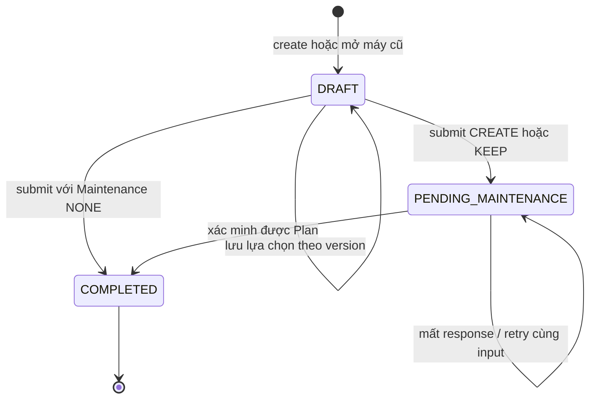

# Thiết kế kỹ thuật — Ghi nhận thiết bị đã bàn giao

Ngày 31/10/2026. Baseline `develop@ca22f09`. Trạng thái **đã triển khai trên nhánh `feature/equipment-registration-handover`**. Bổ sung chi tiết cho
[luồng nghiệp vụ và màn hình](equipment-registration-and-handover.md).
Hai migration additive đã áp dụng trên database local và test. Xem [kết quả kiểm tra](../testing/equipment-registration.md).

Contract máy đọc được: [equipment-registration.yaml](../api/equipment-registration.yaml).
Quyết định kiến trúc: [ADR 0012](../decisions/0012-equipment-registration.md).
API này bổ sung cho contract Asset/Maintenance hiện tại, không sửa hoặc
ghi đè endpoint đã merge.

## 1. Phương án được chọn trong bản thiết kế

- Tái sử dụng Customer/Site/Location/Contact của Organization, Model/Equipment/
  Warranty/QR của Asset và Plan/Task của Maintenance.
- Backend chỉ bổ sung nghiệp vụ trong Asset và Maintenance. Không sửa quyền,
  Identity, Organization, Gateway hoặc event contract để làm luồng này.
- Hai migration mới: một bảng trong Asset và ba cột trong Maintenance, kèm
  ràng buộc/index. Không thêm service, không đổi các trạng thái Equipment/WO.
- Asset điều phối REST theo token người đang thao tác, sau khi commit local.
  Maintenance vẫn tự xác thực và chỉ ghi maintenance_db.
- Một lần thiết lập ban đầu cho mỗi Equipment; tối đa một Plan được tạo/liên
  kết qua lần thiết lập đó. Các Plan tạo từ nghiệp vụ khác vẫn được giữ nguyên.
- Đóng băng lựa chọn sau submit. Resume chỉ tiếp tục cùng yêu cầu; không sửa
  nội dung một lệnh đang có kết quả chưa xác định.

Không triển khai default policy theo model, thiết bị trong kho chưa bán,
chuyển chủ sở hữu, đơn hàng, hợp đồng bảo trì tính phí hoặc import hàng loạt.

## 2. Ranh giới giao dịch

```mermaid
sequenceDiagram
    actor U as Service Manager
    participant W as Web / Gateway
    participant A as Asset
    participant AD as asset_db
    participant M as Maintenance
    participant MD as maintenance_db
    U->>W: Lưu hồ sơ / hoàn tất
    W->>A: Tạo draft rồi submit
    A->>AD: TX: Equipment + registration; sau đó Warranty + đóng băng lựa chọn
    AD-->>A: Commit trước mọi lệnh tạo Plan
    A->>M: PUT internal theo registrationId, token người gọi
    M->>A: GET internal: lựa chọn đã đóng băng và tham chiếu Equipment
    A-->>M: Dữ liệu đã kiểm tra scope
    M->>MD: TX: tìm kết quả cũ hoặc tạo/liên kết một Plan + history
    MD-->>M: Commit
    M-->>A: Plan ID và fingerprint đã xác minh
    A->>AD: TX: hoàn tất registration
    A-->>W: COMPLETED hoặc PENDING_MAINTENANCE nếu chưa xác nhận được
```

Các TX trong sequence là giao dịch riêng biệt. Đường GET nội bộ quay về Asset
không bị giữ bởi một transaction Asset đang chờ HTTP. Không có cross-DB query/FK.
Không giữ JWT trong record, job hoặc log; không có worker dùng token cũ để retry.

## 3. Migration Asset

Tên dự kiến `<timestamp>_equipment_registration`, tạo mới sau migration mới
nhất tại thời điểm implementation. Không sửa SQL migration cũ.

### 3.1. Bảng equipment_registrations

| Cột | Kiểu / ý nghĩa |
| --- | --- |
| id | UUID PK, ID lần thiết lập ban đầu |
| tenant_id | UUID NOT NULL, từ principal |
| equipment_id | UUID NOT NULL, thiết bị thật đã tồn tại trong Asset |
| status | VARCHAR(30), DRAFT / PENDING_MAINTENANCE / COMPLETED |
| version | INTEGER NOT NULL DEFAULT 1, optimistic concurrency |
| create_actor_id | UUID NOT NULL, logical Identity reference |
| create_key | UUID NOT NULL, Idempotency-Key của POST đầu tiên |
| create_request_hash | CHAR(64) NOT NULL, hash request POST đầu tiên |
| warranty_decision | VARCHAR(20), UNCONFIRMED / CREATE / KEEP / NONE |
| warranty_payload | JSONB nullable, input CREATE hoặc ID KEEP đã validate |
| warranty_reason | TEXT nullable, bắt buộc khi NONE |
| warranty_id | UUID nullable, Warranty thực tế sau submit; không ghi chỉ vì đã nhập form |
| maintenance_decision | VARCHAR(20), UNCONFIRMED / CREATE / KEEP / NONE |
| maintenance_payload | JSONB nullable, input Plan hoặc ID Plan cần giữ |
| maintenance_reason | TEXT nullable, bắt buộc khi NONE |
| maintenance_input_hash | CHAR(64) nullable, input đóng băng sau submit CREATE/KEEP |
| maintenance_plan_id | UUID nullable, logical reference được Maintenance xác nhận |
| submitted_by / submitted_at | UUID / TIMESTAMPTZ nullable, người đóng băng yêu cầu |
| completed_by / completed_at | UUID / TIMESTAMPTZ nullable, người xác nhận kết quả cuối |
| updated_by | UUID NOT NULL, người thay đổi draft/phase gần nhất |
| last_attempt_at | TIMESTAMPTZ nullable, lần gần nhất thử bước Maintenance |
| last_error_code | VARCHAR(80) nullable, allowlist lỗi nghiệp vụ an toàn |
| created_at / updated_at | TIMESTAMPTZ NOT NULL, thời gian server |

JSONB có schema DTO xác định tại API; không phải nơi nhận dữ liệu tự do.
Không sao chép toàn bộ Equipment/Plan/Warranty vào registration làm nguồn hiện
hành. Nội dung payload đóng băng là ý định ban đầu phục vụ đối soát.

### 3.2. Constraint và index

- Unique `(tenant_id, equipment_id)`: chỉ một lần thiết lập ban đầu cho máy.
- Unique `(tenant_id, create_actor_id, create_key)`: nhận lại kết quả POST khi
  mất response. Reuse cùng key với request khác trả 409.
- Composite FK `(tenant_id, equipment_id)` → `equipments(tenant_id,id)`, RESTRICT.
- Bổ sung unique `(tenant_id,equipment_id,id)` trên `warranties`; FK
  `(tenant_id,equipment_id,warranty_id)` → đúng Warranty của đúng máy/tenant.
  `warranty_id=NULL` hợp lệ trước khi submit hoặc khi NONE.
- Không FK tới Identity, Organization hoặc Maintenance.
- CHECK status/decision thuộc danh mục trên, version > 0.
- CHECK NONE có reason không trắng và không có payload; UNCONFIRMED không có
  payload/reason; CREATE/KEEP có object payload và không dùng reason của NONE.
- CHECK DRAFT chưa có submitted/completed/hash/planId/warrantyId đã áp dụng.
- CHECK status khác DRAFT có submitted_by/at, warranty đã xác nhận; CREATE/KEEP
  của Warranty có warranty_id, NONE không có warranty_id.
- CHECK PENDING_MAINTENANCE chỉ với quyết định CREATE/KEEP, có hash và chưa có
  completed/planId. COMPLETED có completed_by/at; CREATE/KEEP có hash+planId,
  NONE không có hash/planId. Quyết định bảo trì không được UNCONFIRMED khi submit.
- Index `(tenant_id,status,updated_at)` cho danh sách cần hoàn thiện.

SQL CHECK quản lý hình dạng và tính nhất quán local; service kiểm tra payload
chi tiết, quyền, lịch/ngày, overlap và logical ownership. Không chỉ dựa JSONB.

### 3.3. Dữ liệu cũ và compatibility

Không backfill hàng loạt: Equipment cũ chưa có registration được đọc là
`NOT_RECORDED` (giá trị response suy ra, không phải Equipment.status mới).
Không suy diễn thiếu Warranty/Plan là NONE và không tự tạo lại chính sách.
Khi người có quyền chọn hoàn thiện máy cũ mới tạo record DRAFT, tải dữ liệu
hiện có để người đó xác nhận KEEP/CREATE/NONE.

Các API cũ `POST /equipment`, Warranty riêng và cập nhật hồ sơ vẫn tồn tại.
Chúng không được mặc nhiên đánh dấu đã hoàn tất lần thiết lập ban đầu.
Registration sau COMPLETED là biên nhận thiết lập; Warranty bị void hoặc Plan
bị pause/inactive về sau không xóa lịch sử hoàn tất, trạng thái hiện hành đọc
từ service sở hữu. Không dùng registration thay cho quyền tạo Service Request.

## 4. Migration Maintenance

Tên dự kiến `<timestamp>_maintenance_plan_registration_link`:

| Cột thêm vào maintenance_plans | Kiểu |
| --- | --- |
| setup_registration_id | UUID NULL, logical Asset reference |
| setup_input_hash | CHAR(64) NULL, fingerprint lựa chọn đã xác nhận |
| setup_linked_at | TIMESTAMPTZ NULL |

Unique `(tenant_id,setup_registration_id)`; các Plan không thuộc luồng mới
giữ NULL và không xung đột nhau. CHECK cả ba cột cùng NULL hoặc cùng có giá trị.
Không FK sang Asset, không unique equipment_id, không reset Plan cũ, không
thêm cột vào Task và không thay đổi scheduler/event.

Metadata này dùng cả khi CREATE lẫn KEEP; không diễn giải thành tuyên bố rằng
Plan KEEP đã được tạo bởi lần đăng ký mới. Bản ghi KEEP chỉ được gắn sau khi
kiểm tra đúng Equipment/tenant và không thuộc lần đăng ký khác.

Giữ liên kết/hash cho MVP, không purge theo TTL khiến retry có thể tạo trùng.

## 5. Trạng thái và điều kiện hoàn tất



Không tự chuyển PENDING về DRAFT sau timeout/404 lookup; một request cũ có
thể vẫn đang chạy. Không đổi CREATE thành NONE để che bước chưa biết kết quả.
Trong phạm vi MVP, input đã submit bất biến; lỗi cấu hình/permanent cần owner
đối soát nguyên nhân, không cấp khóa khác để vượt qua. Sửa nhu cầu bảo trì
sau khi Plan được xác nhận dùng API quản lý Plan hiện tại.

Lựa chọn KEEP chấp nhận Plan hiện có, kể cả lịch sử PAUSED/INACTIVE nếu người
nhập xác nhận rõ trạng thái đó; không tự resume và không hứa có lịch sắp tới.
CREATE tạo ACTIVE theo behavior hiện có. Nếu kỳ đầu đã đến hạn, scheduler có
thể sinh Task/WO ngay cả khi bước xác nhận cuối ở Asset còn chờ response;
registration không phải cổng bật/tắt scheduler.

Hoàn tất cần: Equipment không RETIRED; ngày bàn giao đã ghi nhận, các ngày
thực tế không tương lai; đúng customer/site; Warranty CREATE/KEEP hợp lệ hoặc
NONE có lý do; Maintenance đã xác nhận Plan hoặc NONE có lý do; actor có đủ quyền.
Không tự đặt operationalStatus thành OPERATIONAL.

Trước submit NONE, Asset đọc Plan ACTIVE/PAUSED của Equipment qua API
Maintenance hiện có bằng token caller. Nếu có thì yêu cầu KEEP hoặc xử lý Plan
ở màn hình sở hữu trước; nếu nguồn không đọc được thì giữ DRAFT và báo lỗi.
Đây là xác nhận tại thời điểm thiết lập, không phải distributed lock chặn
người khác tạo Plan sau đó. Lịch sử INACTIVE vẫn được hiển thị. Trong Asset
transaction, NONE Warranty không được che một Warranty chưa VOID; hết hạn
không có nghĩa chưa từng khai báo, nên mặc định chọn KEEP lịch sử đó.

## 6. API mới của Asset

Public base qua Gateway: `/api/assets`. Chỉ TENANT_STAFF có
`equipment:manage` đọc/ghi các registration; không trả raw draft/payload/error
nội bộ cho CUSTOMER. Warranty decision thêm `warranty:manage`; thay lựa chọn
Maintenance hoặc submit/resume thêm `maintenance:manage`. Không thêm permission.

| Method / path trong Asset | Mục đích / kết quả |
| --- | --- |
| POST /equipment-registrations | Tạo DRAFT và Equipment mới hoặc gắn Equipment có sẵn; 201 |
| GET /equipment-registrations | List scoped, pagination, status/equipmentId; createKey giới hạn chính actor tạo để đối soát POST; 200 |
| GET /equipment-registrations/{id} | Tiến độ, input, version, allowedActions và lỗi an toàn; 200 |
| PATCH /equipment-registrations/{id} | Lưu lựa chọn DRAFT với expectedVersion; 200 |
| POST /equipment-registrations/{id}/submit | Áp dụng Warranty, đóng băng lựa chọn và thử bước Maintenance; 200 COMPLETED hoặc 202 PENDING |
| POST /equipment-registrations/{id}/resume | Tiếp tục input đã submit; 200 COMPLETED hoặc 202 PENDING |
| GET /internal/equipment-registrations/{id}/maintenance-input | Projection hẹp, immutable cho Maintenance; cần equipment:manage + maintenance:manage |

`POST` đầu tiên bắt buộc header `Idempotency-Key: <UUID>`; method/body lạ bị
từ chối. GET không tự chạy mutation hoặc gọi resume. `submit` cần
`expectedVersion`; `resume` body rỗng, chỉ tiếp tục bản đã đóng băng.

### 6.1. Request tạo draft máy mới

```json
{
  "equipment": {
    "mode": "NEW",
    "data": {
      "modelId": "00000000-0000-4000-8000-000000001001",
      "customerId": "00000000-0000-4000-8000-000000000101",
      "customerSiteId": "00000000-0000-4000-8000-000000000401",
      "assetCode": "TB-2026-001",
      "serialNumber": "PUMP-SN-001",
      "displayName": "Máy bơm khu A",
      "handoverDate": "2026-10-01"
    }
  },
  "warranty": {
    "mode": "CREATE",
    "startDate": "2026-10-01",
    "endDate": "2027-09-30",
    "warrantyType": "STANDARD",
    "terms": "Điều khoản đã xác nhận cho máy này"
  },
  "maintenance": {
    "mode": "CREATE",
    "name": "Bảo trì máy bơm mỗi 3 tháng",
    "description": "Kiểm tra và vệ sinh theo hướng dẫn thiết bị",
    "frequencyUnit": "MONTH",
    "frequencyValue": 3,
    "nextDueDate": "2027-01-01"
  }
}
```

POST chỉ lưu Equipment + input draft + registration/history, chưa tạo
Warranty/Plan. Có thể bỏ warranty/maintenance để mặc định UNCONFIRMED khi lưu
để hoàn thiện sau. TENANT_ADMIN không gửi quyết định Maintenance đã xác nhận.
Không cho client gửi tenantId, actor/status/version/hash hoặc các setup_*.

Máy cũ dùng `equipment: {mode:"EXISTING",id:<UUID>}`, không gửi data ghi đè
customer/model/site. Nếu đã có registration thì 409 REGISTRATION_ALREADY_EXISTS
và trả ID chỉ sau kiểm tra tenant/quyền; frontend mở record đó.

Warranty/maintenance là union có phân biệt mode:

| Mode | Warranty | Maintenance |
| --- | --- | --- |
| UNCONFIRMED | Không có trường chính sách | Không có trường kế hoạch |
| CREATE | startDate/endDate/warrantyType/terms | name/description/frequencyUnit/frequencyValue/nextDueDate |
| KEEP | warrantyId | planId |
| NONE | reason 1–2000 ký tự sau trim | reason 1–2000 ký tự sau trim |

KEEP phải cùng Equipment/tenant, kiểm tra lại khi submit hoặc liên kết Plan.
Warranty VOID không dùng KEEP; warranty hết hạn vẫn là thông tin lịch sử hợp
lệ để xác nhận. NONE không được che Warranty/Plan đã có mà chưa đối soát.
Nếu đã có các bản ghi liên quan, người nhập được chỉ dẫn giữ/quản lý chúng;
wizard không tự void/ẩn/xóa hoặc thay lịch sử.

### 6.2. PATCH và submit

```json
{
  "expectedVersion": 1,
  "warranty": { "mode": "NONE", "reason": "Theo thỏa thuận bàn giao không áp dụng bảo hành" },
  "maintenance": { "mode": "NONE", "reason": "Chỉ xử lý theo yêu cầu khi phát sinh" }
}
```

Đây là ví dụ một draft chưa áp dụng Warranty/Plan, không phải cách hủy chính
sách đang tồn tại. PATCH thay nguyên object lựa chọn được gửi, không merge
các field của mode cũ. Không gửi object thì giữ lựa chọn hiện tại.

```json
{ "expectedVersion": 2 }
```

Body trên dành cho submit. Response tối thiểu:

```json
{
  "id": "00000000-0000-4000-8000-000000009001",
  "equipmentId": "00000000-0000-4000-8000-000000009101",
  "status": "PENDING_MAINTENANCE",
  "version": 3,
  "warrantyId": "00000000-0000-4000-8000-000000009201",
  "maintenancePlanId": null,
  "lastErrorCode": "MAINTENANCE_RESULT_UNKNOWN",
  "allowedActions": ["resume"],
  "completedAt": null
}
```

Status 202 nghĩa Asset đã nhận/lưu bước local nhưng chưa xác nhận được bước
Maintenance, không hứa worker đang tự chạy. UI không hiện "Đã hoàn tất".
Sau lỗi trước Asset commit: 4xx/5xx chuẩn và không ghi nửa Equipment/Warranty.
Sau commit: trả registration PENDING với mã an toàn, không trả lỗi làm client
hiểu rằng chưa lưu gì. Crash/mất response: GET/POST replay để đối soát.

### 6.3. Idempotency, khóa và replay

POST tạo hash từ input đã chuẩn hóa (UUID lowercase, date-only, trim theo DTO,
null/default và thứ tự key cố định). Không đưa token, correlationId vào hash.
Key chỉ scoped theo tenant+actor+operation; cùng key khác hash → 409.
Replay cùng hash trả cùng registration/Equipment và trạng thái hiện tại,
không tạo history hoặc reset input. Không cleanup key trong MVP.

Để ghi đổi lựa chọn/submit: lấy khóa Equipment trước, registration sau; đọc
lại tenant/status/version/reference dưới khóa, rồi mới Warranty theo thứ tự
hiện tại. Hai submit cùng version chỉ một lệnh áp dụng Warranty và chuyển
phase. Lệnh còn lại trả 409 để client GET lại, không áp dụng lần hai.

`version` tăng khi sửa draft hoặc đổi phase. last_attempt/error không làm
thay nội dung đã đóng băng; cập nhật chúng có điều kiện status vẫn PENDING.
Resume sau COMPLETED trả biên nhận hiện tại, không gọi lại tạo Plan.

Nếu cần tái sử dụng repository, tách các helper nhận TransactionClient;
không gọi hàm tự mở transaction riêng từ bên trong transaction đang ghi hồ sơ.
Kiểm tra Organization qua API không tạo transaction xuyên DB; không gọi
Maintenance trước khi Asset commit xong.

## 7. API nội bộ Maintenance và chống tạo Plan trùng

Hai route mới trong Maintenance, Gateway tiếp tục chặn `/internal`:

| Method / path | Hành vi |
| --- | --- |
| PUT /internal/equipment-registrations/{registrationId}/maintenance-plan | Tạo/liên kết đúng một Plan, hoặc trả kết quả cũ |
| GET /internal/equipment-registrations/{registrationId}/maintenance-plan | Lookup kết quả local để đối soát; không mutate |

Cần TENANT_STAFF + `maintenance:manage`; PUT không nhận plan payload từ
client. Maintenance gọi Asset projection bằng token người gọi để lấy ý định
đã submit. Projection kiểm tra tenant/quyền, phase PENDING/COMPLETED và chỉ
trả registrationId, equipmentId, quyết định CREATE/KEEP, input Plan, hash.
Không trả warranty reason/terms/draft khác hoặc token.

Fingerprint đóng băng gồm marker schema `registration-plan.v1`, registrationId,
Equipment ID và quyết định/config/Plan ID. Không gồm current site/version,
current nextDueDate/status của Plan KEEP hoặc các field thay đổi sau này.

PUT thực hiện preflight ngoài transaction: xác thực source qua Asset API,
đọc thử kết quả local và khi chưa thấy kết quả thì lấy Equipment reference
hiện tại. Không nhận tenant từ path/body/header riêng. Sau đó vào transaction:

1. Lấy advisory lock theo tenant+registration, đọc lại kết quả local dưới khóa.
2. Nếu đã có setup_registration_id, so Equipment/hash. Khớp thì trả Plan đó
   với replay=true; khác thì 409, không chỉnh ngược lịch/tên/trạng thái Plan.
3. Nếu vẫn chưa có, tái dùng snapshot version merge/lock của Plan creation
   hiện tại hoặc khóa Plan cần KEEP và xác minh scope hiện tại.
4. CREATE: ghi Plan với anchor=nextDueDate, metadata setup và PLAN_CREATED
   history cùng transaction. KEEP: khóa Plan, xác minh tenant/Equipment và
   liên kết chưa bị claim; chỉ thêm metadata+history liên kết, không sửa lịch.
5. Commit, trả registrationId, equipmentId, planId, setupInputHash, replay. Asset
   so đủ các identity/hash trước cập nhật COMPLETED.

Các bước trên mô tả thứ tự quyết định; HTTP lookup phải ở ngoài TX khóa của
Maintenance. Advisory lock/unique vẫn phải kiểm tra lại khi vào TX, kể cả khi
preflight vừa thấy chưa có Plan. Không giữ khóa rồi chờ một request Asset
đang giữ khóa ngược lại.

GET lookup không có kết quả trả 404; Asset không dùng 404 để mở khóa sửa input.
Sau timeout có thể gọi lại PUT cùng ID, bảo đảm kết quả hội tụ. KHÔNG dùng
POST /maintenance-plans thường để retry một lần setup chưa rõ kết quả.

CREATE phải từ chối Equipment RETIRED theo rule hiện tại. Khi replay một kết
quả đã commit, không tạo lại hoặc làm mất biên nhận chỉ vì Equipment/Plan đã
thay đổi trạng thái sau đó. Cập nhật Site dùng current Equipment snapshot và
quy tắc EquipmentMoved có version; không ghi đè bằng snapshot cũ từ form.

## 8. Bổ sung response/API nhỏ phục vụ giao diện

- Equipment list/detail cho staff bổ sung `registrationStatus` suy từ relation
  (NOT_RECORDED/DRAFT/PENDING_MAINTENANCE/COMPLETED) và registrationId phù hợp
  quyền; thêm filter registrationStatus để tìm hồ sơ thiếu. Không đổi status.
- Customer chỉ thấy nhãn an toàn "Hồ sơ dịch vụ đang hoàn thiện" khi phù hợp;
  không expose draft, hash, createKey, lỗi nội bộ hoặc actor IDs của registration.
- Model list dùng q/status/page hiện có. Không tạo GET /models mới trùng API.
- Tìm Equipment serial dùng q hiện có rồi kiểm tra chính xác; có thể bổ sung
  filter serialNumber/modelId ngay trong Asset nếu cần lookup chính xác.
- Preview lịch trên web MVP chỉ cần ngày kỳ đầu+chu kỳ. Các kỳ kế tiếp nếu
  hiển thị phải lấy rule server; không viết một lịch khác ở frontend. Có thể
  bổ sung endpoint preview đọc trong Maintenance ở đợt sau.
- API Organization hiện có đủ create/select; không mở rộng tìm mã số thuế,
  tự sinh mã hoặc bulk import trong đợt này.

## 9. Mã lỗi và trạng thái UI

| HTTP / code | UI |
| --- | --- |
| 400 VALIDATION_FAILED | Giữ form, chỉ lỗi tại trường/mode liên quan |
| 401/403 | Trước commit không ghi; yêu cầu đăng nhập/đúng quyền; không đổi tài khoản ngầm |
| 404 REGISTRATION_NOT_FOUND | Không phân biệt ID sai với ngoài tenant |
| 409 REGISTRATION_ALREADY_EXISTS | Mở record cũ sau xác minh scope |
| 409 IDEMPOTENCY_KEY_REUSED | Giữ request/key gốc để đối soát; không tự tạo key mới |
| 409 REGISTRATION_VERSION_CONFLICT | Giữ input chưa gửi; chặn ghi đè và yêu cầu người dùng chủ động tải bản đã lưu trước khi sửa tiếp |
| 409 REGISTRATION_INPUT_FROZEN | Chỉ cho kiểm tra/tiếp tục; không sửa dữ liệu đang xử lý |
| 409 WARRANTY_OVERLAP | Giữ draft, chọn Warranty hiện có hoặc sửa khoảng trước submit |
| 409 REGISTRATION_PLAN_CONFLICT | Không tạo Plan khác; hiển thị cần đối soát |
| 422 EQUIPMENT_RETIRED / reference không hợp lệ | Không tự kích hoạt lại hoặc đổi owner |
| 202 PENDING + MAINTENANCE_UNAVAILABLE / MAINTENANCE_RESULT_UNKNOWN | "Thiết bị và bảo hành đã lưu; bảo trì chưa được xác nhận" + Tiếp tục |

Sau Asset commit nếu upstream trả 401/403/422, phản ánh ở lastErrorCode an
toàn của PENDING và hướng dẫn đúng actor/đối soát. Không giả giao dịch Asset
đã rollback. Bảng lỗi không đưa stack, SQL hoặc body nguồn thô ra UI.

## 10. Thiết kế màn hình và đường dẫn

Route chuẩn mới thuộc khu `/app`; alias cũ giữ chuyển hướng khi phù hợp,
không còn page thật/sample cùng tên cho nhóm tính năng này:

| Route dự kiến | Nội dung |
| --- | --- |
| /app/customers | List thật, search/page theo backend, Thêm khách hàng |
| /app/customers/new | Form create gọi Organization thật |
| /app/customers/:id | Chi tiết, site/location/contact thật, Ghi nhận bàn giao |
| /app/equipment-models | Model list thật và tạo model |
| Form trong /app/equipment-models | Sửa thông tin/status qua modal; không tạo route detail khi API chưa có GET model detail |
| /app/equipment | List thật, nhãn tiến độ hồ sơ, nút Ghi nhận bàn giao |
| /app/equipment-registrations/new | Wizard chưa có record server |
| /app/equipment-registrations/:id | Tiếp tục DRAFT/PENDING hoặc biên nhận COMPLETED |
| /app/equipment/:id | Dossier hiện có + tiến độ/đường dẫn hoàn thiện |

Các path /equipment, /customers cũ tiếp tục được giữ để tương thích; menu staff dùng route /app chuẩn. CUSTOMER giữ portal và read scope hiện có. Không
redirect Customer User tới trang quản trị chỉ vì trùng tên route.

### 10.1. Wireframe biểu mẫu

```text
Ghi nhận thiết bị đã bàn giao                      Lưu để hoàn thiện sau

[1 Khách hàng] — [2 Thiết bị] — [3 Bảo hành] — [4 Bảo trì] — [5 Kiểm tra]

Khách hàng  [ Tìm tên hoặc mã... v ]  [+ Thêm khách hàng]
Địa điểm    [ Chọn nơi đặt máy   v ]  [+ Thêm địa điểm]
Vị trí      [ Tùy chọn           v ]
Liên hệ     [ Chọn / thêm người liên hệ ]

Thông tin đã chọn: mã KH / tên / địa chỉ đặt máy

                                         [Quay lại] [Tiếp tục]
```

```text
Thiết bị
(*) Ghi nhận máy mới  ( ) Hoàn thiện máy đã có

Model       [ Hãng / mã / tên... v ]  [+ Thêm model]
Mã thiết bị [ TB-2026-001             ]
Serial      [ PUMP-SN-001             ]  kiểm tra trùng
Bàn giao    [ 01/10/2026              ]
Lắp đặt     [ tùy chọn                ]
Đưa vào dùng[ tùy chọn                ]

Bảo hành
(*) Có điều khoản  ( ) Không áp dụng  ( ) Chưa xác định
[Ngày bắt đầu] [Ngày kết thúc] [Loại] [Điều khoản cho khách]

Bảo trì
(*) Định kỳ  ( ) Không lập định kỳ  ( ) Chưa xác định
[Mỗi 3] [Tháng]  [Kỳ đầu 01/01/2027]
Đến hạn hệ thống tạo công việc; lịch này chưa phải lịch hẹn đã phân công.
```

Thêm nhanh Customer/Site/Model dùng modal/drawer có submit/error riêng; lưu
thành công mới đóng, chọn record mới. Hủy không xóa input wizard. Không tạo
Customer giả/Model giả để vượt trường bắt buộc. Customer/Site đã lưu giữ lại
nếu wizard bị hủy và UI thông báo trước khi lưu form con.

Wizard giữ input cục bộ trong component khi đổi bước; chỉ persist draft lên
server khi người dùng chọn lưu. Không lưu policy/contact plaintext vào
localStorage lâu dài. URL không chứa token hoặc toàn bộ dữ liệu form.

Khi lưu lần đầu: tạo UUID key một lần, giữ request gốc trong bộ nhớ khi chưa
biết kết quả. Timeout thì khóa gửi body khác, cho Kiểm tra/thử lại cùng key.
Có thể lưu marker key/hash/registrationId vào sessionStorage scoped theo
origin+tenant+user, xóa khi logout; không lưu toàn bộ policy/contact/token ở
marker. Sau reload đối soát GET list theo createKey của chính actor; chưa có
kết quả thì hiển thị chưa xác định, không tự gửi body khác hoặc cấp key mới.
Sau có registrationId, mở URL đó và tiếp tục từ server, không POST máy mới.
Không tự replay mutation qua refresh mà chưa đối soát phiên/kết quả.

Client web hiện có tự gửi lại request sau 401, nên luồng mới phải có chế độ
mutation không tự replay; dùng GET/biên nhận để đối soát trước khi người dùng
xác nhận thử lại. Response của phiên cũ không được lưu marker/input hoặc đổi
phiên mới sau logout/login (session generation/epoch ở web). Đây là thay đổi
client web, không thay contract xác thực Identity hoặc cấp quyền mới.

### 10.2. Quyền và trạng thái

- SERVICE_MANAGER: đủ toàn bộ bước; nút dựa allowedActions từ server.
- TENANT_ADMIN: lưu Equipment và draft Warranty; bước Maintenance chỉ đọc,
  nhãn "Cần Service Manager xác nhận"; không submit hoàn tất, không giả NONE.
- DRAFT: sửa lựa chọn, lưu, xem trang kiểm tra; các field chưa xác định được
  giữ nhưng không bấm hoàn tất được. Dữ liệu định danh tối thiểu vẫn bắt buộc.
- PENDING: khóa form đã submit; chỉ kiểm tra kết quả/Tiếp tục, giữ progress.
- COMPLETED: biên nhận + Mở hồ sơ/Tạo hoặc in QR/Ghi nhận máy tiếp theo.
- Thoát khi input chưa lưu cần xác nhận. 400/409/503 giữ input và lỗi, không
  gọi callback success để đóng form. Phân biệt empty với nguồn unavailable.

Danh mục Customer/Model dùng search+pagination server; không tải trang đầu
rồi giả đó là toàn bộ danh mục. Khi đổi customer/site, xóa lựa chọn phụ thuộc
và kiểm tra lại. Lookup trùng serial chỉ là gợi ý; DB vẫn quyết định cuối.

## 11. Các thay đổi file dự kiến khi triển khai

| Khu vực | Phạm vi |
| --- | --- |
| Asset | registration module/controller/service/repository/DTO, projection nội bộ, Maintenance HTTP client, response tiến độ, helper TX Equipment/Warranty, schema/migration/tests |
| Maintenance | internal setup module/DTO/client source, repository liên kết/idempotency, schema/migration/tests |
| Web | registration wizard/state/API/types, Customer/Site/Contact forms thật, Model pages, route/menu và nhãn dossier, mutation/error handling cho luồng mới |
| Docs | OpenAPI bổ sung Asset/Maintenance, ERD amendment, ADR 0012, README và kết quả kiểm thử thực tế |

Không sửa packages/root dependencies khi chưa có nhu cầu thực tế; shared
ServiceHttpClient đã có request PUT và token/correlation forwarding. Hai URL
Asset↔Maintenance đã có env; operation mới báo cấu hình thiếu rõ ràng.
Gateway generic prefixes đã đủ, không đưa điều phối nghiệp vụ vào Gateway.

## 12. Migration, kiểm thử và bàn giao

Hai migration additive, giữ default NULL metadata cho Plan cũ; bảng registration
ban đầu rỗng. Deploy migration trước code mới. Không chạy seed/reset lên dữ
liệu dev chung và không dùng prisma db push. Kiểm tra migrations↔Prisma và
test DB↔Prisma; rà CHECK/index/FK SQL thủ công, vì drift không thay thế review.

Các ca kiểm thử bắt buộc:

| ID | Ca / assertion chính |
| --- | --- |
| REG-01 | NEW tạo một Equipment+DRAFT, POST replay cùng key không thêm history |
| REG-02 | Hai key đồng thời cùng serial/mã hoặc Equipment cũ chỉ một registration |
| REG-03 | NONE/UNCONFIRMED/payload lạ, ngày tương lai, relation sai → từ chối đúng lúc |
| REG-04 | Hai PATCH/submit cùng version không ghi đè hoặc tạo Warranty lần hai |
| REG-05 | Warranty overlap/fault trước commit rollback local cùng history/phase |
| REG-06 | CREATE Plan bị timeout sau commit → resume cùng Plan ID, không đổi lịch |
| REG-07 | Crash sau đóng băng trước HTTP; crash sau Plan commit trước Asset ack → phục hồi |
| REG-08 | Hai resume đồng thời chỉ một Plan/metadata/history link |
| REG-09 | KEEP wrong tenant/Equipment/claimed Plan/hash → 404/409, không nới scope |
| REG-10 | Replay sau Plan sửa lịch/INACTIVE hoặc Equipment RETIRED không reset dữ liệu |
| REG-11 | Tenant Admin/Customer/role đổi giữa các bước bị chặn tại backend |
| REG-12 | Model INACTIVE giữa create, Equipment move giữa Plan lookup/create giữ invariant |
| REG-13 | Web lỗi form con/submit giữ draft, version conflict không mất input |
| REG-14 | UAT catalog trống → tạo Customer/Site/Model → Equipment/Warranty/Plan → QR/dossier |
| REG-15 | Scheduler đúng kỳ đầu; Customer thấy đúng dữ liệu, không raw draft/error/hash |
| REG-16 | Legacy không bị tự đánh NONE; giữ Warranty/Plan cũ, không phát sinh lịch sử giả |

DB tests dùng đúng asset_test_db/maintenance_test_db; integration qua HTTP
thật giữa hai service và Gateway. UI tests chọn vài ca hành vi quan trọng,
không chỉ gọi fetch API để kết luận form đã hoạt động. Regression giữ M1/M2
equipment/warranty/move/scheduler/report/tenant scope hiện tại.

Definition of Done: lint/typecheck/build, unit+DB/integration phù hợp, migration
drift hai service, UAT luồng trên web bằng dữ liệu thật và docs khớp code. Lượt
thiết kế này chỉ kiểm tra tài liệu và tính nhất quán, không nhận các test của
implementation mới là đã chạy.
