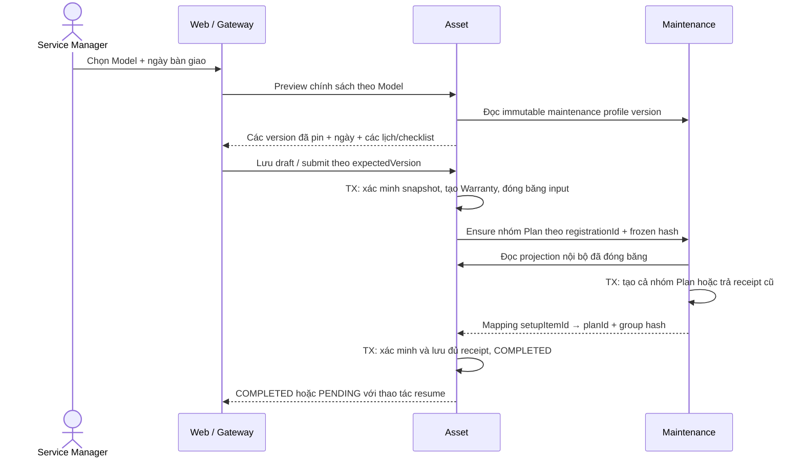
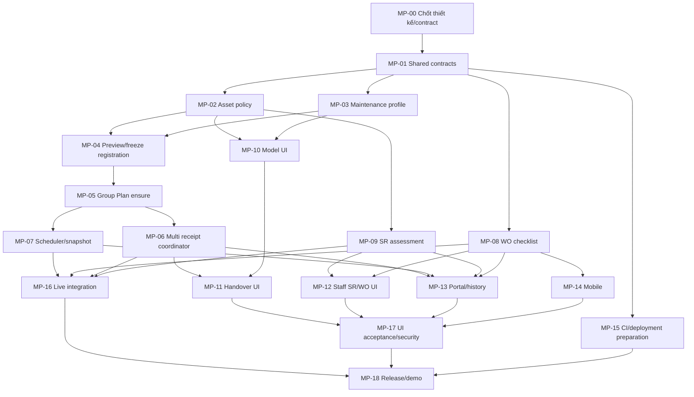

# Kế hoạch áp dụng chính sách dịch vụ theo Equipment Model

Ngày: 2026-11-04. Baseline khảo sát: local `ae0f4ee` trên
`fix/web-live-api-routes`. Trước triển khai phải đối chiếu develop mới nhất.
Trạng thái: **đã triển khai trên `feature/model-service-policies`; nghiệm thu local và release gate ghi tại [báo cáo](../testing/model-service-policies-acceptance.md)**.
Người dùng đã đồng ý hướng chính sách theo Model; các lựa chọn kỹ thuật dưới
đây là baseline để MP-00 chốt, không phải một ADR đã được review.

Danh sách task giao Agent: [model-service-policies-agent-tasks.md](../planning/model-service-policies-agent-tasks.md).
Đọc thêm [AGENTS.md](../../AGENTS.md), [CONTRIBUTING.md](../../CONTRIBUTING.md),
[ADR 0012](../decisions/0012-equipment-registration.md),
[thiết kế bàn giao hiện hành](equipment-registration-technical-design.md),
[state machines](../architecture/state-machines.md),
[event catalog](../../packages/event-contracts/src/catalog.ts).

## 1. Kết quả nghiệp vụ phải đạt

1. Người có quyền cấu hình chính sách bảo hành và chương trình bảo trì cho Model.
2. Mỗi chương trình bảo trì có nhiều hạng mục lịch, mỗi lịch có checklist riêng.
3. Chọn Model khi bàn giao tự lấy chính sách đã công bố; backend tính ngày và
   preview, không bắt nhân viên nhập lại điều khoản hoặc chu kỳ cho từng máy.
4. Người dùng xác nhận bản áp dụng; ngoại lệ chỉ người có quyền được sửa, phải
   có lý do, không sửa ngược chính sách nguồn.
5. Mỗi máy giữ chính sách đã nhận. Sửa Model sau này không đổi máy đã bàn giao.
6. Đến kỳ, Maintenance sinh Task; WO nhận checklist bất biến, kỹ thuật viên thực
   hiện và ghi kết quả từng mục trên Web/Mobile.
7. Service Manager đánh giá bảo hành theo thời hạn, nguyên nhân và điều khoản
   đã áp dụng; lỗi còn hạn nhưng bị loại trừ đi qua Cost Estimate hiện có.
8. Khách hàng thấy chính sách thực tế của máy mình, lịch bảo trì và kết quả được
   phép công bố. Mọi thao tác giữ tenant/customer/assignment scope hiện tại.

## 2. Các giới hạn của baseline và tác động bắt buộc

| Hiện trạng | Tác động phải xử lý |
| --- | --- |
| EquipmentModel chưa có chính sách | Thêm chính sách có phiên bản, API detail/editor |
| Warranty có start/end/type/terms | Thêm nguồn phiên bản và snapshot, không đọc điều khoản latest thay máy cũ |
| Registration có maintenancePlanId đơn | Mở rộng thành nhóm kết quả nhiều Plan, giữ tương thích luồng cũ |
| Plan unique tenant+setupRegistrationId | Không thể tạo nhiều Plan cho một registration trước khi nâng constraint/identity |
| Task chưa có checklist | Bổ sung snapshot nội dung tại thời điểm sinh Task |
| MaintenanceTaskDue v1 chỉ có title và references | Thêm phiên bản contract mang nội dung công việc; không mutate v1 |
| WO/Report chưa lưu checklist kết quả | Thêm snapshot, API kết quả, validate complete, Web/Mobile |
| SR dùng IN_WARRANTY để bỏ qua báo giá | Tách temporal status khỏi incident coverage, cập nhật mọi nhánh estimate/accept |
| Tenant Admin không có maintenance:manage | Giữ phân quyền; Service Manager xác nhận phần Maintenance |

Đây là thay đổi liên service, không thể hoàn thành bằng thêm cột description
hoặc frontend autofill. Các chi tiết lịch/checklist phải được validate ở backend.

## 3. Baseline nghiệp vụ để MP-00 chốt

### 3.1. Mẫu và phiên bản

- Mỗi tenant có Model riêng; cùng mã Model ở tenant khác không chia sẻ chính sách.
- MVP: một họ chính sách bảo hành và một chương trình bảo trì mặc định cho mỗi
  Model; mỗi họ có các phiên bản. Không cần thư viện template dùng chung nhiều
  Model, rule engine, hợp đồng bán hàng hoặc service mới.
- Vòng đời phiên bản: DRAFT → PUBLISHED → RETIRED. PUBLISHED không sửa nội dung;
  chỉnh sửa tạo DRAFT phiên bản mới. RETIRED không dùng cho áp dụng mới nhưng
  vẫn đọc được qua các bản đã áp dụng. Không hard-delete lịch sử/references.
- Trong mỗi service chỉ một phiên bản mặc định đang dùng cho áp dụng mới ở mỗi
  Model; publish/default switch dùng lock và constraint, có expectedVersion.
- Bảo hành và bảo trì công bố độc lập ở service sở hữu. UI hiển thị riêng kết
  quả từng phần, không giả atomic save/publish xuyên hai DB. Khi bàn giao phải
  pin rõ cả hai version ID, không dùng “latest” ở thời điểm resume.
- Chưa cấu hình, không áp dụng có lý do, và có chính sách là ba tình trạng khác
  nhau. DRAFT/thiếu cấu hình không được tự diễn giải thành NONE.
- Model INACTIVE không nhận áp dụng mới. Máy đã áp dụng, Task/WO và biên nhận
  cũ vẫn đọc được; retry đã commit không tạo lại vì Model hoặc template đổi.

### 3.2. Bảo hành

Bản chính sách gồm: tên, thời hạn tháng, căn cứ ngày bắt đầu, phạm vi bảo hành,
điều khoản loại trừ có mã ổn định + mô tả, điều khoản khách hàng và nguồn version.
MVP tự tính từ ngày bàn giao; căn cứ ngày đưa vào sử dụng chỉ bổ sung nếu MP-00
chốt dùng và có validation ngày thực tế. Không đo giờ chạy/IoT trong đợt này.

Quy ước đề xuất: khoảng thời gian hiệu lực [ngày bắt đầu, ngày kỷ niệm kết thúc),
cộng tháng có clamp cuối tháng; endDate lưu inclusive = ngày exclusive trừ một
ngày. Ví dụ 10/11/2026 + 12 tháng lưu endDate 09/11/2027. MP-00 phải ghi rõ
kết quả cho 31/01, 29/02, năm nhuận để mọi service/UI dùng cùng quy tắc.
Không để frontend tự quyết định ngày kết thúc khác backend.

Danh mục mã nguyên nhân/loại trừ đủ nhỏ cho MVP, ví dụ MANUFACTURING_DEFECT,
ACCIDENTAL_DAMAGE, LIQUID_INGRESS, MISUSE, WEAR_AND_TEAR, UNKNOWN. Mã nguyên nhân
không đồng nghĩa tự động bị từ chối: policy mỗi Model xác định phạm vi và người
có quyền ghi kết luận cho sự cố cụ thể. Không suy đoán nguyên nhân từ từ khóa.

Sửa thời hạn/điều khoản lúc bàn giao là override riêng, cần permission, lý do,
actor/time, lưu giá trị nguồn và giá trị cuối. Không tăng quyền Tenant Admin để
vượt qua maintenance:manage. Không tự thay đổi chính sách các thiết bị cũ.

### 3.3. Bảo trì

Một Maintenance Profile version có nhiều Schedule Rule. Mỗi rule gồm:

- ID ổn định trong phiên bản, tên công việc, unit DAY/WEEK/MONTH/YEAR + interval.
- Căn cứ ngày bàn giao, kỳ đầu/offset và quy tắc lịch thống nhất với ADR 0009.
- Checklist có itemId, thứ tự, bộ phận/vật tư, hành động INSPECT/CLEAN/LUBRICATE/
  ADJUST/REPLACE, hướng dẫn, required, cho phép N/A hay không, nội dung khách
  hàng được phép xem. Vật tư dự kiến có thể là tên/quy cách bằng text trong MVP.
- REPLACE yêu cầu thay theo định kỳ; INSPECT có thể chỉ định điều kiện thay và
  kỹ thuật viên ghi nhận kết quả/thực hiện thực tế. Không buộc thay mọi thứ.

Mỗi rule tạo một Plan riêng trên thiết bị. Các rule 3 tháng/12 tháng là các
lịch độc lập; MVP không tự gộp/triệt tiêu WO trùng ngày. UI phải chỉ rõ các lịch
và cảnh báo công việc bị lặp; cấu hình checklist tránh vô tình yêu cầu cùng việc
hai lần. Gộp đợt bảo trì, lịch theo giờ máy, “mỗi lần thứ N” và biểu thức luật
phức tạp để ngoài phạm vi đợt này. Rule fixed calendar vẫn phải đủ cho các chu
kỳ phổ biến và lần bảo dưỡng đầu có offset nếu đã chốt trong MP-00.

Kỳ đầu phải do server tính và preview. Đảm bảo không phát task ngay ngày bàn
giao nếu rule yêu cầu 3 tháng sau. Bảo toàn cách xử lý cuối tháng, năm nhuận,
pause/resume và downtime theo ADR 0009, trừ điều chỉnh được ADR mới chỉ rõ.
Không đổi lịch của Plan legacy một cách ngầm định.

Bảo hành không có nghĩa mọi bảo trì đều miễn phí. Đợt này chương trình bảo trì
được khách xác nhận khi bàn giao; terms phải nêu phạm vi dịch vụ. Không thêm
thu phí/invoice/payment hoặc tự phê duyệt chi phí. Nếu cần duyệt giá từng lần
bảo trì thì thiết kế riêng luồng đó trước khi bật tự sinh công việc cho gói đó.

### 3.4. Quyết định bảo hành của Service Request

Giữ temporal status hiện có: IN_WARRANTY / OUT_OF_WARRANTY / NO_WARRANTY.
Thêm assessment riêng, không thay đổi nghĩa của các giá trị cũ:

- UNASSESSED / COVERED / NOT_COVERED.
- Nhận định nguyên nhân, policy/warranty source + snapshot, điều khoản áp dụng,
  lý do kết luận, người và thời điểm quyết định, revision chống stale update.
- Còn hạn + assessment COVERED mới được đi luồng tiếp nhận không báo giá.
- Còn hạn + NOT_COVERED được dùng Cost Estimate; mọi guard create/send/approve/
  revise, allowedActions, view và test phải cập nhật cùng rule.
- Chưa biết nguyên nhân giữ REVIEWING hoặc yêu cầu bổ sung thông tin qua
  AWAITING_INFO hiện có. Không cho UNKNOWN tự được miễn phí hoặc tự bị loại trừ.
- Baseline MVP chưa thêm WO chẩn đoán từ SR chưa được duyệt. Nếu muốn kỹ thuật
  viên đến kiểm tra rồi mới quyết định, MP-00 phải thiết kế thêm luồng diagnostic
  và cập nhật dependency/phạm vi; không tạo vòng lặp “cần WO để kết luận nhưng
  cần kết luận mới tạo WO”. Không lách bằng cách đánh dấu COVERED tạm.
- Kết luận loại trừ một sự cố không tự VOID Warranty của cả thiết bị.
- Thay đổi assessment phải có history và xử lý estimate SENT/APPROVED đang tồn
  tại; không âm thầm biến một báo giá đã được khách duyệt thành giao dịch khác.
- Legacy SR/Warranty không được backfill nguyên nhân hay quyết định giả. MP-00
  định nghĩa compatibility cho request đang xử lý và mode mới trước rollout.

### 3.5. Checklist thực hiện

- Task giữ checklist từ Plan áp dụng tại lúc sinh. WO giữ bản từ Task, không
  lấy Model/Profile mới nhất khi mở công việc hoặc replay event.
- Result mỗi item: NOT_DONE / DONE / NOT_APPLICABLE; item cho phép N/A mới có
  trạng thái này và phải có lý do. Kết quả kiểm tra/ghi chú lưu riêng, không ép
  INSPECT thành “đã thay”. DRAFT result được lưu khi technician đang thực hiện.
- Complete WO yêu cầu mọi required item hoàn tất hợp lệ; kiểm tra dưới cùng
  transaction/lock với report, trạng thái WO, inventory hold và outbox.
- Assignment thay đổi chặn kỹ thuật viên cũ ghi kết quả; không xóa công việc đã
  thực hiện, lưu actor/assignment/time. Quy định sửa tiếp của người mới rõ ràng.
- WO thay thế do hủy lấy cùng checklist nguồn Task nhưng tạo kết quả thực hiện
  mới, không mặc nhiên copy DONE từ WO đã hủy.
- WO legacy không có checklist vẫn hoàn thành theo contract cũ; payload cũ không
  được cho phép bỏ qua checklist bắt buộc trên WO có checklist mới.
- Dự kiến thay vật tư không làm giảm tồn. Tiếp tục dùng ISSUE/RETURN/CONFIRM_USE
  hiện có cho thực tế; không tạo giao dịch kho từ tick hoặc checkbox DONE.

## 4. Ownership dữ liệu và hướng schema

Tên bảng dưới đây là tên đề xuất; MP-00/MP-01 chốt trước implementation để
các Agent không tự tạo hai mô hình khác nhau. Mỗi service chỉ có FK nội bộ.

| Service | Cấu trúc bổ sung dự kiến | Điểm quan trọng |
| --- | --- | --- |
| Asset | ModelWarrantyPolicy + revisions; current default revision binding theo tenant+model | Immutable published revision, policy source validated |
| Asset | Warranty: nullable policyVersionId + applied snapshot + override audit | Legacy có source null; không giả xuất xứ |
| Asset | Registration: pinned versions, resolved snapshots/hashes, group receipt + RegistrationMaintenancePlan links | Logical Plan refs, giữ payload đóng băng khi PENDING |
| Maintenance | ModelMaintenanceProfile + revisions, schedule rules/checklist definitions | modelId logical Asset reference, validate tenant/active |
| Maintenance | Plan: source profile/rule + applied checklist snapshot; setup group/item identity | Một Plan/rule; hash ràng buộc exact payload |
| Maintenance | SetupGroup/receipt hoặc cấu trúc tương đương | Trạng thái cả nhóm, mapping itemId→planId; atomic local commit |
| Maintenance | Task: frozen instructions/checklist + source identity | Không lệ thuộc Plan đã sửa sau khi task sinh |
| Work Order | Checklist items snapshot + item results/audit | WO ownership/assignment, optimistic version, completion transaction |
| Service Request | Warranty assessment + history/source snapshot | Không trộn temporal status và coverage |

Có thể dùng JSONB cho bản chụp bất biến với schema/version và validation chặt;
các quan hệ cần unique, lookup, kết quả checklist hoặc kiểm tra permission nên
có cấu trúc/index rõ. Không dùng JSON tự do làm toàn bộ domain và thay FK/guard.
Không mặc định mọi trường policy cần bảng riêng nếu không có nhu cầu truy vấn.

## 5. API và contract phải chốt

- Giữ prefix hiện có `/equipment-models`, `/equipment-registrations`,
  `/maintenance-plans`, `/maintenance-tasks`, `/work-orders`, `/service-requests`.
  Bổ sung model detail và policy/profile revisions + publish/retire/preview
  trong service sở hữu. Mọi path và DTO phải có OpenAPI trước Agent consumer.
- Preview backend trả pinned version IDs, resolved dates, từng schedule/checklist,
  default/override, warnings và fingerprint. Submit không tin các trường tính
  toán hoặc snapshot do client gửi tùy ý; resolve version bất biến và xác minh.
- Revision mới xuất hiện sau preview: hoặc vẫn áp đúng bản đã pin còn eligible,
  hoặc 409 yêu cầu xem lại theo rule MP-00; không silently chuyển sang latest.
- Version đã RETIRED trước submit mới: trả 409 + giữ draft. Resume của command
  đã đóng băng/commit phải tiếp tục exact snapshot, không resolve lại template.
- API group setup nhiều Plan là contract bổ sung/version mới; endpoint singular
  cũ còn tương thích. Bản cũ chỉ dành request legacy đúng một Plan, không chọn
  “Plan đầu tiên” để che dữ liệu mới.
- Dùng schema discriminated/version rõ cho registration legacy/new. Response
  mới có danh sách biên nhận. Contract quy định maintenancePlanId cũ trong trường
  hợp single/zero/multiple, không trả ID tùy tiện.
- Event MaintenanceTaskDue phiên bản mới mang snapshot đủ cho consumer không
  gọi ngược service bằng machine JWT. Replacement event cũng cần phiên bản mới
  tương ứng; cùng task/WO semantics phải chống xử lý hai lần giữa versions.
- Không phát cả v1 lẫn v2 để tạo hai lần WO. Consumer hỗ trợ phiên bản cũ/mới
  trước, rồi mới bật producer mới. Consumer SR/Asset/Notification liên quan cũng
  phải kiểm tra không bỏ rơi/rò rỉ payload mới.
- Nếu nội dung event completion hoặc assessment thay đổi semantics, định nghĩa
  version mới/contract riêng; không dùng fields mới để phá v1/v2 đã có.
- Customer projection gồm chính sách thực tế và kết quả cho phép công bố;
  không expose internal checklist notes, hash, keys, raw draft, rule nội bộ.

## 6. Luồng transaction và phục hồi

- HTTP ngoài DB transaction/khóa. Token người dùng được forward theo ADR 0004;
  không giữ JWT để worker retry, không thêm service token tự chế.
- Atomic local group creation tại Maintenance: lỗi rule thứ hai rollback cả nhóm
  Maintenance; Warranty ở Asset đã commit vẫn được giữ và trạng thái PENDING
  nói rõ sự thật. Không giả rollback xuyên DB.
- Identity: tenant+registration+stable setupItemId; mapping, item payload hash
  và group hash bất biến. Advisory lock/unique kiểm tra sau khi lấy lock.
- Receipt phải đúng tenant/equipment/group/item set, không thiếu/thừa/duplicate
  item, đúng payload hash; 200 với receipt sai không được đánh COMPLETED.
- Timeout sau commit, crash trước/sau acknowledgment, hai resume đồng thời
  phải hội tụ cùng nhóm/Plan, không thêm Warranty/history trùng.
- Không auto-expire pending, cấp UUID mới hoặc sửa input để “thoát lỗi”.
- Model/Plan thay đổi sau commit không làm mất receipt; API lookup trả lại
  kết quả đã commit, không reset lịch/nội dung của Plan đang vận hành.

## 7. Phân quyền và an toàn dữ liệu

Giữ role/permission catalog hiện tại nếu đủ:

| Hành động | Guard dự kiến |
| --- | --- |
| Model base create/edit | equipment:manage, TENANT_STAFF |
| Warranty policy create/publish/override | equipment:manage + warranty:manage |
| Maintenance profile create/publish/override | equipment:manage + maintenance:manage |
| Hoàn tất registration có chính sách | Các quyền hiện có, không cho Tenant Admin tự nâng quyền |
| Warranty assessment | service_request:review, scope tenant, state/revision hợp lệ |
| Checklist execution | work_order:execute, đúng assignment; complete thêm service_report:submit |
| Customer read | quyền đọc sẵn có + customer scope; chỉ projection an toàn |

Nếu MP-00 xác định quyền mới thực sự cần, phải có task riêng sửa catalog, seed,
data migration Identity và test; không tạo role mới hoặc đổi catalog trong PR UI.
Không expose internal route qua Gateway để tiện cho frontend. Policy/Profile
readiness endpoint cho actor chỉ có quyền xem không được trả dữ liệu nhạy cảm.

## 8. Tương thích dữ liệu cũ và rollout

- Migration additive; không sửa migration đã merge hoặc dùng prisma db push.
- Policy source mới nullable cho Warranty/Plan cũ, nhãn LEGACY/MANUAL rõ ràng;
  không gán chính sách Model mới vào thiết bị cũ hoặc tính lại ngày tự động.
- MP-00 định nghĩa xử lý registration DRAFT/PENDING/COMPLETED cũ. PENDING phải
  hoàn thành bằng codec/endpoint legacy trước, không đổi hash đang xử lý.
- Với Model mới sau rollout có thể lưu draft base trước; muốn hoàn tất bàn giao
  phải có policy/profile published hoặc NONE có lý do từ người có quyền.
- Muốn chuyển thiết bị cũ sang chính sách mới là thao tác có preview/audit riêng;
  ngoài scope rollout tự động của đợt này. KEEP Warranty/Plan cũ tiếp tục dùng.
- Triển khai: migrations → consumer/backend đọc cả old/new → backend producer
  có cờ chưa bật → Web/Mobile mới → smoke legacy/new → bật tính năng.
- Backend mới không được chấp nhận client cũ complete WO mới mà bỏ checklist.
  App cũ phải nhận mã lỗi rõ và hướng dẫn cập nhật, không tạo giả checklist DONE.
- Rollback ưu tiên tắt chức năng phát sinh mới; không drop schema đã có dữ liệu,
  không xóa outbox v2. Consumer tương thích vẫn cần chạy để drain/replay.
- Cập nhật SQL ERD, ADR, OpenAPI, fixture/demo, README và runbook cùng rollout.

## 9. Đồ thị phụ thuộc và cổng nghiệm thu

- Gate A: MP-00/01 xong, schema/API/event/permission không còn quyết định mâu thuẫn.
- Gate B: MP-02..09 xong, backend nhiều Plan + checklist + coverage qua integration.
- Gate C: Web/Mobile thật xong, không còn mock hoặc đường bỏ qua guard.
- Gate D: deploy từ môi trường sạch, migration/legacy/security/failure tests và
  UAT thực, một người khác chạy lại demo được. Chỉ Gate D mới chốt toàn tính năng.

Có thể song song sau Gate A: Asset policy, Maintenance profile, WO checklist,
chuẩn bị CI. Web làm contract fixture trước nhưng chỉ chốt sau API thật.
Các task cùng sửa một service/file phải tuần tự hoặc làm trên commit dependency
đã merge/cherry-pick rõ. Không cho nhiều Agent tự sửa root/shared/ERD cùng lúc.

## 10. Bộ ca nghiệm thu tối thiểu

| ID | Kịch bản | Assertion bắt buộc |
| --- | --- | --- |
| POL-01 | Tạo Model + policy/profile v1, publish | Đủ validation, chỉ một default/service, audit actor |
| POL-02 | Hai Agent/người sửa hoặc publish đồng thời | Một ghi thành công, stale nhận 409, không duplicate revision |
| POL-03 | Bàn giao máy A theo v1 | Ngày đúng, một Warranty, đủ N Plan, đúng checklist/source |
| POL-04 | Publish v2 rồi bàn giao máy B | A vẫn v1; B dùng v2; Task/WO cũ không đổi |
| POL-05 | Publish/retire giữa preview và submit | Exact pinned version hoặc 409 theo contract; không latest âm thầm |
| POL-06 | Override/NONE/chưa cấu hình | Quyền+lý do đúng; UNCONFIRMED không thành NONE |
| POL-07 | Tháng cuối, leap year, first offset, pause/downtime | Preview và scheduler thống nhất, không phát sớm/trùng kỳ |
| POL-08 | Hai lịch 3/12 tháng cùng hạn | Hai công việc có tên/nội dung đúng baseline, không gộp giả |
| POL-09 | Lỗi rule thứ hai trong group | Không có nhóm Plan dở dang; Asset PENDING trung thực |
| POL-10 | Timeout/crash sau Maintenance commit, retry/restart | Cùng mapping IDs, không duplicate Warranty/Plan/history |
| POL-11 | Receipt sai hash/thiếu item/khác tenant | Asset không COMPLETED, lỗi đối soát rõ |
| POL-12 | Event v1/v2, duplicate, replacement, broker restart | Một WO/source; snapshot nguồn đúng, kết quả replacement mới |
| POL-13 | Complete thiếu required/N/A sai/ID item lạ | Backend chặn, không report/status/outbox partial |
| POL-14 | Đổi assignment khi đang sửa checklist | Actor cũ bị chặn; history trước đó còn nguyên |
| POL-15 | Checklist có REPLACE, kỹ thuật viên đánh DONE | Không tự sinh stock transaction; ISSUE/RETURN cũ vẫn đúng |
| POL-16 | Còn hạn, lỗi được bảo hành | COVERED có evidence → accept, không cần estimate |
| POL-17 | Còn hạn, lỗi bị loại trừ | NOT_COVERED có reason → estimate→approve→WO; Warranty vẫn ACTIVE |
| POL-18 | UNKNOWN/chưa assessment/ngoài hạn | Không auto miễn phí; pending hoặc estimate đúng state machine |
| POL-19 | Đổi assessment khi estimate đang SENT/APPROVED | Rule concurrency/history, không lách customer approval |
| POL-20 | Tenant A/B, Customer A/B, sai Model/part/version/item IDs | 404/403 đúng, không leak policy draft/internal result |
| POL-21 | Role đổi sau preview/phiên đổi giữa request | Backend kiểm lại; UI không nhận response phiên cũ |
| POL-22 | Dữ liệu legacy và PENDING cũ | Giữ nguồn/date/hash; resume hoàn tất không backfill giả |
| POL-23 | Mobile cũ complete WO mới, Web field giả | Không bypass checklist/assessment bằng payload cũ |
| POL-24 | Customer dossier/timeline/notification | Đúng policy áp dụng, không lộ internal checklist notes |
| POL-25 | Migrate x2, seed x2 trên DB test, build stack sạch | Idempotent, drift đạt; evidence commit/env rõ |
| POL-26 | Web/Mobile mất mạng, refresh/retry, API unavailable | Không fake success/0, không tạo lại mutation bằng key mới |

Unit test không thay DB/broker/UI acceptance. Lệnh có thể phá dữ liệu chỉ dùng
DB test đúng service. Không reset/seed vào demo đang dùng để có PASS nhanh.

## 11. Hoàn thành và bàn giao

- Toàn bộ task MP-00..18 được nghiệm thu, mỗi task có commit/PR và kết quả chạy.
- Lint/typecheck/test/build theo phần thay đổi; full regression theo CI repo.
- DB E2E các service thay đổi, broker thật, Gateway/MinIO và browser/Android đủ
  cho phần mới; test quyền/logic thất bại có assertion cụ thể.
- OpenAPI/state machine/event catalog/ERD/migration/README không mâu thuẫn.
- Demo: hai thiết bị cùng Model nhận hai phiên bản khác nhau; một ca còn hạn
  nhưng loại trừ phải báo giá; nhiều lịch/checklist chạy tới Service Report;
  mất response sau commit không nhân bản; Customer xem đúng dữ liệu của mình.
- Báo cáo phân biệt PASS thực chạy, NOT RUN, blocked và giới hạn. Không chốt
  hoàn tất chỉ vì giao diện render hoặc unit test xanh.
