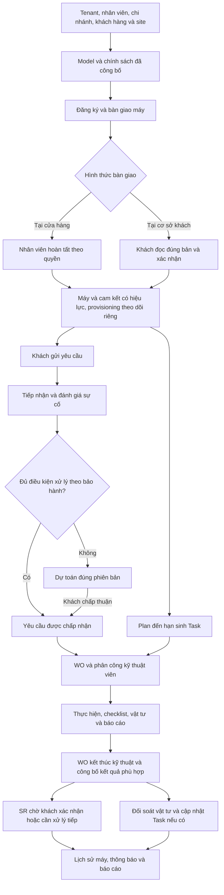

# Bảng rà soát luồng nghiệp vụ, chức năng và logic PBL6

Ngày: 10/11/2026. Code tham chiếu: `develop@48f86d5` và working tree hiện tại. Tài liệu bổ sung cho [đánh giá thiết kế trải nghiệm](2026-11-10-product-design-critical-review.md), tập trung vào **đầu vào → quyết định → thay đổi dữ liệu → người xử lý tiếp → ngoại lệ**.

Đánh giá dựa trên nhu cầu vận hành và các đường code đã đọc, không lấy việc một task có trong kế hoạch cũ làm bằng chứng đúng nghiệp vụ. Chưa chạy UAT mới trong lượt lập bảng. “Đã có” nghĩa tìm thấy nền triển khai, không đồng nghĩa mọi biến thể đã PASS. “Đề xuất” cần chốt contract/quyền trước khi code.

## 1. Cách đọc bảng

- **Giữ:** logic nền phù hợp, cần bảo toàn và nghiệm thu.
- **Hoàn thiện:** đã có API/luồng nền nhưng cần nối rõ hơn, bổ sung dữ liệu hoặc xử lý ngoại lệ.
- **Chốt mới:** chưa đủ quy tắc/contract để khẳng định đã hỗ trợ; cần quyết định sản phẩm trước.
- **Ưu tiên 1:** quyền, số liệu, cam kết và luồng cốt lõi. **Ưu tiên 2:** phối hợp/vận hành và trải nghiệm. **Ưu tiên 3:** mở rộng khi đã kiểm chứng nhu cầu.

Các bảng mô tả đích mong muốn; phần nền hiện có và phần cần sửa được tách thành cột riêng. Điều kiện quyền luôn gồm permission **và** tenant/customer/branch/assignment tương ứng; có role không tự đồng nghĩa được thao tác mọi hồ sơ.

## 2. Bản đồ luồng tổng thể



Sơ đồ trên là tuyến chính, không thay thế state machine. Đánh giá sự cố cần nhiều hơn việc ngày bảo hành chưa hết. Task bảo trì không cần SR giả. Các thay đổi liên service có thể đồng bộ trễ; UI phải phân biệt “đã ghi nhận” với “đang hoàn tất đồng bộ”.

## 3. Quản trị, quyền và dữ liệu nền

| Mã / mức | Ai và khi nào | Luồng hợp lý | Điều kiện và kết quả cần bảo đảm | Nền hiện có / điểm cần sửa | Vì sao sửa, lợi ích |
|---|---|---|---|---|---|
| B01 / 1 | Platform Admin khởi tạo doanh nghiệp | Tạo tenant → thiết lập admin → gửi kích hoạt → admin hoàn tất cấu hình | Không tạo trùng tenant/admin khi lỗi gửi; quản trị nền tảng không tự đọc nghiệp vụ tenant | **Giữ** quản trị tenant/invite. **Hoàn thiện** trạng thái provisioning, bước lỗi và retry đúng bước | Doanh nghiệp biết còn thiếu gì, không phải nhờ sửa DB hoặc tạo lại từ đầu |
| B02 / 1 | TA thêm nhân viên | Mời user → gán role được phép → branch chính → profile Technician nếu cần → kích hoạt/sử dụng | User, membership và Technician thuộc đúng tenant; lỗi profile không làm mời trùng user; role cũ không tự được nâng quyền | **Giữ** RBAC và branch. **Hoàn thiện** onboarding nhiều bước, audit; phục hồi mật khẩu/resend là **chốt mới** nếu API chưa có | Nhân viên vào làm được và biết vì sao chưa có quyền |
| B03 / 1 | TA/SM cấu hình khách và địa điểm | Customer → site → location/contact → branch phục vụ ca mới | Branch nhà cung cấp khác site khách; tham chiếu cùng customer/tenant; thiếu routing có hàng chờ | **Giữ** danh mục dùng chung tenant và routing theo site. **Hoàn thiện** diễn giải scope và form liên kết | Tránh giao ca sai nơi, không cô lập danh mục khách/máy theo branch một cách không cần thiết |
| B04 / 1 | TA xử lý ca chưa phân bổ | Xem hàng chờ → kiểm nguồn SR/WO → chọn branch hợp lệ → ghi lý do → xác nhận version | Một quyết định thắng khi hai admin thao tác; ca đã chạy không tự chuyển branch; thay routing chỉ tác động ca mới | **Giữ** phân bổ và audit đã có. **Hoàn thiện** lối vào menu/notice đang bị bỏ trong diff local | Ca không bị bỏ quên; admin xử lý được mà không bypass quyết định dịch vụ |
| B05 / 1 | Mọi user đăng nhập/đổi phiên/đổi quyền | Xác thực → tải profile/scope → đọc/ghi theo quyền hiện tại → logout hoặc refresh khi cần | Response cũ không cập nhật tài khoản mới; biết ID/key/QR không cấp quyền; dependency scope lỗi không mở quyền | **Giữ** auth/session guard. **Hoàn thiện** hồi quy toàn endpoint và hướng dẫn khi thiếu quyền | Không lẫn dữ liệu, giảm thao tác nhầm và tránh “sửa lỗi 403” bằng cấp quyền quá rộng |

## 4. Thiết bị, chính sách và bàn giao

| Mã / mức | Ai và khi nào | Luồng hợp lý | Điều kiện và kết quả cần bảo đảm | Nền hiện có / điểm cần sửa | Vì sao sửa, lợi ích |
|---|---|---|---|---|---|
| B06 / 1 | Người có quyền quản lý Model | Tạo draft policy → preview → publish → chọn bản áp dụng khi bàn giao | Bản publish và snapshot máy cũ giữ nguyên; lỗi cấu hình phát hiện trước khi tạo cam kết | **Giữ** revision/snapshot. **Hoàn thiện** phần tóm tắt quyền lợi/ngoại lệ và hiệu lực | Cả nhân viên và khách đọc lại đúng cam kết, không bị policy mới thay lịch sử |
| B07 / 1 | SM bàn giao tại cửa hàng | Chọn STORE → xác nhận đúng máy/customer/site/ngày → policy preview → hoàn tất | Site vẫn là nơi khách đặt máy; không tạo xác nhận khách giả; retry không tạo hai máy/bảo hành | **Giữ** STORE. **Hoàn thiện** một điểm vào rõ và kết quả sau hoàn tất | Giao nhanh nhưng vẫn có hồ sơ và ngày hiệu lực đúng |
| B08 / 1 | SM và Customer Admin bàn giao tại cơ sở khách | Chọn CUSTOMER_SITE → gửi đúng snapshot → khách đọc/accept → kích hoạt và tiếp tục provisioning | Trước accept chưa áp warranty/plan trái quy tắc; sau accept ngày hiệu lực theo ngày bàn giao đã duyệt; chỉ đúng customer/role quyết định | **Giữ** workflow hiện có. **Hoàn thiện** preview cam kết và phân biệt accept thành công với provisioning chậm | Khách hiểu mình ký gì; không phải xác nhận lại vì broker chậm |
| B09 / 1 | Khách từ chối hoặc hồ sơ hết hạn | Ghi lý do/trạng thái → SM sửa → preview lại → gửi phiên bản mới | Bản cũ giữ nguyên và không thể accept lại; không tự hoàn tất khi hết hạn; không đổi hình thức để bypass xác nhận | **Giữ** reject/cancel/expire/resend. **Hoàn thiện** so sánh nội dung thay đổi | Giảm tranh chấp, tránh khách duyệt nhầm link cũ |
| B10 / 2 | Nhân viên sửa dữ liệu, máy chuyển site hoặc đổi máy | Phân biệt sửa lỗi ghi nhận / chuyển vị trí / thay thiết bị vật lý → kiểm ảnh hưởng → lưu history | Sửa vị trí hiện tại không đổi địa điểm WO cũ; máy thay phải có identity riêng và liên kết; policy đi theo máy nào cần rule rõ | **Hoàn thiện** chức năng sẵn có; transfer/replace đầy đủ là **chốt mới**, không gộp thành PATCH tự do | Lịch sử vẫn đáng tin, tránh đổi serial để che mất máy cũ |

## 5. Yêu cầu dịch vụ, quyết định bảo hành và chi phí

| Mã / mức | Ai và khi nào | Luồng hợp lý | Điều kiện và kết quả cần bảo đảm | Nền hiện có / điểm cần sửa | Vì sao sửa, lợi ích |
|---|---|---|---|---|---|
| B11 / 1 | Customer User/Admin hoặc staff báo sự cố | Chọn máy → mô tả/ảnh hưởng/liên hệ → xem lại → gửi → nhận mã theo dõi | Đúng máy và scope; thấy ca đang mở để chọn bổ sung hoặc báo sự cố khác; mất response không tự tạo mới | **Giữ** SR create và selection riêng. **Hoàn thiện/chốt mới** dữ liệu liên hệ/ảnh, chống trùng và lookup | Khách ít dùng vẫn gửi đúng, SM ít phải hỏi lại |
| B12 / 2 | SM tiếp nhận và cần bổ sung | NEW → REVIEWING → yêu cầu thông tin có câu hỏi rõ → khách trả lời → REVIEWING | Khách thấy nội dung cần bổ sung; có đầu mối tiếp nhận; INTERNAL không lọt vào public | **Giữ** trạng thái/comment. **Hoàn thiện** owner và mốc cập nhật; waiting suy ra từ nguồn | Khách biết phải trả lời gì và ca không nằm chờ vô thời hạn |
| B13 / 1 | SM quyết định xử lý theo bảo hành | Đọc thời hạn/policy đã áp dụng → đánh giá nguyên nhân/phạm vi sự cố → ghi căn cứ → chấp nhận hoặc lập phương án chi phí | Còn hạn không tự đồng nghĩa được miễn phí; dùng nhánh assessment hiện hành, giữ hành vi legacy có giải thích | **Giữ** đánh giá/snapshot. **Hoàn thiện** trình bày kết luận, nguồn và lý do | Quyết định có căn cứ, khách hiểu vì sao sự cố có/không được bảo hành |
| B14 / 1 | SM lập và khách duyệt dự toán | Draft dòng công việc/vật tư → server tính tổng → SENT → khách duyệt đúng revision → ACCEPTED hoặc COST_REJECTED | Bản SENT/APPROVED không sửa âm thầm; hết hạn/superseded không được duyệt; trường hợp tổng 0 vẫn qua quy tắc chấp thuận | **Giữ** revisions và review form. **Hoàn thiện** recovery và diễn giải phạm vi/ngoại lệ | Không nhầm tiền/bản duyệt, giảm chấp thuận ngoài ý muốn |
| B15 / 1 | Phát hiện cần làm thêm ngoài phạm vi đã duyệt | Ghi phần phát sinh và lý do → tính ảnh hưởng → gửi đề nghị → khách duyệt/từ chối → thực hiện đúng phần được phép | Giữ bản gốc; không sửa APPROVED; chỉ chặn phần phụ thuộc quyết định mới; không coi im lặng/report là đồng ý | **Chốt mới** amendment/revision, các điều kiện WO và approval; không mở rộng sang hóa đơn | Kiểm soát phát sinh minh bạch; kỹ thuật viên biết giới hạn được làm |
| B16 / 1 | Yêu cầu cần hủy/từ chối | Kiểm trạng thái và người thao tác → xác nhận hệ quả → ghi lý do → chuyển trạng thái hợp lệ | SR PROCESSING không bị hủy trực tiếp để bỏ lại WO đang làm; terminal không tự mở lại bằng PATCH | **Giữ** transition guards. **Hoàn thiện** lời giải thích ảnh hưởng tới ca và vật tư | Người dùng hiểu đang hủy dịch vụ hay chỉ hủy một lần thực hiện |

## 6. Work Order, kết quả và phản hồi khách

| Mã / mức | Ai và khi nào | Luồng hợp lý | Điều kiện và kết quả cần bảo đảm | Nền hiện có / điểm cần sửa | Vì sao sửa, lợi ích |
|---|---|---|---|---|---|
| B17 / 1 | SM tạo lệnh sau quyết định, hoặc hệ thống từ Task | SR ACCEPTED/Task hợp lệ → tạo một WO nguồn → lưu địa điểm/branch → cập nhật nguồn qua event | Đúng một loại nguồn; tối đa một WO chưa kết thúc mỗi SR; event trễ không khiến người dùng tạo thêm | **Giữ** source guard/unique/event. **Hoàn thiện** UI chờ đồng bộ và đối soát nguồn | Không trùng việc, không xử lý trước khi đủ điều kiện |
| B18 / 2 | SM/người có quyền điều phối | Xem kỹ năng/branch/lịch → phân công → Technician nhận/từ chối → reassign nếu hợp lệ | Cùng branch, đúng trạng thái; reject có lý do; lịch sử assignment giữ lại; client cũ không ghi đè quyết định mới | **Giữ** assignment. **Hoàn thiện** workload; slot/khách xác nhận lịch là **chốt mới** | Ít giao sai người và hiểu sai giờ hẹn |
| B19 / 1 | Technician đã được giao | Accept → travel tùy chọn → start → checklist/log → hold có lý do hoặc resume → report | Đúng người hiện hành; startedAt không reset khi resume; mất mạng chỉ lưu nháp nếu chưa có xác nhận server | **Giữ** workflow/nháp. **Hoàn thiện** thông tin hiện trường, yêu cầu hỗ trợ và thông báo đổi phân công | Nhân viên làm liên tục, dữ liệu không mất hoặc gắn nhầm người |
| B20 / 1 | Technician báo cáo kết quả | Nhập phát hiện/giải pháp/result/tóm tắt công khai → kiểm dữ liệu → complete và report cùng transaction WO | Không complete khi reservation HELD; kết quả có thể RESOLVED/PARTIALLY_RESOLVED/UNRESOLVED; không ép confirm-use trước report | **Giữ** completion/report. **Hoàn thiện/chốt mới** phần việc còn lại, nguồn xác nhận tình trạng máy | Khách không hiểu mọi COMPLETED là máy đã tốt; tránh vòng chờ nghiệp vụ |
| B21 / 1 | SM hủy WO | Kiểm reservation/trạng thái → chọn hủy lần thực hiện hay cả SR → ghi lý do → hủy assignment → event cập nhật nguồn | Không hủy khi HELD chưa giải quyết; cancelServiceRequest=false và true có hệ quả khác; không xóa report/history cũ | **Giữ** cancellation modes. **Hoàn thiện** dialog nêu hậu quả và đường thay thế | Có thể đổi phương án mà không vô tình chấm dứt yêu cầu khách |
| B22 / 1 | Khách nhận kết quả | Đọc đúng kết quả/phạm vi → đồng ý hoặc phản hồi chưa đạt → đóng SR hay chuyển xử lý tiếp | RESOLVED chưa phải CLOSED; reopen có assessmentRequired về REVIEWING, legacy về ACCEPTED; partial phải giải thích phần còn lại | **Giữ** confirm/reopen. **Chốt mới** dữ liệu proxy và điều kiện khép phần việc còn lại | Khách có quyền phản hồi thực chất; không bị ghi đồng ý bằng thao tác nhân viên không có căn cứ |
| B23 / 2 | Khách không phản hồi hoặc lỗi tái diễn sau đóng | Không phản hồi: nhắc và giao owner theo dõi. Tái diễn: SR mới liên kết ca cũ, review lại | Im lặng không là consent; ca terminal không bị sửa ngược; liên kết không tự miễn phí hay tạo WO | **Chốt mới** nhắc/đóng hành chính nếu cần và link recurrence; giữ workflow đánh giá | Không bỏ quên ca, không mất lịch sử; doanh nghiệp thấy chất lượng xử lý lại |

## 7. Kho và trách nhiệm phụ tùng

| Mã / mức | Ai và khi nào | Luồng hợp lý | Điều kiện và kết quả cần bảo đảm | Nền hiện có / điểm cần sửa | Vì sao sửa, lợi ích |
|---|---|---|---|---|---|
| B24 / 1 | Inventory Staff nhập/điều chỉnh | Chọn kho/Part → nhập lượng/đơn vị/chứng từ/lý do → validate → ghi stock và ledger cùng transaction | Đúng branch, precision; không âm tồn; CORRECTION trỏ nguồn hợp lệ; replay cùng key không ghi lại | **Giữ** ledger/input/receipt. **Hoàn thiện** phiếu đọc được và giải thích correction | Đối chiếu được số dư và không nhầm số lượng vì định dạng |
| B25 / 1 | Inventory Staff xuất cho WO | Kiểm WO → giữ reservation phía WO → commit xuất/usage/proof trong Inventory → settle reservation | WO chưa terminal, kho cùng scope, đủ tồn; hai Issue cạnh tranh không âm; proof chưa rõ không tự release | **Giữ** protocol. **Hoàn thiện** test race và hướng dẫn operation treo | Không xuất cho việc đã đóng, không trừ hai lần vì retry |
| B26 / 1 | Kho nhận hàng thừa/hỏng | Chọn nguồn xuất → nhập lượng/condition → trả đúng kho → khả dụng hoặc cách ly → inspect RELEASE/SCRAP khi phù hợp | Không vượt lượng còn lại; Return được xử lý theo rule sau WO terminal/Part hoặc kho inactive; hàng cách ly không cấp được | **Giữ** Return/inspect. **Hoàn thiện** giải thích ảnh hưởng từng lựa chọn | Kho biết thật sự nhận gì và lượng nào có thể xuất tiếp |
| B27 / 1 | Technician của báo cáo đã hoàn tất xác nhận dùng | Chọn usage/report hợp lệ → lượng thực dùng → lý do cho khách/xử lý linh kiện cũ → confirm-use → correction theo quyền | WO/report hoàn tất; người xác nhận đúng; used+returned không vượt issued; không trừ tồn thêm khi confirm-use | **Giữ** endpoint/quyền. **Hoàn thiện** đường vào UI và đối soát. Không giao việc này mặc định cho Inventory Staff | Lịch sử máy phản ánh phụ tùng thực đã dùng, phân biệt giao hàng với sửa chữa |
| B28 / 1 | Hàng đã xuất bị mất/tiêu hủy ngoài hiện trường | Báo sự việc gắn lần xuất → xác định lượng/căn cứ → người có quyền giải quyết trách nhiệm → ghi disposition | Không RETURN hàng chưa nhận; không confirm-use giả; không trừ kho lần hai; không ghi đè ledger | **Chốt mới** workflow/quyền/đính chính; LOSS điều chỉnh tại kho không thay thế hoàn toàn | Ca đối soát được ngay cả khi xảy ra thất thoát thực tế |
| B29 / 2 | Tồn xuống thấp hoặc operation chưa rõ kết quả | Ngưỡng đánh giá server → cảnh báo đúng người; operation kiểm proof → retry cùng intent/abort khi được phép | quantity < min; một cảnh báo mỗi đợt, re-arm khi phục hồi; COMMITTED không hoàn tồn bằng abort | **Giữ** LowStock/recovery. **Hoàn thiện** danh sách có owner và bước xử lý | Kho không bị spam và không tự tạo giao dịch bù sai để chữa timeout |

## 8. Bảo trì, lịch sử, tệp và vận hành

| Mã / mức | Ai và khi nào | Luồng hợp lý | Điều kiện và kết quả cần bảo đảm | Nền hiện có / điểm cần sửa | Vì sao sửa, lợi ích |
|---|---|---|---|---|---|
| B30 / 1 | SM tạo Plan hoặc hệ thống áp policy | Chọn nguồn máy/policy → lịch neo/term → preview → tạo một Plan có receipt khi cần | Kỳ đầu trong hạn; WARRANTY_END có nguồn bảo hành hợp lệ; POST trực tiếp cần chống trùng riêng | **Giữ** policy/registration. **Hoàn thiện/chốt mới** key/lookup POST Plan trực tiếp | Không có hai lịch cho một lần gửi bị timeout |
| B31 / 1 | Scheduler đến hạn | Đọc Plan ACTIVE → kiểm kỳ/hạn → sinh Task một lần → WO qua event → cập nhật kết quả về Task | Ngày neo/month clamp đúng; không sinh ngoài hạn; PARTIALLY_RESOLVED hiện được coi là completed ở Task, nhưng UI phải giữ kết quả một phần để người dùng hiểu | **Giữ** scheduler/linkage. **Hoàn thiện** diễn giải hạn/kết quả và evidence boundary | Cam kết bảo trì đúng ngày, không che chất lượng thực hiện bằng status Task |
| B32 / 1 | Plan thay đổi/hết hạn hoặc WO bảo trì hủy | Sửa kỳ chưa sinh/pause/inactive theo rule; WO hủy → Task chờ → SM request replacement → WO mới | INACTIVE cuối; hết hạn không sinh bù kỳ mới; Task cũ giữ nguyên; requestId cố định cho một lần yêu cầu thay thế, không dùng một key cho mọi lần thay thế tương lai | **Giữ** lifecycle/replacement. **Hoàn thiện** next action và recovery | Bảo trì tiếp tục được sau hủy mà không sinh trùng hoặc phá lịch sử |
| B33 / 1 | Staff tải tệp, người có quyền công bố, khách đọc | Prepare → PUT storage → finalize → công bố theo quyền → download qua API cấp link | Không coi PUT xong là finalize; report attachment sau report theo contract; INTERNAL không lọt metadata/count/link customer | **Giữ** pipeline. **Hoàn thiện** progress/cleanup/recovery và audience preview | Khách nhận đúng bằng chứng; tránh file “tải xong” nhưng không mở được |
| B34 / 2 | Mọi user tra hồ sơ | Mở máy/ca → tóm tắt hiện tại/cam kết/việc mở → lọc history → nguồn chi tiết | Dữ liệu hiện tại khác snapshot; quyền từng nguồn; nguồn lỗi hiển thị thiếu, không giả empty; còn trang phải rõ | **Giữ** dossier/projections. **Hoàn thiện** liên kết và dữ liệu completeness | Tìm được lịch sử toàn bộ đã ghi nhận và lịch sử từng lần xử lý |
| B35 / 2 | Nghiệp vụ phát event, người nhận mở notification/report | Commit nguồn → outbox → consumer idempotent → projection/count → mở lại nguồn hiện hành | Notification không là bằng chứng transaction đã hoàn tất; không lộ branch/customer; báo cáo lọc cùng kỳ/scope và không đếm một trang list | **Giữ** events/inbox/reports. **Hoàn thiện** action links, metric definitions và delayed/error states | Người nhận biết phải làm gì; chủ doanh nghiệp nhìn số liệu có thể kiểm chứng |
| B36 / 1 | Mất mạng, service lỗi, đổi quyền hoặc thao tác đồng thời | Giữ intent → kiểm trạng thái nguồn/proof → cập nhật UI hoặc recovery đúng role → audit | Client uncertain không đổi server COMMITTED thành thất bại; không dùng correlationId thay quyền/key; cross-service không giả transaction nguyên tử | **Giữ** cơ chế từng service. **Hoàn thiện** phần chưa có receipt và giải thích lỗi thống nhất | Không mất/trùng dữ liệu, không để khách tự đoán cách sửa lỗi nội bộ |

## 9. Bảng quan hệ trạng thái cần giữ rõ

Không đề xuất thay catalog bằng tên trạng thái mới chỉ để UI đọc dễ hơn. Nhãn hiển thị có thể thân thiện nhưng phải phản ánh trạng thái và điều kiện thật.

| Sự kiện/quyết định | SR | WO | Maintenance / Inventory | Ý nghĩa người dùng |
|---|---|---|---|---|
| Khách gửi yêu cầu | NEW | Chưa có | Không tác động kho | Đã ghi nhận, chưa có nghĩa đã nhận xử lý |
| SM yêu cầu bổ sung | AWAITING_INFO | Không tự tạo WO | Không tác động kho | Cần khách trả lời câu hỏi cụ thể |
| Duyệt phương án hợp lệ | ACCEPTED | Có thể tạo WO theo quyền | Không tự xuất vật tư | Doanh nghiệp đủ căn cứ nhận xử lý |
| Nhận WorkOrderCreated | PROCESSING | CREATED hoặc đã tiến triển | SR event đến trễ cần hội tụ đúng | Có lệnh thực hiện, chưa chắc đã có người nhận |
| Technician báo RESOLVED | RESOLVED sau event hợp lệ | COMPLETED | Task nguồn có thể COMPLETED; confirm-use sau report | Công việc đã có kết quả; SR chờ khách xác nhận |
| Technician báo PARTIALLY_RESOLVED | RESOLVED sau event hợp lệ | COMPLETED | Code Maintenance hiện coi Task COMPLETED | Chỉ xử lý một phần; phải hiển thị phần còn lại, không gọi máy đã sửa hoàn toàn |
| Technician báo UNRESOLVED | ACCEPTED theo consumer hiện hành, cần kiểm lại allowedActions trước tạo tiếp | COMPLETED | Task FAILED, không ghi nhận như lần hoàn tất bảo trì thành công | Lần thực hiện kết thúc nhưng chưa giải quyết sự cố |
| Khách confirm kết quả | CLOSED | Giữ COMPLETED | Không tự hoàn tất mọi việc đối soát kho | Khách đồng ý nội dung xác nhận; phần cam kết còn lại phải được xử lý rõ |
| Khách reopen khi còn RESOLVED | REVIEWING nếu assessmentRequired, legacy về ACCEPTED | WO cũ giữ nguyên | Không tự tạo WO hoặc xuất kho mới | Cần xem xét lại, chưa phải đồng ý làm thêm miễn phí |
| Hủy WO, giữ yêu cầu | Về ACCEPTED theo event hợp lệ | CANCELLED | Task maintenance có luồng chờ/thay thế riêng | Hủy lần thực hiện, không tự bỏ nhu cầu khách |
| Hủy WO và hủy yêu cầu theo quyền | CANCELLED theo event hợp lệ | CANCELLED | Giao dịch kho đã có không bị xóa | Kết thúc ca theo quyết định hủy, còn nghĩa vụ xử lý vật tư nếu có |
| ISSUE commit nhưng settle chưa xong | Không tự đổi | HELD có thể còn chặn terminal | Inventory COMMITTED; settlement đang chờ | Kho đã ghi xuất; cần hoàn tất đối soát kỹ thuật, không xuất lại |
| Plan hết hạn | Không tự tạo SR | WO cũ không tự hủy | ACTIVE→INACTIVE theo scheduler | Hết sinh kỳ mới, không xóa việc cũ và không tự kết luận mọi máy đã bảo trì xong |

Hàng SR UNRESOLVED phản ánh trạng thái kỹ thuật; các yêu cầu có assessment hoặc rule mới phải đọc allowedActions/nguồn hiện tại. Không suy ra quyền tạo lệnh từ nhãn UI hoặc event cũ.

## 10. Các bất biến phải bảo vệ ở server

| Mã | Quy tắc | Vì sao không thể chỉ kiểm trên UI? |
|---|---|---|
| I01 | Mọi đọc/ghi/reference đúng tenant; customer đúng customer; branch/assignment theo loại dữ liệu | Người dùng có thể đổi ID, token/quyền có thể thay đổi, URL tệp có thể bị chia sẻ |
| I02 | Không tạo WO từ SR chưa đủ trạng thái; không có hai WO chưa kết thúc cho cùng SR | Hai người/tab có thể gửi cùng lúc |
| I03 | Chấp thuận gắn đúng revision/snapshot/actor; bản đã duyệt không sửa ngược | Khách mở trang cũ trong lúc người khác revise |
| I04 | Tồn không âm, đơn vị/precision đúng, ledger và stock nhất quán | Client có thể gửi số khác hiển thị, hai giao dịch cạnh tranh |
| I05 | Không complete/cancel WO khi reservation HELD chưa được xử lý hợp lệ | Hai service có DB riêng và có cửa sổ race |
| I06 | Confirm-use sau report hợp lệ; returned+confirmed không vượt issued theo mô hình hiện tại | Double-click và hai người đối soát có thể vượt lượng còn lại |
| I07 | Khi thêm mất/tiêu hủy ngoài hiện trường, disposition không đếm trùng và không trừ kho lần hai | Đó là xử lý lượng đã xuất, khác nghiệp vụ xuất mới/điều chỉnh kho |
| I08 | Retry cùng intent không tạo side effect lần hai; cùng key khác body bị từ chối ở endpoint hỗ trợ key | Khóa nút không bảo vệ reload, hai tab hoặc retry mạng |
| I09 | Kỳ bảo trì giữ ngày neo, trong hạn, một Task/kỳ và đúng liên kết WO | Scheduler có thể chạy lại hoặc có nhiều worker |
| I10 | History/snapshot/ledger không bị viết lại để che sửa sai | Cần chứng minh diễn biến và cam kết cũ |
| I11 | Event replay/trễ không làm projection quay về trạng thái cũ trái rule | Broker không bảo đảm “một lần duy nhất” cho mọi hiệu ứng |
| I12 | Lỗi dependency xác thực scope không được fallback mở rộng quyền | Tính sẵn sàng không được đổi lấy lộ dữ liệu |

## 11. Điểm mâu thuẫn hoặc vòng chờ cần tránh

| Cách làm tưởng hợp lý | Hệ quả xấu | Cách xử lý đề xuất |
|---|---|---|
| Muốn WO complete phải xác nhận dùng hết vật tư | Confirm-use lại yêu cầu report đã completed, không bước nào đi tiếp | Complete/report theo rule; settle reservation trước terminal; đối soát sử dụng sau report |
| Coi tất cả parts còn chưa trả là đã dùng | Lịch sử máy sai, không tìm được hàng đang giữ hoặc mất | Duy trì lượng chưa đối soát riêng; dùng/trả/disposition có chứng cứ |
| Thiếu người nhận thì biến ISSUE đã commit thành pending chưa xuất | UI và số tồn mâu thuẫn, người dùng có thể xuất lại | Giữ trạng thái transaction; giao nhận còn thiếu là trạng thái trách nhiệm riêng |
| Gói bảo trì hết hạn thì hủy toàn bộ Task/WO cũ | Xóa nghĩa vụ đã sinh hoặc công việc đang làm | Chỉ ngừng sinh kỳ mới; việc cũ theo workflow của nó |
| Khách im lặng sau một số ngày thì tự ghi đã đồng ý | Sai căn cứ chấp thuận và chất lượng dịch vụ | Nhắc/theo dõi; đóng hành chính nếu cần phải là rule riêng, không giả consent |
| Đổi routing site thì sửa branch ca cũ | Nhân viên mất/nhận quyền bất ngờ, sai lịch sử | Routing mặc định cho ca mới; chuyển ca đang chạy cần quy trình riêng nếu bổ sung |
| Chỉ cần QR là đọc được hồ sơ máy | Lộ dữ liệu khách và lịch sử | QR nhận diện; mọi truy cập vẫn kiểm quyền |
| Có thông báo là nghiệp vụ đã xong | Người dùng tin projection trễ hoặc event không đại diện kết quả cuối | Mở nguồn hiện hành, phân biệt commit/provisioning/notification |
| Một key cho mọi lần replacement của cùng Task | Lần thay thứ hai có thể nhận lại kết quả lần thứ nhất | Key ổn định cho mỗi ý định thay thế; retry giữ key, lần quyết định mới dùng identity mới theo contract |
| Luồng khách giống nguyên luồng staff nhưng ẩn vài nút | Metadata, comment hoặc file nội bộ có thể vẫn về client | Projection công khai có kiểm server; UI khách chỉ nhận phần được phép |

## 12. Những quyết định còn cần chốt và tiêu chí để chốt

| Quyết định mới | Phương án khuyến nghị | Chỉ chốt khi trả lời được |
|---|---|---|
| Phần phát sinh sau dự toán đã duyệt | Liên kết amendment với bản duyệt, giữ bản cũ | Ai duyệt, phần nào phải chờ, bị từ chối thì xử lý việc đã làm thế nào? |
| Xác nhận thay khách | Bắt buộc căn cứ/người phản hồi/kênh/thời điểm | Có phân biệt actor nhân viên và người khách đồng ý, có đọc lại được nội dung đồng ý? |
| Đóng ca kết quả một phần | Cho khách phản hồi đúng phần được giải thích, phần còn nghĩa vụ có đầu mối theo dõi | Không còn nghĩa vụ nào bị làm biến mất bằng nút đóng? |
| Sự cố tái diễn sau CLOSED | SR mới liên kết nguồn cũ, review lại | Có giữ lịch sử và không tự cấp bảo hành/chi phí mới? |
| Mất vật tư ngoài hiện trường | Disposition gắn nguồn xuất, trách nhiệm/quyền rõ | Không nhập kho giả, không trừ kho hai lần, không nhầm với phí khách phải trả? |
| Lịch khách xác nhận | Tách dự kiến và đồng ý; đổi lịch có thông báo/căn cứ | Có xử lý khách không phản hồi, đổi người và lịch chồng với dữ liệu thiếu? |
| Giới hạn theo site trong cùng customer | Theo nhu cầu khách có nhiều chi nhánh: đề xuất admin toàn customer, người dùng thường theo site được cấp; xem mục 14 | Quyền xem lịch sử máy chuyển site, người duyệt tập trung và kế hoạch chuyển quyền tài khoản cũ đã rõ chưa? |
| Đóng hành chính vì không phản hồi | Chưa bật mặc định; cần rule và nhãn riêng | Khách có đường phản hồi, không bị ghi là đã hài lòng hoặc miễn trừ quyền lợi? |

## 13. Thứ tự thực hiện và cách đánh giá logic đã tốt chưa

1. **Giữ và kiểm chứng nền:** B01–09, các guard SR/WO, ledger/reservation, scheduler và audience. Lỗi có bằng chứng mới giao sửa, không viết lại tính năng đã có chỉ để khớp bảng.
2. **Khép khoảng trống dữ liệu và recovery:** B11/B14/B22/B30/B36; ưu tiên tạo không trùng, chấp thuận đúng bản, proxy có căn cứ, báo lỗi có đường xử lý.
3. **Khép trách nhiệm giữa người dùng:** B12/B18/B23/B27–29; ca không có owner, vật tư chưa đối soát và việc khách chưa phản hồi có nơi tiếp nhận.
4. **Phát triển sau quyết định:** B10 transfer/replace, B15 amendment, B28 mất hiện trường và lịch khách xác nhận. Mỗi phần có contract/schema/permission và kịch bản ngoại lệ riêng.
5. **Cải thiện điểm vào và thông tin:** B33–35 và các màn hình chi tiết theo role; không để UI hứa tính năng server chưa hỗ trợ.

Một luồng chỉ được coi là **hợp lý** khi không mâu thuẫn trạng thái/quyền, không mất hoặc đếm trùng dữ liệu. Chỉ được coi là **rõ ràng** khi người dùng biết kết quả, trách nhiệm và hệ quả của quyết định. Chỉ được coi là **tiện lợi** khi không nhập lại thông tin đã có, không bị mắc kẹt sau lỗi và không phải đi qua các bước không liên quan.

Để kiểm chứng, mỗi luồng cần ít nhất một ca bình thường và một ca ngoại lệ: hai người cùng thao tác, mất response sau commit, sai quyền, thay đổi phiên bản, phụ thuộc tạm lỗi hoặc khách không phản hồi. Lưu commit, input, kết quả thực, bằng chứng và phần chưa chạy. Việc bảng logic đã hoàn chỉnh không thay thế kiểm thử tích hợp và quan sát người dùng thực hiện.

## 14. Khách hàng có nhiều chi nhánh và thiết bị ở nhiều nơi

### 14.1. Phân biệt hai phía của việc phục vụ

**Chi nhánh khách hàng là nơi khách đặt máy; chi nhánh nhà cung cấp là đơn vị chịu trách nhiệm phục vụ.** Chúng không phải cùng một đối tượng và không cần tương ứng một–một.

| Khái niệm | Ví dụ | Cách thể hiện đề xuất |
|---|---|---|
| Tenant — doanh nghiệp cung cấp | Công ty thiết bị Minh Phát | Sở hữu hệ thống dịch vụ, nhân viên và kho |
| Branch của nhà cung cấp | Minh Phát HCM, Minh Phát Đà Nẵng | Chi nhánh tiếp nhận/điều phối, kỹ thuật viên và kho phục vụ |
| Customer — doanh nghiệp mua thiết bị | Chuỗi phòng khám An Phúc | Một hồ sơ khách hàng cho toàn chuỗi nếu cùng đơn vị quản lý/chấp thuận dịch vụ |
| CustomerSite — chi nhánh/cơ sở khách | An Phúc Quận 1, An Phúc Thủ Đức, An Phúc Đà Nẵng | Nơi lắp/đặt thiết bị, có địa chỉ, liên hệ và chi nhánh nhà cung cấp phục vụ mặc định |
| Location — vị trí trong cơ sở | Tầng 2 → Phòng siêu âm 03 | Chỉ dẫn tìm máy trong cùng site, không phải chi nhánh độc lập |
| Equipment — từng máy vật lý | SA-001, serial X, tại An Phúc Quận 1 | Gắn customer + site hiện tại + location nếu có; giữ identity và lịch sử khi chuyển nơi |

Đối với mô hình này, tận dụng CustomerSite hiện có để biểu diễn chi nhánh khách; UI đặt nhãn **“Chi nhánh / cơ sở khách hàng”**. Không tạo mỗi site thành một Tenant hay Customer riêng chỉ vì khác địa chỉ. Nếu mỗi đơn vị là bên ký kết/chấp thuận độc lập và cần dữ liệu riêng, cần xác định lại boundary Customer; quan hệ tập đoàn/công ty con nhiều tầng là phạm vi mở rộng riêng.

Nếu một chi nhánh hành chính của khách có nhiều địa điểm vật lý, MVP có thể ghi mỗi địa điểm là một CustomerSite và dùng tên/mã để phân biệt. Chỉ thêm tầng “chi nhánh khách → nhiều site” khi có nhu cầu quản trị/quyền thực; không nhồi nhiều địa chỉ vào một site khiến điều phối mơ hồ.

**Hiện trạng code:** Organization đã có CustomerSite, Location, Contact theo site và `defaultServicingBranchId`. Asset đã gắn Equipment với `customerSiteId` và `locationId`. SR lấy branch phục vụ từ dữ liệu tham chiếu thiết bị. Tuy nhiên, `CustomerUserMembership` hiện liên kết tài khoản với Customer, **chưa có danh sách site được cấp riêng trong model này**. Vì vậy hỗ trợ nhiều nơi lắp đặt đã có nền, còn phân quyền người khách theo từng site là phần cần thiết kế/bổ sung; lọc dropdown không đủ tạo bảo mật.

### 14.2. Ví dụ xuyên suốt

```text
Nhà cung cấp Minh Phát (Tenant)
  Chi nhánh phục vụ HCM
    → An Phúc Quận 1: SA-001, SA-002
    → An Phúc Thủ Đức: SA-003
  Chi nhánh phục vụ Đà Nẵng
    → An Phúc Đà Nẵng: SA-004

Khách hàng An Phúc (một Customer)
  Customer Admin trụ sở: xem toàn bộ các cơ sở, duyệt theo quyền
  Customer User Quận 1: đề xuất chỉ xem/gửi yêu cầu trong Quận 1
  Customer User Thủ Đức: đề xuất chỉ xem/gửi yêu cầu trong Thủ Đức
  Một nhân viên phụ trách hai cơ sở: cấp rõ hai site, không nhân đôi user
```

Nhân viên Quận 1 báo hỏng SA-001 → hệ thống xác minh quyền đối với máy/site → lấy chi nhánh phục vụ HCM từ routing site → SM HCM tiếp nhận → dự toán gửi Customer Admin có quyền của An Phúc → Technician HCM tới đúng Phòng siêu âm 03 → báo cáo và vật tư gắn cùng máy/WO → người khách đúng quyền xem/xác nhận theo workflow. Cơ sở Đà Nẵng không phải điểm đến của ca này chỉ vì cùng Customer.

### 14.3. Bảng luồng bổ sung cho khách hàng nhiều chi nhánh

Các dòng C01–C12 bổ sung B03/B04/B10/B11/B18/B22/B30/B34/B35. Cột “cần hoàn thiện” là đề xuất, không tuyên bố API đã triển khai.

| Mã | Ai / tình huống | Luồng nghiệp vụ | Điều kiện và ngoại lệ | Cần hoàn thiện / lợi ích |
|---|---|---|---|---|
| C01 | Nhân viên có quyền tạo hồ sơ khách nhiều chi nhánh | Tạo Customer một lần → thêm từng CustomerSite với địa chỉ/liên hệ → thêm Location → đặt branch phục vụ mặc định | CustomerSite thuộc đúng Customer/tenant; không dùng Branch nội bộ thay CustomerSite; kiểm active/reference | Form phân biệt rõ “Cơ sở khách” và “Chi nhánh phục vụ”; tránh trùng khách và giao sai nơi |
| C02 | SM bàn giao máy cho từng cơ sở | Chọn Customer → site → location → thiết bị/serial → người liên hệ tại chỗ → cam kết → hình thức bàn giao | Location phải thuộc site; snapshot bản gửi có đúng cơ sở/địa chỉ; chọn Customer trước để không trộn site của khách khác | Tóm tắt “máy nào, ở đâu, ai nhận”; Customer Admin trụ sở vẫn hiểu đúng bản đang duyệt |
| C03 | Customer Admin quản lý người ở cơ sở | Mời Customer User → gán một/nhiều site được phép → kiểm quyền hiệu lực → cập nhật/thu hồi khi nhân viên chuyển cơ sở | Đề xuất quyền site là data scope, không thêm role mới; admin chỉ cấp site trong customer mình và quyền mình được phép cấp | Cần contract/membership site và enforcement server; giảm lộ dữ liệu giữa cơ sở mà không tách Customer giả |
| C04 | Nhân viên cơ sở gửi yêu cầu | Mặc định site được cấp nếu chỉ có một → chọn máy tại site → xác nhận location/liên hệ thực tế → gửi | Server lấy site từ máy đã xác minh, không tin site/branch tùy ý trong body; nếu máy đã chuyển phải tải lại và xem lại địa điểm trước gửi | Chỉ thấy máy liên quan; không gửi nhầm chi nhánh, vẫn cho đa-site chọn đúng nơi |
| C05 | Định tuyến ca tới nhà cung cấp | Từ site máy → lấy branch phục vụ mặc định ACTIVE → lưu branch trên SR → WO từ SR kế thừa | Một branch phục vụ nhiều site; không suy theo tên tỉnh hoặc branch của người đang tạo; thiếu routing vào hàng chờ TA, không chọn ngẫu nhiên | Giữ cơ chế routing nền, thêm thông tin xác nhận; khách chỉ cần biết đầu mối dịch vụ thay vì hiểu sơ đồ nội bộ |
| C06 | Cơ sở gửi yêu cầu nhưng trụ sở duyệt chi phí/bàn giao | Người cơ sở báo sự cố → SM lập phương án → Customer Admin đúng quyền xem bản → duyệt/từ chối → cơ sở theo dõi | Người báo không tự được quyền duyệt tiền; người liên hệ tại site không tự trở thành người chấp thuận; thiếu admin hoạt động phải có việc theo dõi | Giữ role respond hiện có; hiển thị rõ “chờ quản trị khách hàng”, tránh gửi nút duyệt cho người không được phép |
| C07 | Kỹ thuật viên tới một trong nhiều cơ sở cùng tên | WO hiển thị customer/site/address/location/contact của công việc → xác nhận lịch → thực hiện | Không chỉ hiện tên Customer; địa điểm công việc và vị trí hiện tại của máy có thể khác nhau; đổi lịch/địa điểm đang làm phải review, không tự ghi đè | Giảm tới nhầm cơ sở, không buộc Technician gọi tìm lại địa chỉ |
| C08 | Bảo trì cho máy ở nhiều cơ sở | Plan theo máy → Task đến hạn → WO nhận routing site phù hợp → phân công và theo dõi từng cơ sở | Plan dùng chung tenant không có nghĩa mọi customer user được đọc; site thiếu routing phải có hàng chờ; nhiều kỳ/worker không tạo trùng | Bổ sung scope customer-site khi mở rộng quyền; dashboard theo cơ sở và danh sách thiếu routing |
| C09 | Khách chuyển máy giữa hai cơ sở trong cùng Customer | Ghi yêu cầu/chuyển vị trí theo quyền → xem ca/lịch đang mở → chọn ngày hiệu lực → cập nhật site/location hiện tại → history | Giữ equipment ID/serial; location cũ không được giữ nếu thuộc site cũ; không tự reset warranty/term; nguồn WO/SR cũ không bị viết lại | Cần quy trình transfer rõ hơn PATCH; nhân viên biết máy ở đâu, lịch sử không đứt |
| C10 | Máy chuyển nơi trong khi đang có ca/lịch | Cảnh báo các hồ sơ đang mở → SM đánh giá điểm làm thực tế và branch → giữ ca ở nơi cũ hoặc xử lý thay thế/chuyển giao có kiểm soát | MVP đề xuất chặn hoàn tất chuyển máy khi có việc đang thực hiện mà chưa giải quyết ảnh hưởng; chuyển ca đang chạy liên branch cần contract riêng; không hủy tự động | Tránh lịch cũ dẫn Technician tới sai nơi, không làm mất responsibility hoặc vật tư đã xuất |
| C11 | Trụ sở/cơ sở xem lịch sử và báo cáo | Admin chọn toàn customer hoặc site; user chọn site được cấp → xem máy/ca/parts công khai → drill-down | Số liệu cùng quyền và filter; phân biệt “máy hiện ở site” với “công việc diễn ra tại site”; count/download/notification cùng scope | Trụ sở so tình hình giữa cơ sở, nhân viên chỉ thấy việc mình được phép; không đếm lịch sử theo vị trí hiện tại sai nghĩa |
| C12 | Đóng site, đổi người phụ trách hoặc mất liên hệ | Xem máy/ca/lịch/người đang gắn → hoàn tất/chuyển theo quy trình → ngừng site cho phát sinh mới → giữ lịch sử | Không xóa site đã có giao dịch; không tự chuyển máy/ca sang site khác; thiếu contact/admin có đầu mối xử lý | Ngăn máy/ca bị bỏ rơi và bảo toàn bằng chứng khi khách tái cơ cấu |

### 14.4. Phân quyền đề xuất: quyền hành động và phạm vi site là hai lớp

Đây là **thiết kế đích cần review**, chưa phải mô tả quyền site hiện đã có. Mặc định đề xuất quản lý tập trung ở Customer Admin, còn Customer User theo các site được cấp.

| Người dùng | Phạm vi xem đề xuất | Hành động | Giới hạn quan trọng |
|---|---|---|---|
| Customer Admin trụ sở | Các site thuộc Customer của mình | Duyệt bàn giao/chi phí theo quyền hiện có, quản lý Customer User/site access, xem tổng | Không có quyền tenant khác hoặc tự chọn branch/kỹ thuật viên/kho nhà cung cấp |
| Customer User một cơ sở | Site được gán | Xem máy/ca công khai, gửi yêu cầu/bổ sung, phản hồi kết quả theo quyền hiện hành | Không tự nhận quyền approve estimate/handover chỉ vì đứng tại site |
| Customer User phụ trách nhiều cơ sở | Tập site được gán rõ | Cùng nhóm hành động trên trong tập site đó | Không suy thành toàn customer khi có từ hai site trở lên |
| Người liên hệ tại cơ sở không có tài khoản | Không tự có quyền đọc portal/API | Liên hệ phối hợp qua kênh đã ghi nhận | Số điện thoại/tên contact không phải danh tính xác thực; không dùng contact làm bằng chứng consent tự động |
| SM/Technician/Inventory nhà cung cấp | Theo permission và branch/assignment/kho của nhà cung cấp; danh mục theo rule hiện hành | Xử lý ca và dữ liệu được cấp | Customer site filter không mở quyền sang branch nhà cung cấp khác; role Technician không có nghĩa xem mọi ca của cả Customer |
| Tenant Admin nhà cung cấp | Toàn tenant trong quyền quản trị/giám sát | Routing và phân bổ theo quyền | Không đại diện khách để duyệt chi phí/bàn giao chỉ vì có quyền admin nhà cung cấp |

Khi bổ sung site scope phải áp ở **list/detail/search/count/export/file/notification/lookup-retry**, không chỉ dropdown và menu. User bị thu hồi site không tiếp tục đọc/ghi bằng bookmark, cache hoặc key cũ; không tự bảo đảm thu hồi tức thì signed URL đã cấp, vì URL chịu TTL hiện hành.

Không suy quyền site từ tên chi nhánh, email, người tạo SR hay branch nhà cung cấp. Organization sở hữu liên kết user–Customer–site, Identity giữ role; các service kiểm qua API/event/context được thiết kế và version phù hợp, không query DB của nhau. Client không tự khai siteId để làm nguồn quyền.

**Chuyển đổi tài khoản cũ:** hiện user khách gắn ở cấp Customer. Trước khi bật hạn chế site cần inventory quyền hiện có, preview tác động, cấp site rõ ràng và kiểm trước/sau; không âm thầm cấp toàn site hoặc vô tình khóa hết người dùng. Trong chế độ mới, thiếu cấu hình site cần hướng dẫn admin xử lý, không fallback mở toàn Customer. Quản lý approval phân tán cho từng site là bước mở rộng riêng; chưa cần tạo thêm role “Customer Branch Admin”.

### 14.5. Máy chuyển site: tách nơi hiện tại, nơi của công việc và lịch sử được phép xem

| Dữ liệu / hành động | Đề xuất xử lý khi SA-001 chuyển Quận 1 → Thủ Đức |
|---|---|
| Equipment | Giữ ID/serial/customer; cập nhật site/location và lịch sử chuyển có người/ngày/lý do; location mới phải thuộc Thủ Đức |
| Warranty/policy đã áp | Giữ thời hạn và snapshot đã xác nhận; không tự phát lại bảo hành vì đổi nơi. Điều khoản có hạn chế địa điểm thì cần review riêng trước chuyển |
| SR/WO đã tạo | Giữ nơi công việc và branch phục vụ đã lưu; không tra site hiện tại của máy để thay địa chỉ ca cũ |
| SR mới sau chuyển | Xác minh vị trí hiện hành rồi route theo site Thủ Đức; nếu chưa có routing thì vào hàng chờ |
| Plan và kỳ tương lai | Giữ ngày neo/term; rà cơ chế snapshot/routing hiện có để kỳ chưa sinh dùng nơi hiệu lực phù hợp. Không khẳng định chỉ đổi Equipment là mọi projection đã cập nhật |
| Task đã sinh/WO đang mở | Liệt kê để SM quyết định xử lý; không tự chuyển branch/assignment hoặc tạo lệnh trùng; trường hợp chưa có quy trình chuyển thì chặn chuyển có ảnh hưởng hoặc giải quyết từng ca trước |
| Quyền máy hiện tại | User Thủ Đức được đọc máy theo site mới; user Quận 1 không tự còn quyền trên máy hiện tại chỉ vì từng báo hỏng |
| Quyền hồ sơ công việc cũ | Đề xuất đọc theo site công việc được lưu và quyền hiện tại của user; máy chuyển không tự chuyển quyền các ca cũ sang user site mới |
| Lịch sử kỹ thuật đi theo máy | Đề xuất site mới được xem projection kỹ thuật công khai tối thiểu cần vận hành; không mặc định đọc mọi dự toán/contact/file/comment của site cũ. Admin toàn Customer xem đầy đủ phần công khai trong quyền |
| Tệp và liên kết từ lịch sử | Mỗi link/API kiểm scope nguồn. Projection kỹ thuật cho site mới không tự cấp quyền mở nguyên WO/SR cũ |

Quy tắc lịch sử trên là quyết định quyền mới cần chủ sản phẩm chốt trước triển khai. Phải chốt rõ trường dữ liệu nào đi theo máy và trường nào theo hồ sơ công việc; nếu chưa có projection phù hợp thì giới hạn đọc, không mở toàn bộ hồ sơ cũ để chữa lỗi link.

Nếu chuyển máy sang **Customer khác**, không dùng quy trình chuyển site cùng Customer. Cần xử lý quyền sở hữu, chấp thuận, bảo hành và dữ liệu lịch sử riêng; không đổi customerId rồi cho bên mua mới xem tài liệu của khách cũ.

### 14.6. Nội dung UI cần thể hiện

- Form tạo yêu cầu: Customer tự xác định từ phiên → cơ sở được phép → máy → vị trí/liên hệ thực tế. User chỉ có một cơ sở được chọn sẵn, vẫn nhìn thấy nhãn để xác nhận.
- Hồ sơ máy: `Khách hàng / Cơ sở hiện tại / Vị trí / Serial`; lịch sử chuyển nơi ở phần riêng.
- Hồ sơ SR/WO: `Cơ sở diễn ra công việc / Địa chỉ và liên hệ công việc / Chi nhánh nhà cung cấp phục vụ`; nếu vị trí máy hiện tại khác thì hiển thị cảnh báo cụ thể.
- Portal trụ sở: lọc toàn Customer hoặc site, nhóm việc chờ duyệt có tên site/serial; nút duyệt nêu đúng phiên bản và nơi thực hiện.
- Portal cơ sở: tên cơ sở rõ; không hiển thị số liệu toàn Customer rồi chỉ lọc danh sách, không để lộ tên cơ sở khác qua gợi ý tìm kiếm.
- Hàng chờ nhà cung cấp: “Cơ sở khách chưa có đơn vị phục vụ” dẫn tới cấu hình/phân bổ đúng quyền; không đẩy lỗi cấu hình nội bộ cho khách phải chọn branch.
- Báo cáo: có nhãn “Theo nơi thực hiện công việc” hoặc “Theo vị trí máy hiện tại”; không trộn hai định nghĩa trong cùng tổng số.

### 14.7. Ca kiểm chứng trước nghiệm thu mô hình này

| Ca | Kết quả bắt buộc |
|---|---|
| Một Customer, ba site, hai branch nhà cung cấp | Ca mới route đúng từng site; admin khách xem tổng; dữ liệu không trộn sang Customer khác |
| User site A sửa ID/filter sang site B | Backend chặn cả read/write/count/file khi site scope mới đã bật; không chỉ ẩn dropdown |
| User được cấp A và B, sau đó bị thu hồi B | Không đọc/ghi lại B bằng phiên cũ/bookmark/recovery; dữ liệu A vẫn dùng được |
| User site A tạo yêu cầu, admin trụ sở duyệt | Quyết định đúng bản/máy/site; user A theo dõi được nhưng không tự approve tiền/bàn giao |
| Máy chuyển A→B giữa lúc form tạo SR đang mở | Phát hiện vị trí thay đổi, yêu cầu review lại hoặc xử lý theo version đã chốt; không âm thầm tạo lệnh tới địa chỉ cũ |
| Máy chuyển A→B, có WO đang thực hiện | Transfer nêu ảnh hưởng và không ghi đè ca; không tạo giao dịch kho/assignment ngoài branch hợp lệ |
| Site đổi branch phục vụ A→B | Ca cũ giữ branch đã lưu; ca mới theo B; Maintenance routing phải hội tụ đúng version |
| Site chưa routing hoặc branch phục vụ inactive | Có hàng chờ owner rõ, không chọn branch ngẫu nhiên, không mất yêu cầu khách |
| Truy lịch sử máy sau chuyển nơi | User mới chỉ thấy projection được cho phép; không mở toàn bộ hồ sơ/site cũ qua link; admin vẫn truy vết được |
| Site ngừng hoạt động còn máy/ca/user | Có kiểm tra ảnh hưởng và đường xử lý; không xóa lịch sử hoặc tự chuyển tài sản |

**Thứ tự triển khai:** trước hết hoàn thiện nhãn/site selection/routing trên mô hình CustomerSite đã có; tiếp theo chốt và triển khai quyền customer-site toàn tuyến; sau đó quy trình chuyển máy và quyền lịch sử; cuối cùng approval phân tán/nhiều tầng cơ cấu nếu doanh nghiệp thật sự cần. Chỉ cập nhật tài liệu trong lượt này, chưa thay đổi quyền hoặc code ứng dụng.

## 15. Nguồn code để đối chiếu khi triển khai

- [SR controller](../../apps/service-request-service/src/service-requests/service-requests.controller.ts), [SR service](../../apps/service-request-service/src/service-requests/service-requests.service.ts).
- [WO create](../../apps/workorder-service/src/work-orders/work-orders.service.ts), [WO workflow](../../apps/workorder-service/src/work-orders/workflow.controller.ts), [report/checklist DTO](../../apps/workorder-service/src/work-orders/workflow.dto.ts).
- [Registration handover](../../apps/asset-service/src/registrations/registration-handover.service.ts).
- [Inventory controller](../../apps/inventory-service/src/inventory/inventory.controller.ts), [Inventory DTO](../../apps/inventory-service/src/inventory/dto.ts), [reservation contract](../api/inventory-reservations.yaml), [usage contract](../api/inventory-accountability.yaml).
- [Plans controller](../../apps/maintenance-service/src/plans/plans.controller.ts), [Maintenance journey](../../apps/maintenance-service/src/plans/journey.service.ts), [WO event consumer](../../apps/maintenance-service/src/events/work-order-events.consumer.ts).
- [Decision queues](../../apps/web/src/features/workspace/decision-queues.ts), [closeout summary](../../apps/web/src/features/workspace/RequestCloseoutSummary.tsx), [RBAC catalog](../../packages/auth/src/catalog.ts).
- [Organization schema — CustomerSite/Location/Contact/Membership](../../apps/organization-service/prisma/schema.prisma), [Asset schema — Equipment và địa điểm](../../apps/asset-service/prisma/schema.prisma).

Nguồn code dùng để xác định hiện trạng, không coi việc tồn tại một hàm là bằng chứng tất cả yêu cầu thiết kế trong bảng đã được đáp ứng.
